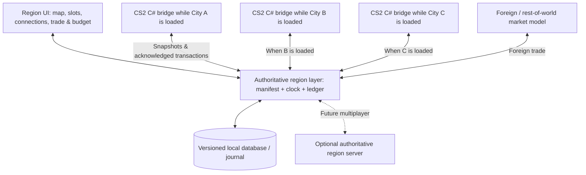

# Cities: Skylines II — Regional / Country Simulation Mod
## Research, feasibility and development log — v2.0

**Created:** 3 November 2026  
**Updated:** 4 November 2026 — v2.0 adds optional continuous-geography country map architecture with separate playable city saves; see §29 and the standalone map architecture document  
**Project status:** Concept / public-code research; no game-side prototype built  
**Working project name:** *Regions* (placeholder, not a trademark/branding decision)  
**Investigated game baseline:** v1.6.2f1, as described in public community source analysis; actual installed binaries have not been provided or independently decompiled for this report.

> **v1.8 PHASE 1 CLOSEOUT — player experience:** The central product is connecting cities, not requiring users to manage a federal economic spreadsheet. The player-facing default should hide complexity, provide automatic markets and one-click city addition, and show a visible, verified benefit of one connected route. See §27.

> **v1.5 COMPATIBILITY PRIORITIZATION:** See §24. Full support is a *development target*, not a verified result. Prioritize vanilla, MapExt or EconomyEX (mutually redundant), Realistic Trips/Time2Work, and Road Builder. Support Traffic/Anarchy/529 Tiles with standard network interfaces where feasible. Declare unsupported economy-overhaul combinations instead of attempting to merge two price/tax/demand controllers. The critical caveat is that EconomyEX itself discourages coexistence with Realistic Trips; supporting each separately is NOT proof they work together.

> **v1.3 MULTIPLAYER DESIGN REVISION — shared country / independently owned saves:** See §22. The initial multiplayer experience needs no live entity or scene synchronization. Players can contribute a CS2 city save to a country, keep editing their own authoritative copy, and publish updated revisions. The country receives an immutable city snapshot plus economic summary; an optional full save is distributed for inspection. Ownership, save lineage, region revisions, validation, and publication must be explicit to prevent forks and cross-save inconsistencies.

> **v1.2 COMPATIBILITY / PATCH RESILIENCE ADDENDUM:** See §21. Independent regional math is comparatively stable, but game-specific Harmony price hooks, company writes and economy statistics are patch-sensitive. A changed API may produce an immediate error; a changed *meaning* of the same statistic can silently change the economy. Build a fail-closed game adapter, a versioned compatibility report, and automatic baseline comparison before enabling economic effects.

> **v1.1 CODE AUDIT ADDENDUM — Adwozo Market Based Economy:** See §20. Directly inspected source verifies price getter Harmony postfixes, supply/demand price estimation, inventory-to-revenue modifications, and opt-in wage/workforce/tax changes. Treat its price hooks as a testable integration precedent, not as proof of origin/destination-aware regional trade or compatible current-game signatures.

> **Core proposition:** Several independent Cities: Skylines II city saves share a geographical region, a governed economy, infrastructure corridors and population/trade flows. Each saved city continues to render and run as an ordinary city when opened. A separate region layer represents what exists between—and across—those saved cities.

---

> **v0.4 DESIGN REVISION — aggregate regional market:** The developer has raised the possibility of modeling intercity trade *without precise bilateral quantities or monetary settlements*. This is now a serious candidate for the first playable economy. **The strict escrow and bilateral-ledger architecture in v0.1–v0.3 is retained below as an optional higher-fidelity design, NOT a mandatory v1 requirement.** The two models must not be accidentally mixed: regional prices/incentives can be modeled approximately; precise physical stock transfers cannot be claimed without validated debits and credits.

> **v0.5 RESEARCH ADDENDUM — resource statistics and native demand:** See §14 for the current audit findings, the distinction between goods demand and zoning demand, and recommended safe MVP changes.

> **v0.6 DESIGN ADDENDUM — industry-specific taxes with unchanged RCI bars:** See §15. CS2 already has individual product/resource tax sliders and per-resource company demand. The region mod should exploit and observe that native structure instead of inventing new demand bars or imposing a duplicate company-tax penalty.

> **v0.7 DESIGN ADDENDUM — transport-aware soft regional market:** See §16. Keep aggregate price/access effects, but make them **conditional on real regional corridor topology**. Delivered costs depend on path, transport mode and commodity characteristics, with optional congestion/capacity penalties. No per-shipment simulation is needed; low-cost access is never granted without a compatible connection.

> **v1.0 EXPERIMENTAL DESIGN ADDENDUM — stable reference country:** See §19. Develop a repeatable multi-city reference country, quantify natural fluctuations before any intervention, branch every one-factor experiment from the same immutable country/save/region checkpoint, compare treatment with contemporaneous no-change controls, and include unload/reload and performance trials. A quiet baseline is useful; a fully static economy is neither necessary nor always desirable.

> **v0.9 TESTING/OBSERVABILITY ADDENDUM — economic correctness:** See §18. Treat regressions, silent mispricing, stale snapshots, policy stacking, fiscal mistakes, native demand feedback, save/load safety and performance as first-class design risks. Design every regional calculation to be independently reproducible, traced, and testable before connecting it to a live save. MCP game control is one possible test harness, not an economic oracle.

> **v0.8 DESIGN ADDENDUM — federal economic policy:** See §17. Add a configurable national policy engine layered on the transport-aware soft regional market: production/input subsidies, tariffs, quotas and tariff-rate quotas, price controls, procurement, strategic reserves, trade agreements, and transport/infrastructure support. Maintain fiscal budget limits, distinguish real cash flows from estimated market effects, and never treat soft shadow flows as physically booked exports.

## 0. Executive conclusion

**Feasible with a major custom simulation layer, not with a small patch.** The attractive, achievable version is a **single-player, asynchronous multi-city regional economy**, eventually extended to a **server-backed, asynchronous multi-player economy**. Exact live vehicles and persistent individual citizens travelling seamlessly from one separately loaded save to another would require substantially more work and cannot be assumed feasible through normal mod interfaces.

The chief difficulty is not drawing a map or saving links. It is **maintaining one consistent accounting system for goods, money, jobs, people, and utilities when the game itself only simulates one city save at a time**. The outside connection system normally talks to an abstract external economy, not another saved city's actual production, stock, budget or households.

**Evidence scope:** The game is proprietary. This assessment reviews detailed community code analysis of game v1.6.2f1 (which identifies decompiled C# classes/systems), official modding information, and the actual publicly available source of several existing code mods. It does **not** claim an instrumented run against the author's local installed game or that any proposed economy-writing hook has already passed an in-game test.

### Feasibility at a glance

| System | Feasibility assessment | Reason / constraint |
| --- | --- | --- |
| City registry, save slots, names, hierarchy | **High** | The mod can store stable IDs and a region manifest. |
| Select and label external connection endpoints | **High, test needed** | Outside connections are ECS entities that can be queried and classified. |
| Region map and linked-route management panel | **High** | CS2 supports custom runtime UI modules with a C# bridge. |
| Read-only population / jobs / budget / resource snapshots | **High to medium** | Relevant ECS components exist; some metrics require custom aggregation. |
| Virtual intercity freight and shipments | **Medium** | Build a ledger and tie it to relevant outside connections; detailed vanilla integration is the hard part. |
| Distinguish national/intercity from international trade | **Medium** | Straightforward in the *region* ledger; changes to in-city import/export behavior need experimentation. |
| Shared national treasury, grants, redistribution | **Medium** | Separate ledger can be robust; applying city transfers safely requires a game-side hook. |
| Full multi-level taxes integrated with vanilla | **Medium–low** | Collection and budget flows have many systems; rates are not a single easy variable. |
| Cross-city commuting / tourism / education by totals | **Medium** | Model origin/destination cohorts and use synthetic local arrivals; avoid duplicate people. |
| Persistent single individual living in one save and working in another | **Low / highly experimental** | Only one world's agents exist while that save is loaded. |
| Water/electricity trade contracts between saves | **Medium** | Each city has utility outside connections, but game-side flow solvers are separate and only locally active. |
| Seamless animated vehicles travelling into another running city | **Not a credible v1 target** | Separate saves do not form a continuous world. |
| Multiplayer, each person controlling their own city | **Medium in an asynchronous model** | Shared region server, city snapshots, orders and conflict handling. |
| Live synchronous simulation of several cities in different game instances | **Very difficult / unproven** | Demands multi-world synchronization far beyond basic mod interoperability. |

These are engineering judgements, **not percentages or verified working features**.

---

## 1. Requirements log — as proposed

### F-01 — City grouping and save assignment

- Create a region, province or country and add a city save to a specific **city slot**.
- Show all member cities in a menu with geographical relative placement, name, population, economic indicators and connected neighbors.
- Use a region ID and **stable per-city UUID**, not a save filename alone: filenames change, saves can be duplicated, and a player can restore old saves.
- Each slot tracks its save identity, version/hash, current snapshot, simulated time and owner (for future multiplayer).
- Support deliberate relocation/rotation of a city icon; this **does not** physically translate the terrain of one save into another.

### F-02 — Connection routing

- Register the city's individual outside connection endpoints and match them to an endpoint in another city.
- Distinguish: **road, railway, sea, air, electricity, fresh-water and sewage**. Water/sewage are subflows of the pipe network and require direction/quality rules. Electricity is another distinct flow network.
- Validate compatible modes: a railway must connect to a compatible railway interface, not an airplane endpoint. A road-to-seaport or road-to-airport shipment is an **intermodal route** and needs a transfer node/rule rather than pretending the two endpoints are identical.
- Store capacity, distance, travel time, route status, costs, owner, internal/international border designation and cargo/passenger utility permissions.
- Permit multi-hop trade (A → B → C) later. Its economic origin/destination should stay A/C even if B is only a transit point.

### F-03 — Economic overhaul

- Add municipal, provincial/state and federal/national government accounts, each with defined revenue bases and spending powers.
- Introduce intergovernmental transfers, possible shared infrastructure funding and optional equalization grants.
- Separate **production, final demand, intermediate inputs, inventories, domestic transfers, foreign imports and foreign exports**.
- Route part of an outside connection's import/export demand to a member city and the remainder to a simulated international/rest-of-world market.
- Make settlement two-sided: an internal sale changes the seller's and buyer's balance sheets. It must not accidentally mint goods or currency.
- Show trade by resource, origin, destination and transportation mode; enable a consolidated national view.

### F-04 — Movement of people

Four logically separate flows, each with different identities and effects:

1. **Commuters:** resident in City A, employed in City B; home and work tax incidence are potentially different.
2. **Tourists/visitors:** remain resident in A (or an external country), temporarily spend in B.
3. **Students:** reside in A, study in B; occupy educational places and potentially incur education-service transfers.
4. **Migrants:** actually change usual residence from A to B; affect population and housing rather than simply commuting.

Do not implement all four as a single generic “people moving” number: their financial, housing, employment and demographic effects differ.

### F-05 — Multiplayer (optional later milestone)

- Different players own separate city saves and can join the same country.
- Different countries can trade with one another and set treaties/tariffs.
- Potentially jointly fund infrastructure and national services.
- Keep the single-player save workflow useful without any server requirement.
- **Not the same as existing single-city co-op mods:** those synchronize several players editing **one** host-run city; this project needs several independent cities with linked economies.

---

## 2. Real-world economic model: the parts worth borrowing

### 2.1 The jurisdiction hierarchy

A country, province/state and city are **government units**, not necessarily three nested wallets with identical taxation rights. Real systems distribute tax bases and decision-making powers differently. For the mod, make that distribution a **configurable fiscal constitution**:

- `national`: foreign trade/customs policy, national-level taxes, redistribution, national infrastructure, external financial balance.
- `province`: provincial taxes or revenue shares, provincial public services and transfers.
- `municipality`: zoning, services, local fees, local budgets and infrastructure.
- `private sector`: households and companies with their own resources and money; **municipal budgets should not be credited for every firm-to-firm trade**.

**Example policy (invented game rule, not a statement of Canada's actual tax percentages):** From a simulated $100 of new tax collected, $50 remains local, $30 enters a provincial treasury, and $20 enters a federal treasury. The three credits sum to $100. If the federal government grants $10 back to a municipality, it decreases federal cash and increases municipal cash; it is **not new national income**.

The Canadian Equalization system illustrates why transfers can be a meaningful separate game mechanic: federal general revenues finance grants designed to reduce disparities in provinces' fiscal capacity, rather than treating every individual interprovincial trade as a government-to-government payment. [Finance Canada — Equalization](https://www.canada.ca/en/department-finance/programs/federal-transfers/equalization.html).

**First implementation recommendation:** municipal vanilla budget + external regional/provincial/national ledger + scheduled reconciled grants/contributions. Deep rewriting of the game's tax collection should come later.

### 2.2 Internal trade vs foreign trade

Real statistical systems explicitly distinguish flows **between regions in one country** from flows **between residents and nonresidents of that country**. Statistics Canada's supply-and-use tables distinguish interprovincial trade and trade with the rest of the world. Its regional trade measures represent economic origin/destination **transactions**, which are not necessarily equal to observed vehicle movements through transit provinces. [Statistics Canada — methods](https://www150.statcan.gc.ca/n1/pub/13-017-x/2008001/themes/ch11/5213253-eng.htm); [trade data](https://www150.statcan.gc.ca/n1/en/catalogue/1210008801); [detailed flow methodology](https://www150.statcan.gc.ca/n1/pub/71-607-x/71-607-x2025014-eng.htm).

The mod should therefore keep **two distinct models**:

1. **Economic origin–destination (OD) ledger:** A firm in A sold steel to a firm in C, units/price/timestamp.
2. **Transport route / capacity ledger:** the steel travelled A → B → C by rail, consuming capacity on A–B and B–C links. B is a transit route, not necessarily the economic importer.

For national accounts:

- **A sells to B in the same country:** A records a regional export and B a regional import. The country's *external* trade balance does not change.
- **A sells to a foreign country:** national exports increase and foreign-currency/rest-of-world settlement applies.
- **B buys from abroad:** national imports increase.
- **A makes wood and B uses the wood to make furniture:** calculate GDP using **value added**, not wood sales + full furniture sales. BEA describes the principle as output minus intermediate inputs. [BEA, September 2026](https://apps.bea.gov/scb/issues/2026/09-september/0926-revisions-to-state-pi-gdp.htm).

The IMF's Balance of Payments definition centers transactions between **residents and nonresidents**, reinforcing the distinction between intercity and international movements. [IMF BOP](https://data.imf.org/Datasets/BOP).

### 2.3 Supply, demand, freight and specialization

A feasible first-pass freight optimizer can use per-resource regional stocks rather than copying millions of per-agent transactions:

`exportable_supply(A, product) = production + released_inventory − domestic_priority_demand − reserved_shipments`

`import_need(B, product) = production_input_need + retail_need + target_inventory − domestic_supply − inbound_shipments`

`ship(A→B) = min(exportable_supply, import_need, route_capacity, seller_credit_or_buyer_budget_constraint)`

Use price attractiveness and travel friction to rank possible sellers: local supply first when competitive, then nearby member cities, then distant member cities, finally external markets when needed. This is a **game design decision**, not a universal real-world law: firms sometimes choose imports because of quality or comparative advantage even when domestic supply exists.

A more mature selection model should consider price, distance, shipment time, bottleneck capacity, reliability, tariffs/customs, demand urgency and a stochastic preference term. The U.S. Bureau of Transportation Statistics' **FAF6** is a useful schema reference because it tracks freight by origin/destination, commodity, weight/value and mode; do **not** import actual U.S. freight values as CS2 balancing constants. [BTS FAF6](https://www.bts.gov/faf).

**Economic conservation rule:** goods removed from a source must either be in transit, delivered, destroyed by a specified loss rule or returned. A trade must also record buyer debit, seller credit, and explicitly modeled freight/tariff revenue. A national consolidated ledger eliminates internal transfers when calculating external balances.

### 2.4 Commuting, tourism, students and migration

The US Census Bureau collects commuting flows by **place of residence** and **place of work**. That is a sensible first model: a cohort can live in A and fill employment demand in B without changing its home population. [US Census commuting flows](https://cdn.www.census.gov/topics/employment/commuting/guidance/flows.html).

**Suggested simulation fields:** `home_city`, `destination_city`, `purpose`, `count`, `travel_mode`, `typical_travel_time`, `period`, `wage_or_spend`, `status`.

- **Commuting:** limited by matching skills, work vacancies and a generalized commute cost; workers are recorded in A's resident pool and B's workplace pool. Consider source- and residence-based taxation rules separately.
- **Tourism:** visitors spend money where they visit, but don't become permanent residents or fill permanent jobs. Day trips and overnight visits have different housing/hotel demand.
- **Education:** the destination's school capacity constrains enrollment. A government could compensate another for educating its residents, as a *mod policy* if desired; tuition is not a universal requirement.
- **Migration:** update usual residence, population and housing supply/demand, with a reversible cross-save transaction. This is more complex than adding a tourist.

At first represent **cohorts / aggregate flows**, not the same persistent citizen entity existing in two saves at once.

### 2.5 Power, water and sewage

Utilities are analogous to markets for contracted network capacity and energy/water volumes, but differ in timing:

- **Electricity:** energy supply must balance demand at the modeled interval, constrained by interface capacity; the inactive city is represented by published net surplus and import commitments, not a live second grid solver.
- **Fresh water:** volume, capacity, contamination/quality, potentially reservoir storage, price.
- **Sewage:** separate directed disposal capacity and treatment/quality rules; do not assume clean-water and sewage are interchangeable.
- Cross-border power/water flows affect **money settlement** but should not be mislabeled freight imports/exports.

The cleanest first implementation is a contracted regional allocation that the currently loaded city's utility systems can consume/produce through its existing outside connections, subject to proving safe hooks in-game.

---

## 3. Technical findings from public game-code analysis

### 3.1 Outside connections — tangible modding surface

Source analysis: [Outside connections, verified game v1.6.2f1](https://github.com/CitiesSkylinesModding/agents-plugins/blob/main/plugins/cs2-modding/skills/cs2-modding/references/mechanics/transportation-and-vehicles/outside-connections.md).

Relevant symbols and meaning:

| Symbol / component | What we can infer |
| --- | --- |
| `Game.Prefabs.OutsideConnection` | Authoring prefab for the transport outside connection. |
| `OutsideConnectionData` | Transfer mode (`m_Type`) and `m_Remoteness` (off-map geometry). |
| `Game.Objects.OutsideConnection` | Tag on placed outside-connection objects, **including** certain utility outside connections. |
| `Game.Economy.Resources` | Resource buffers, including company/household money as `Resource.Money`. |
| `StorageCompany`, `StorageLimitData`, `TradeCost` | Goods connection acts as a storage/trading participant, with transport costs and limits. |
| `ResourceSeller`, `StorageTransferRequest`, `TripNeeded` | Useful evidence of the trade/transport pipeline. |
| `ElectricityOutsideConnection`, `WaterPipeOutsideConnection` | Distinguish utility markers from cargo/passenger OCs; they don't have the same `OutsideConnectionData`/storage role. |
| `Game.Net.OutsideConnectionSystem` | Builds/updates the off-map geometric network and lanes; **does not** match two different saved worlds. |

`OutsideConnectionTransferType` is a flags enum: `Road=1`, `Train=2`, `Air=4`, `Ship=0x10` and `All=0x17`. Use named flags, not an assumed contiguous bitmask. `m_Remoteness` is **not** geographic distance between cities, nor an import-price parameter. The prefab's `m_Commuting` field was reported **unused** in v1.6.2f1, so setting it does not create commuters.

**Important connection nuance:** road OCs have a passenger stop while road freight uses delivery trucks. Rail, sea and air OCs can represent passenger/cargo stops. Utility OCs have different component shapes and must be queried separately. A generic “all OCs have `OutsideConnectionData`” query would miss power/water.

**First game experiment:** enumerate *placed* OCs (not just prefabs), identify mode, live entity and map-edge position, generate an endpoint fingerprint and show them on a local panel. Test road, rail, sea, air and utilities on a controlled test map. Entity index/version is not a safe cross-save persistent identity: store your **own endpoint UUID** in serializable mod state, with a position/type fingerprint for re-association after network edits.

### 3.2 Economy and trade — the principal challenge

Source analyses: [Trade and restocking](https://github.com/CitiesSkylinesModding/agents-plugins/blob/main/plugins/cs2-modding/skills/cs2-modding/references/mechanics/economy-and-companies/trade-and-restocking.md), [Economy and companies](https://github.com/CitiesSkylinesModding/agents-plugins/blob/main/plugins/cs2-modding/skills/cs2-modding/references/mechanics/economy-and-companies/economy-and-companies.md).

| Game system | Relevant operation | Risk for our mod |
| --- | --- | --- |
| `BuyingCompanySystem` | Builds industrial/resource purchase requests | Need to discover which requests should match domestic suppliers in other saves. |
| `ResourceBuyerSystem` | Applies purchase price, deducts buyer money, handles some resources virtually | Intercity payment must not be applied twice. |
| `TradeSystem` | Manages outside-connection storage and trade costs/balances | Stock can replenish autonomously; setting quantities directly may mint supply. |
| `ResourceExporterSystem` | Initiates weighted physical exports and weightless virtual exports | Need to catch confirmed exported quantities and link them to real regional supply. |
| `StorageTransferSystem` | Handles storage transfers | Potential freight instrument point; needs testing. |
| `DeliveryTruckAISystem` | Completes transport and money flow for weighted goods | Delivery point is a promising event boundary but patching may be hard due to Burst. |
| `EconomyUtils` | Resource buffer and balance operations | Money and goods may be written through generic buffer operations. |

**Critical observation:** in the vanilla external-trade path, goods OCs operate as abstract outside market entities. The public source analysis reports that exports credit sellers **without requiring an external city's wallet debit**, and imports debit buyers **without crediting another city**. The outside connections' resources also dynamically gravitate toward a target stock. That is acceptable for an infinite off-map world, but **not** for two player-owned cities that are supposed to exchange limited goods and money. The region bridge must reconcile actual trade and not blindly add symmetric transfers on top of vanilla transactions.

This is why the minimal working trade prototype should be **one resource, two cities, one linked road OC**, with explicit export/import event instrumentation and no attempt to rewrite the entire economy in a first release.

**Open implementation question (high priority):** can the mod selectively influence destination matching and trade costs at a given external connection, then observe a completed import/export, without replacing `ResourceBuyerSystem`, `ResourceExporterSystem` or large Burst jobs? If not, replacement systems may be necessary.

**Proof that extensive replacement can be done in principle, not proof this design works:** [RealEco's `Mod.cs`](https://github.com/Infixo/CS2-RealEco/blob/main/Mod.cs) registers custom ECS systems and disables vanilla `HouseholdBehaviorSystem` and `ResourceBuyerSystem` under some settings. This approach is fragile across updates and can conflict with other economy mods. It is not a turnkey drop-in for this project.

### 3.3 Money, fiscal policy and taxes

Source analysis: [Taxes and the city budget](https://github.com/CitiesSkylinesModding/agents-plugins/blob/main/plugins/cs2-modding/skills/cs2-modding/references/mechanics/economy-and-companies/taxes-and-budget.md).

- `Game.City.PlayerMoney` represents the playable city's government treasury. It is distinct from the money rows in private company/household `Resources` buffers.
- `Game.Simulation.BudgetApplySystem` posts scheduled city income/expense slices. However it is **not** the only `PlayerMoney` writer: loans, property/tile purchasing and other city systems can change balances. Reconstructing actual treasury cash from visible projected budget slots alone is unreliable.
- `Game.Simulation.TaxSystem` manages a **92-slot tax-rate array** (global and per-zone/education/resource offsets), not one scalar. `TaxPayer.m_UntaxedIncome` accumulates income before collection. Tax consequences do not all happen when the player drags a slider.
- `Game.Simulation.CityServiceBudgetSystem` is part of projected budget, not a safe sole source for fiscal settlement.

**Pragmatic rule:** keep federal and provincial wallets outside the vanilla city cash value. For an agreed periodic contribution, perform **one observable actual debit** to the live city's treasury and one credit in the regional ledger, with the exact reverse for grants. Keep a journal with transaction IDs; never apply an operation twice on load/reload. If a city is offline, queue a **pending** operation rather than altering its unseen save file silently.

In a later stage, integrate source-specific tax splitting if a reliable end-to-end hook is identified and tested. A merely cosmetic federal-tax percentage does not count as an economic overhaul.

### 3.4 Residents, jobs, tourists and schools

Source analyses: [Citizens and households](https://github.com/CitiesSkylinesModding/agents-plugins/blob/main/plugins/cs2-modding/skills/cs2-modding/references/mechanics/citizens-and-households/citizens-and-households.md), [Tourism/lodging](https://github.com/CitiesSkylinesModding/agents-plugins/blob/main/plugins/cs2-modding/skills/cs2-modding/references/mechanics/economy-and-companies/tourism-and-lodging.md).

Relevant ECS structures:

- `Citizen`, `HouseholdMember`, `PropertyRenter`, `Worker`, `Employee`, `Student`, `HouseholdCitizen`.
- `CommuterHousehold {m_OriginalFrom}`, `TouristHousehold {m_Hotel, m_LeavingTime}`.
- `CommuterSpawnSystem`, `TouristSpawnSystem`, `TourismSystem`, `LodgingProviderSystem`.
- `PayWageSystem`, `TaxPayer`, related household/resource logic.

The source analysis indicates commuters and tourists already are conceptually external origin entities, and the outside connection can act as an outbound work/study destination for local residents. **But these have no out-of-the-box persistent identity tying one city's worker to another saved city's resident.** Simply changing the OC `m_Commuting` parameter will not solve this (unused on the investigated version).

**First movement simulation:** regional OD flow quotas. When a city is loaded, set the eligible inflow weight/representation for commuters and tourists, account for matching regional employment and accommodation, and update regional cohorts. A later game-side prototype must verify how much control is possible over the spawner and wage mechanics without replacing systems. Record projected movement separately from **confirmed** spawned/satisfied flows.

**Caution:** cloning worker entities across saves naively gives two simulated people, two wealth containers and potentially inconsistent employment/population counts. True persistent citizen migration must use an atomic transfer protocol and handle households, schools, jobs and homes.

### 3.5 Electricity and pipe solvers

Source analysis: [Utilities and flow networks](https://github.com/CitiesSkylinesModding/agents-plugins/blob/main/plugins/cs2-modding/skills/cs2-modding/references/mechanics/utilities-and-flow-networks/utilities-and-flow-networks.md).

Electricity uses `ElectricityFlowSystem`; pipes use `WaterPipeFlowSystem` with distinct fresh-water and sewage layers. These are local network-flow calculations. The relevant utility OCs do not work like goods storage companies, so reuse only the common **regional link metadata**, not the goods settlement code.

Research the outside import/export node, capacity and tariff/pricing hooks individually. Start by **reading and displaying** import/export capacity and flow; only then try limiting or settling city-to-city utility contracts. Never assume two paused independent utility solvers continuously balance each other.

### 3.6 UI and save lifecycle

- [Runtime React UI guide](https://github.com/BrokeAssSoftware/cs2-modding-guide/blob/integration/how-to/ui/runtime-ui.md) identifies custom React/TypeScript/Gameface panels mounted through the game's UI module registry with C# bindings. A full regional map and link editor warrants this, whereas basic config can use `Game.Settings.ModSetting`.
- [Save serialization code analysis](https://github.com/CitiesSkylinesModding/agents-plugins/blob/main/plugins/cs2-modding/skills/cs2-modding/references/technique/save-serialization/save-serialization.md): mod state can persist through `ISerializable` ECS components or system serialization; `IDefaultSerializable` provides safe defaults for older saves. Implement system serializer early during `OnLoad`, not via a UI-triggered late instantiation.
- **Serialization gotcha:** custom marker-only entities may persist across loads because the game's clear logic knows vanilla archetypes; clean mod-owned state explicitly when a city changes. Entity references are remapped on deserialization—use cross-save IDs, not raw ECS `Entity` references.
- [Mod lifecycle](https://github.com/CitiesSkylinesModding/agents-plugins/blob/main/plugins/cs2-modding/skills/cs2-modding/references/technique/mod-lifecycle-and-ordering/mod-lifecycle-and-ordering.md): `Game.Modding.IMod` uses `OnLoad(UpdateSystem)` and `OnDispose()`. Phase ordering is essential for correct before/after-vanilla operations.
- [Cities2-DataExport — `SnapshotWriter.cs`](https://github.com/mayor-modder/Cities2-DataExport/blob/main/SnapshotWriter.cs) provides an actual published example of writing versioned JSON snapshots; useful starting pattern for a read-only exporter.

---

## 4. Proposed architecture (provisional design decision D-01)



Only one bridge needs to run in the user's live CS2 process at a time. The other cities remain represented by their **most recent verified snapshots plus scheduled commitments**. Future multiplayer will let several bridges be online simultaneously, but they still must submit to **one authoritative region ledger**, never independently calculate both ends of the same trade.

### Suggested modules

| Module | Responsibility | Initial output |
| --- | --- | --- |
| `RegionCore` | Country/province/city registry, rules, IDs, common timeline | Region manifest + validated schema |
| `CS2Bridge` | Enumerate live city ECS, export metrics, apply signed commands | JSON snapshots + diagnostics |
| `ConnectionRegistry` | Detect outside nodes; bind stable IDs; check type/direction | Link editor data |
| `RegionalEconomy` | Stock/surplus/need, purchase matching, pricing, shipping | Trade order journal |
| `FiscalLedger` | Municipal/provincial/federal contributions/grants | Balance report |
| `PopulationFlows` | Commuter, tourist, student, migrant OD cohorts | Flow dashboard |
| `UtilityContracts` | Capacity, electricity and pipe allocation | Export/import quotas |
| `RegionUI` | Main menu, map, city card, route editor, dashboards | React panel |
| `RegionServer` **later** | Auth, concurrency, shared country market, replay protection | Network API |

### Region and city identity

Store an externally versioned `region_id`, `country_id`, `province_id`, `city_id`, `city_slot_id`, `save_fingerprint`, and a separate `endpoint_id` for each gate. Each export carries a `snapshot_id`, `region_epoch`, `game_time`, `exported_at_utc`, mod version, and content hash. A fork of a city save should not silently become an independent city generating supply twice: ask the player to **replace** the slot or **fork** to a fresh ID.

### State ownership

- **In-game authoritative when active:** buildings, roads, company/household state, city budget, local agents, network utility flows.
- **Region authoritative:** identity of cities and edges, historical accepted snapshots, government-region wallets, shipment orders and in-transit stock, foreign-market accounting, cross-city obligations, multiplayer ownership.
- **Provisional / estimated:** output, consumption and visitor demand of an offline city since its last snapshot. These are informational forecasts only in the default policy; they cannot be sold or treated as verified goods until generated and committed by a loaded city.

Only apply a region transaction into a city when the correct city save/region epoch is loaded and its prior command ID has not been acknowledged. Use a journal + atomic manifest writes + backup/rollback. Do not directly edit arbitrary `.cok` binary save files in the initial version.

---

## 5. City connection and UI specification

### Region overview

Map of draggable city cards/icons with a scale indicator and north direction, plus state/province and country boundary groups. Display city names, last sync age, treasury, population, production and demand indicators. Lines represent registered outside connections, colored/filtered by mode in the actual UI. **Map placement is a conceptual spatial relationship** unless the player explicitly calibrates coordinate offsets and geographic scale between maps.

### Suggested screens

1. **Region map:** city slots, relative position, connected routes, country/province borders.
2. **City directory:** add/open/replace/fork city save, owner, last export, warnings.
3. **Connection manager:** list local OCs, connect to remote OCs, type/capacity/direction checks, mode filtering.
4. **Economy:** per-resource production/demand, domestic shipping, foreign import/export, prices, bottlenecks.
5. **Government:** local/provincial/national treasury, rates, spending and grants.
6. **Movement:** commuter/student/tourist/migration OD matrix.
7. **Sync and audit:** status, snapshot history, unapplied/pending transactions, save branch conflicts.

Example link creation flow: open **City A**, select its east-edge road OC → choose **City B** slot → choose B west-edge road OC from previously exported metadata → validate both ends → commit a region link → status stays **pending verification** until City B is opened and acknowledges the link. No unverified claim that the other save's physical endpoint has already changed.

### Connection classification

- **Transport link:** `ROAD / RAIL / SEA / AIR`; per mode permitted `PASSENGERS / FREIGHT`, end-node compatibility and capacities.
- **Utility link:** `ELECTRICITY / WATER / SEWAGE`; per-link injection/withdrawal capacities, volumetric rates, prices.
- **Economic border:** `INTRA_PROVINCE / INTER_PROVINCE / INTERNATIONAL`; border conditions and tariffs (international trade only by default).
- **Status:** `PROPOSED / VERIFIED / SUSPENDED / BROKEN`; don't confuse a visually drawn link with a verified working transaction path.

---

## 6. Regional time and consistency — the unglamorous core

**Issue:** Saving A after five in-game years while B remains six months old makes B's stock, jobs and population stale. A mod must not promise that B has instantly produced what A wants.

Choose a default early model:

- **Synchronized economic epochs:** on saving or explicitly exporting city snapshots, `RegionCore` can calculate the next settlement batch. Each city has a last-acknowledged epoch; stale cities may sell only quantities reserved from their last committed surplus.
- **Optional frozen-offline mode (first release):** unsimulated cities do not produce new goods, collect arbitrary tax or create migrants between visits. This is strict but safe.
- **Optional coarse background simulation (advanced):** simulate bounded supply, demand and spending from recent rates for absent cities. Publish clear estimated vs confirmed values. Prevent infinite reselling from the same snapshot.
- **Two-step commit for deliveries:** reserve quantity and buyer payment once; on confirmed origin dispatch mark `IN_TRANSIT`; on destination acknowledgment mark `DELIVERED`. Expired/failed shipments become reversible or compensated—not silently duplicated.
- **Save rollback rule:** when a user loads a save older than the last region settlement, show a conflict and either replay unapplied transactions safely, fork the city, or roll back a whole **consistent regional checkpoint**. Never silently allow the old city to sell stock twice.

**Illustrative invariant for a resource batch:**

`source Δstock + in_transit Δstock + destination Δstock + explicitly recorded loss = 0`

If A ships 100 units of lumber to B, first A decreases 100 and in-transit increases 100. At delivery, in-transit decreases 100 and B increases 100. The final consolidated stock change is zero, excluding later production/consumption. Analogous ledger postings account for cash plus explicit shipping/fee costs.

---

## 6A. New discussion — resource quantities and business changes in offline cities (D-07 through D-11)

**Origin:** follow-up discussion on 2026-11-03. The original design explicitly adds the requirement that **physical resource quantities must be tracked**, and asks whether companies should close or move when a city is unloaded and other connected cities' demand changes. This section modifies how Phase 2–3 should operate.

### 6A.1 Scope and priority

- **F-06 — Track resource quantities:** for each CS2 resource, track `resource_id`, game-compatible `quantity`, available quantity, reserved quantity, committed shipments, imported quantity, exported quantity and an explicit monetary transaction value. Money **cannot substitute for stock**, or a city may pay for goods its partner cannot actually produce.
- **F-07 — Offline business behaviour:** an unloaded city's individual businesses and households do **not** run. The region may record new commercial conditions, including lost export demand, but it must not create or delete exact company entities in that save while it is closed.
- **F-08 — Reconciliation:** when that city next loads, apply outstanding committed orders, cash transfers and demand signals in a deterministic and idempotent order. Record acknowledgements, then allow the native simulation to decide hiring, production, bankruptcy and replacement of tenants.
- **F-09 — Offline exports:** other cities can buy **previously committed, real export stock** from an inactive city; an old inventory snapshot is **not** automatically saleable. The first implementation should prefer a regional escrow/export depot over a speculative company-by-company inventory reservation.
- **F-10 — Asynchronous clock:** an inactive city's `local_simulation_time` stays frozen, while the regional ledger may advance in `region_epoch`. Log how old each city's last observation is. Avoid artificially skipping thousands of game-company ticks to catch up.

### 6A.2 Findings from public game source analysis

The official 2023 *Economy & Production* game feature explanation says businesses track money and resource stocks, buy inputs, adjust hiring and production when demand changes, and may become insolvent. Publicly documented 1.6.2f1 decompile paths provide further detail:

- `Game.Simulation.ProcessingCompanySystem`, `ServiceCompanySystem` and `ExtractorCompanySystem` run company production using input/output resource buffers; they are **game-world systems**, not a region-wide service.
- `Game.Economy.Resources` stores per-resource integer amounts in an ECS dynamic buffer, and `EconomyUtils` defines price and resource helpers. Use these resource identities and game units in the bridge; do **not** assume every `m_Amount` is a physical metric ton.
- `Game.Simulation.IndustrialAISystem`, `CommercialAISystem` and `CompanyEconomyStatisticSystem` adjust workforce or record profits from current city conditions.
- `Game.Simulation.CompanyMoveAwaySystem` can mark and delete a renting company when conditions warrant (including bankruptcy, taxes and workforce issues). A deleted company is not automatically the *same* company entity relocating to another saved city. The proposed region should treat intercity business relocation as a **sectoral relocation signal** unless deliberate identity handoff is researched later.
- Some extractor entities are excluded from the specific `CompanyMoveAwaySystem` query described in the analysis. Do not generalize an identical bankruptcy procedure to every business type.

**Evidence standard:** these observations are based on publicly available third-party analysis of decompiled v1.6.2f1 and mod source; game-side read/write hooks and their behaviour on the latest installed version require tests. See sources at end of log.

### 6A.3 Three options and recommendation

| Offline policy | Behaviour | Benefit | Failure mode |
| --- | --- | --- | --- |
| **A. Frozen local simulation + reserved regional stock** (**recommended v1**) | No unloaded-company birth/death, production or new staff. Previously verified exported stock may be sold via an export escrow. Changes in demand are logged for the next load. | Exact local save remains authoritative; simplest way to avoid fictitious companies, people or goods. | Closed cities react later; trade supply is finite; old city indicators become stale. |
| B. Coarse macro simulation | Estimate output, demand, stocks and company counts by sector, then translate pressure into changes on load. | Background regions feel alive. | Huge mismatch between invented aggregate closures and actual ECS companies; hard to explain why a specific factory disappears. |
| C. Multiple live CS2 instances | Every city runs its native simulation concurrently. | Best consistency with actual business behaviour. | Expensive, difficult clock/network synchronization; not suitable as a first milestone. |

**Decision D-07 (proposed):** start with A and add a *non-authoritative macro pressure dashboard* from B. Forecasts are visually distinguished from committed goods and **never** directly create bankruptcies, remove households, or settle real shipments.

### 6A.4 Export inventory escrow — the missing mechanism

A resource shipment should have both a *quantity* and a *price*. It needs a real seller-side source of stock. A city snapshot may show 1,000 units of wood, but those units could already be allocated to local consumption when the city resumes. To avoid selling the same stock twice, implement one of two modes:

1. **Strict handshake (easiest to verify):** buyer submits order; it waits until origin city is loaded, the origin removes 100 wood from its actual game stock and acknowledges dispatch; only then is the shipment deliverable. Slower cross-save play but clean accounting.
2. **Precommitted escrow / export depot (better gameplay, higher implementation burden):** while City A is active, the player or a safe automated process allocates 300 wood from a confirmed source into an export depot, and **actually debits it from the live city economy**. The region then owns those 300 units and can sell them while A is closed. Inventory in escrow is not double-counted in A.

**Example:** A produces and escrows 300 wood while loaded. A closes. B orders 120 wood. The region reserves 120, settles the appropriate buyer-side payment, places 120 in transit, and leaves only 180 units of A's export depot available. The region never silently creates more supply. Once delivered, B must be credited with 120 wood using a confirmed receiving operation; if that game-side credit fails, the shipment is not fully acknowledged and replay/compensation rules apply. Additional orders exceeding 180 must wait for A to reopen or use an external market, if allowed.

**Critical implementation caveat:** directly removing producer inventory from a running save and later adding importer inventory to another save has **not** been demonstrated. A Phase 3 proof must show the change is persistent, does not upset native resource transport flows, and is processed before consumption can double-use the quantities. Until proven, use strict handshake and keep the depot as a later experiment.

### 6A.5 Internal company economics vs municipal government budgets

If a company sells 120 units of wood to a company in another city, that does **not** mean the exporting city's municipal treasury receives the entire sales value. In vanilla CS2, companies and government are distinct entities. So a regional ledger should distinguish:

- seller company cash/revenue (and its stock change);
- buyer company cash/cost of inputs (and its stock change);
- logistics provider's fees, if modeled;
- municipal/provincial/national taxes and fees, if applicable.

**Decision D-08 (proposed):** model cross-city shipment cash as a transfer between appropriate economic agents, using a **regional clearing account** if application to the native local agent must wait for the city to load. Do not book all trade value as government revenue or inject unbacked cash into a city.

### 6A.6 How companies should react when a city eventually reloads

Suppose City A had five furniture factories exporting to B. B later experiences a recession, but A remains unloaded.

- The region updates the **contracted orders**, accessible demand and unsold inventory in the *regional* trade view.
- A is shown as **inactive/stale**; its factories do not pretend to fire workers or close off-screen. Any stock already in a confirmed depot may still be sold.
- When A is reopened, the bridge reconciles committed inventory and money exactly once. Regional demand/accessibility signals then affect the active city's import/export opportunities or applicable demand/price inputs, subject to what can actually be patched safely.
- **Native company simulation** resumes. It may cut production and workers, go bankrupt or later be replaced; this is observed in the next snapshot. Do not arbitrarily delete two factories because the region guessed a 40% fall in demand.

This creates a deliberate gameplay rule: **business closures happen during local simulation; trade obligations can settle asynchronously if backed by committed goods and cash.** Show the lag in the UI. If the player demands background bankruptcies, that becomes an *optional later scenario mode* requiring validation and safeguards.

**Decision D-09 (proposed):** demand changes may queue while offline, but the default does *not* fast-forward business failures. Apply economic effects gradually when active rather than inventing retroactive native company histories.

### 6A.7 Analogous challenge: households and migration

A commuter, tourist or student total can be represented as an OD flow count, with broad financial and demand effects. **Permanent migration** must eventually change both saves' real households; it cannot be simply two numbers in separate snapshots.

**Recommended initial migration contract:** `PROPOSED → ORIGIN_DEPARTURE_CONFIRMED → IN_TRANSIT → DESTINATION_ARRIVAL_CONFIRMED`. The origin's real residents must be removed/approved before a new household can be credited as an internal migrant elsewhere. When either save is closed, keep a pending token rather than silently double-counting people. The precise game-native citizen/household deletion and spawn workflow requires testing. A simpler UI-only initial option is to *attribute* vanilla migration by totals without claiming a strict one-to-one person transfer; report it as an estimate rather than conserved migration.

**Decision D-10 (proposed):** distinguish strict backed intercity migrants from estimated regional migration indicators. Avoid a system that clones permanent residents on repeated save loads.

### 6A.8 Offline data contract and invariants

A per-city exported snapshot should minimally record:

```json
{
  "city_id": "city-a",
  "snapshot_id": "snapshot-381",
  "city_status": "INACTIVE",
  "local_simulation_tick": 518400,
  "region_epoch_acknowledged": 41,
  "resources": {
    "Wood": {
      "measured_local_quantity": 1000,
      "committed_export_escrow_quantity": 300,
      "available_export_escrow_quantity": 180,
      "forecast_output_per_day": 70,
      "forecast_is_transaction_authoritative": false
    }
  },
  "industries": {
    "Furniture": {
      "last_measured_company_count": 5,
      "last_measured_employees": 130,
      "unobserved_demand_change_pct": -40,
      "offline_company_closures_applied": 0
    }
  }
}
```

*All numerical values above are illustrative. Resource quantities use game-compatible resource units; the source snapshot and regional escrow must be kept separate in storage so stock is never inadvertently counted twice.*

Important invariants:

- `available_export_escrow = committed_export_escrow - reservations - dispatched` (with adjustments for cancellation/returns) must never be negative.
- Goods may be **confirmed** or **estimated**, never simultaneously both.
- An accepted cross-city transaction has one globally unique ID; applying it to a city must be idempotent across reloads and crashes.
- The same transfer must not be recognized twice because a player forks or rolls back a save.
- An offline city cannot produce goods, collect continuously accruing company profits or experience native bankruptcies under default A.
- A company's sale is not automatically booked as government income.
- A region's two stored representations of population must distinguish **live residents**, **committed migrants in transit**, and **estimates**.

### 6A.9 Engineering test to do next

Before any automated economic integration, make a tiny **inventory/bankruptcy inspector** in a disposable test save:

1. Identify one manufacturing company and read its `Resources` buffer, output resource, employees, profitability and company identifier over multiple live updates.
2. Pause and close the city. Change a **region-only** demand field in an external test ledger and reopen: verify **nothing native changed while the save was closed**.
3. Test reserving and debiting a small number of one product while the game is running. Save/reload and see if the game preserves the change, whether vanilla reorders stock, and whether moving goods interacts with `ResourceExporterSystem`.
4. Test a low-profit company while active: see whether changing accessible demand actually influences its in-game profit, staffing or eventual removal. Do not mistake a dashboard-only metric for a real game mechanic.
5. Test double replay of the same economic command: the resource and money adjustment must occur **exactly once**.
6. Then test a two-city export with the source **inactive after escrow was funded**. Verify conserved quantities at dispatch, transit and delivery and correct cash settlement.

**Test result status as of 2026-11-03:** **NOT TESTED** — based on public analysis; local executable/decompile not provided.

---

## 7. Suggested file/data schema (sketch, not a drop-in game mod)

```json
{
  "schema_version": 1,
  "region_id": "uuid-region",
  "name": "Example Federation",
  "current_epoch": 42,
  "countries": [
    { "country_id": "uuid-country", "name": "Example Country", "treasury": 2500000 }
  ],
  "provinces": [
    { "province_id": "uuid-province-a", "country_id": "uuid-country", "name": "Province A", "treasury": 120000 }
  ],
  "cities": [
    {
      "city_id": "uuid-city-a",
      "slot": "A1",
      "save_fingerprint": "hash-of-specific-save-lineage",
      "country_id": "uuid-country",
      "province_id": "uuid-province-a",
      "map_offset_km": [0, 0],
      "last_snapshot_id": "uuid-snapshot",
      "last_acknowledged_epoch": 41
    },
    {
      "city_id": "uuid-city-b",
      "slot": "B1",
      "save_fingerprint": "hash-of-save-b-lineage",
      "country_id": "uuid-country",
      "province_id": "uuid-province-a",
      "map_offset_km": [28, 0],
      "last_snapshot_id": "uuid-snapshot-b",
      "last_acknowledged_epoch": 41
    }
  ],
  "connections": [
    {
      "edge_id": "uuid-link",
      "from_city": "uuid-city-a",
      "from_endpoint": "uuid-road-east",
      "to_city": "uuid-city-b",
      "to_endpoint": "uuid-road-west",
      "mode": "ROAD",
      "distance_km": 28,
      "capacity_units_per_day": 500,
      "status": "VERIFIED"
    }
  ],
  "transactions": [
    {
      "tx_id": "uuid-once-only",
      "epoch": 42,
      "kind": "GOODS_SHIPMENT",
      "resource": "Wood",
      "quantity": 100,
      "seller_city": "uuid-city-a",
      "buyer_city": "uuid-city-b",
      "status": "IN_TRANSIT"
    }
  ]
}
```

All IDs and monetary amounts are fictional examples. In production, **separate the append-only transaction journal from the current-state snapshot** and version both. Favor an embedded database such as SQLite for authoritative local transactions and serialized JSON for portable manifest/snapshots. Use a transport-neutral message protocol if multiplayer is planned, so the same business logic can run against local file transport or a server later.

---

## 8. Development roadmap and measurable proof points

### Phase 0 — Safe inspection / instrumentation (highest priority)

**Deliverable:** A code mod that exports read-only diagnostics from the loaded city; zero game economy edits.

- Confirm installed build version, mod/toolchain compatibility and supported API behavior.
- Implement `IMod.OnLoad` and two-phase initialization; basic in-game settings/logging.
- Query *placed* outside endpoints: road, rail, sea, air, electricity and water pipe. Record map-edge coordinates, prefab, components, network connections and live capacity values where accessible.
- Export economy counts, inventories where identifiable, jobs, population, company money and `PlayerMoney` read-only.
- Verify serialization and restore against multiple save/reload cycles.

**Pass:** opening, saving and reopening the same city reproduces the same logical endpoint IDs (or a deterministic rebind with clear warning). No crashes, entity leakage or permanent city mutation.

### Phase 1 — Region shell and link editor

**Deliverable:** two or more saves in fixed slots, linked logically in a visible regional map.

- Versioned region manifest and city UUIDs.
- Import/read snapshot metadata from save A and B.
- Assign city positions and compatible endpoint links.
- Detect deleted/remapped connections; require acknowledgment at each end.

**Pass:** A east ROAD ↔ B west ROAD works as a **logical verified link** across save reloads. Attempting ROAD ↔ AIR as a directly homogeneous mode is refused. Forked/stale save detected.

### Phase 2 — Regional snapshots and noninteractive economic balance

**Deliverable:** dashboard displaying production, needs, surpluses, foreign flows and national consolidation.

- Export read-only per-resource indicators, mode and company availability.
- Start simple commodity market estimates and `supply vs demand` charts.
- Log which numbers are exact, estimated or unavailable. Don't invent unobservable production quantities.

**Pass:** all displayed international trade is distinguishable from transactions between cities in the same country.

### Phase 3 — First actual freight shipment (critical go/no-go)

**Deliverable:** one commodity (e.g. wood), A ↔ B road trade under a deterministic transaction journal.

- Choose the *least invasive confirmed* capture and apply hooks after actual game tests.
- Reserve source stock and destination payment; post one shipping order.
- Reconcile two separate loaded saves with a one-time acknowledgment.
- Track `IN_TRANSIT`, `DELIVERED`, `FAILED`, retry and cancel.
- Compare vanilla outside imports/exports before/after to find double-entry bugs.

**Pass:** 100 units cannot be sold by A twice, B cannot receive them twice, both cash ledgers reconcile, retries and save reloads are idempotent. If this cannot be made reliable without excessive vanilla replacement, **scale down scope** rather than pile on more features.

### Phase 4 — Shared finances / grants / budgets

**Deliverable:** national/provincial wallets plus explicit grants/contributions.

- Keep a separate region ledger, expose one treasury balance per government.
- Test applying a city-government debit/grant once at safe lifecycle time.
- Only after proof add tax sharing or tax-rate integration.

**Pass:** $10 contribution means city cash −10 and federal cash +10, with exactly one regional transaction and consistent save/reload.

### Phase 5 — Utility contracts

**Deliverable:** electricity first, then fresh water, then sewage.

- Record generation/consumption/net availability by boundary link.
- Test utility outside-connection quota and price hooks.
- Handle off-line supply contracts and distinct pipe flow/quality.

### Phase 6 — Regional population flows

**Deliverable:** abstract commuters, tourists, student mobility and migration, each separately accounted.

- Start with OD flow quotas and read-only comparisons to local spawns.
- Add verified synthetic inflows where game controls are available.
- Limit by work/school/hotel capacity, distance, and link mode.
- Migration should follow only after cross-save population integrity tests.

### Phase 7 — Optional multiplayer countries

**Deliverable:** server-authoritative shared region where each user controls one separate city.

- Authentication, city ownership and access permissions.
- Live city snapshots and server order journal; API versioning.
- Cross-country trade, tariffs and possibly treaties.
- Synchronization/rollback/conflict resolution under simultaneous submissions.
- Offline city quotas and anti-duplication/anti-cheat.

**Relevant precedent:** [Rollocraft/CS2MultiplayerMod](https://github.com/Rollocraft/CS2MultiplayerMod) and [CitiesSkylinesMultiplayer/CS2M](https://github.com/CitiesSkylinesMultiplayer/CS2M) demonstrate networking and multiplayer **for a shared host city**, not an existing multi-save economy. These codebases have differing licenses (some forks explicitly noncommercial); verify each license before adapting any code, and expect conflicts with invasive ECS patches.

---

## 8A. New architecture decision: no offline save mutation, no bulk catch-up (v0.3)

### New concern reported by the project author

**Failure mode A — editing closed save files:** Writing entity/household/company changes into a serialized city while its ECS world is not running bypasses the game's own update ordering, consistency rules, references and versioning. This creates serious corruption and compatibility risks. **Decision: never mutate native city saves while they are unloaded.** The region's own journal is a different, external data store and may be updated offline, but it cannot claim to have updated the city ECS.

**Failure mode B — replaying everything on load:** A city that has not run for six regional months might accumulate hundreds or thousands of relocations, production events, bankruptcies or citizen actions. Replaying that event history when loading risks a CPU spike, burst of pathfinding requests, housing/job churn and cascading simulation instability. **Decision: no retroactive replay of individual companies or households.** In fact, rate limiting the replay is less robust than not creating that replay queue in the first place.

### Proposed hybrid: frozen local entities + continuous regional conditions + gradual in-game adaptation

1. **While unloaded:** preserve the local native snapshot as saved. The region updates prices, route constraints, national budgets, real transactions against previously committed stock, and demand indicators. It does not manufacture fresh production, silently bankrupt a company, alter a household's residence or edit native entity data in the save.
2. **On opening:** validate save lineage and prior synchronization checkpoint, display any pending acknowledged stock/money settlements, and read *current* regional prices/demand rather than replaying a historical time series. Do not attempt structural entity changes during initial load.
3. **After unpausing:** inject *bounded, gradual* economic signals through verified game-side hooks (e.g. import/export opportunities, order limits, prices where safe, fiscal settlement, migration demand). Let native CS2 systems perform normal company hiring, production changes, move-aways and household dynamics. Cap work in both **number of operations per simulation tick** and **wall-time budget**. If simulation performance degrades, pause synchronization until a later tick; do not force completion.
4. **On ordinary save:** publish a new snapshot and checkpoint. The regional journal retains an immutable list of financial/resource transfers and acknowledgements; transient economic-pressure targets can be recomputed or replaced by the latest desired state.

**Major semantic trade-off:** The city does **not** actually experience six months of company losses, aging, deaths, migration or taxes while unloaded. The recession is encountered after re-opening. Call this `freeze-and-converge` (not faithful offline time simulation), and show "last simulated" and "regional state as of" times distinctly in the UI.

**Feasibility status:** This is a proposed architecture, not a proven working patch. CS2's `GameSystemBase` systems can be scheduled for periodic updates, but the actual hook for altering trade demand and real company behavior, and the safety of a specified maximum workload, need experimental verification on a running game.

### Critical split: flows that must be conserved vs states that can converge

| Type | Persist while unloaded? | Re-entry strategy | Never do |
| --- | --- | --- | --- |
| **Resource stock already escrowed/exported** | Yes, in the external regional inventory ledger | Deliver/settle through validated game hooks, one-time receipts | Replenish an inactive company's stock or duplicate sold cargo |
| **Money already committed** | Yes, in external double-entry journal | Acknowledge posting once, with debit/credit checks and save checkpoint | Pay either party twice when a save is reloaded |
| **Trade prices, sector demand, expected exports** | Yes, as *latest conditions*, optionally historical dashboard data | Smooth input/pressure signals over game ticks | Queue six months of per-company trade requests |
| **Company bankruptcies, staffing** | No authoritative offline changes | Allow vanilla local simulation to react to current demand/profitability | Delete hundreds of company entities on load |
| **Tourist / commuter counts** | Aggregate completed flows only if properly accounted | Re-evaluate current corridor flows and reconcile caps | Spawn every tourist/commuter "missed" while closed |
| **Permanent migration** | Intent/request ledger only until safely settled; confirmed migrations conserved | Use validated departure/arrival handshake or apply limited future incentives; keep "requested" separate from "completed" | Count residents in B before they actually leave A, or retroactively transfer thousands of households |
| **Government tax revenue** | Only actual debits/credits or explicit policy-based regional model; do not infer six months of vanilla tax receipts | Post bounded, idempotent transfers | Treat hypothetical taxes in a frozen city as collected cash |

### Migration must be handled differently from economic pressure

If the region says 1,000 people *want* to leave A for B, that is not a completed migration. Do not instantly subtract 1,000 from an unloaded city or spawn 1,000 in another city. Initial implementation: assign a **prospective migration quota** based on destination housing/jobs; when each city is loaded, observe/steer real household move-out and move-in through safe controls, reconcile **confirmed** movements, and allow requests to remain pending or expire. If eventual exact A-to-B conservation becomes mandatory, require a two-sided, durable handshake and reject transactions with incompatible/outdated saves. Until that is proven, be honest that flows are statistical rather than individual cross-save identities.

### Why simply throttling on load is insufficient

Even 10 entity operations per tick can trigger downstream native systems (pathfinding, services, housing search and other ECS jobs). The correct optimization is **do not synthesize a large replay queue**. Prefer a constant-size target vector such as `{sector_export_demand, commodity_price, inbound_household_pressure}`. Update its target whenever regional conditions change; the city's existing simulation gradually responds. A bounded queue is still appropriate for real *indivisible financial or inventory commitments*; it is not appropriate for hypothetical months of citizen/company life events.

### Suggested pseudo-control loop (illustrative, unverified)

```text
on_city_loaded(saved_checkpoint):
    assert_valid_region_and_city_lineage()
    compare_checkpoint_to_region_journal()
    if old_save_or_conflict: enter_read_only_sync_mode_and_request_resolution()
    load_latest_region_economic_targets()
    load_pending_confirmed_money_and_inventory_commitments()

on_city_simulation_tick():
    if game_paused_or_city_not_ready: return
    if prior_tick_cost_exceeded_budget: defer()
    smoothly_update_verified_economic_signal_hooks()
    settle_at_most_N_idempotent_confirmed_transactions()
    collect_observed_real_world_changes_for_next_snapshot()

on_city_saved():
    commit_snapshot_and_journal_checkpoint_with_save_lineage()
```

### A sharper distinction: the region may run while a city does not

The region can have one authoritative **transaction sequence** without all city saves sharing a single game date. Stored fields should include: `city_id`, `save_lineage_id`, `game_build`, `city_simulated_date`, `region_commit_seq`, `latest_ack_seq`, `snapshot_as_of`, and `regional_conditions_as_of`. These distinguish *what was actually simulated* from *what is known by the region*. The UI should label stale snapshots; trade quotas from old snapshots must be escrow-backed or expire. Open old saves in read-only synchronization mode until conflict resolution, not blind replay.

### Performance and safety validation (new required tests)

- **Unloaded protection:** Check hash of inactive `.cok`/save file before and after region trades; byte-identical unless the user loaded/saved that city through the game.
- **No replay:** Simulate 1 day vs 1 year of regional inactivity with identical *current regional targets* and zero durable commitments; first few seconds after opening should have comparable mod-induced workload.
- **Bounded transactions:** Inject 1, 100 and 10,000 queued *confirmed* transfer acknowledgements; ensure batch processing does not extend main-thread work beyond a tunable budget; no stampede of native jobs.
- **Recovery:** Crash between order reservation, game-side application and regional acknowledgment. Restart and retry without minting stock/money or deleting entities twice.
- **Restored old save:** Load an older city checkpoint after the region has processed transactions; raise visible conflict and disable writes, not silently apply all later changes.
- **Economic sensitivity:** Change demand and route availability while a city is frozen, reload it, and confirm through actual tests that the intended companies respond during normal gameplay rather than by wholesale direct mutation.

**Evidence and caveats:** [Paradox save checklist and economy transition](https://www.paradoxinteractive.com/games/cities-skylines-ii/news/save-game-checklist); [community system scheduling](https://github.com/BrokeAssSoftware/cs2-modding-guide/blob/integration/explanation/system-scheduling.md); [CS2 game serialization and mod components](https://github.com/CitiesSkylinesModding/agents-plugins/blob/main/plugins/cs2-modding/skills/cs2-modding/references/technique/ecs-in-this-game/ecs-in-this-game.md); [experimental Pathfind Solutions report of backlog-related pauses](https://steamcommunity.com/app/949230/discussions/0/594069100231270859/). The reported user performance issue is an analogy, **not proof** that this mod's reconciliation loop will cause identical stalls.

---

## 9. Technical risks / research questions to track

| ID | Question | Priority | Current status / next test |
| --- | --- | --- | --- |
| R-01 | Can a user-facing outside connection be given a stable ID that survives road/rail edits and save round-trips? | **Critical** | Design metadata + fingerprint; verify with live ECS. |
| R-02 | Where can an individual weighted freight export/import be confirmed without double-counting vanilla stock or money? | **Critical** | Instrument `ResourceExporterSystem`, `ResourceBuyerSystem`, `DeliveryTruckAISystem`, and `TradeSystem`. |
| R-03 | Can an OC be assigned a per-gate trade partner, capacity or cost instead of always using the vanilla external market? | **Critical** | Live prototype against 1.6.2f1 before committing design. |
| R-04 | How are the time lines of several independently played saves reconciled? | **Critical** | Default frozen-offline snapshot, explicit synchronization epoch. |
| R-05 | What happens when players reload old saves, duplicate them or remove the mod? | **Critical** | Lineage IDs, backups, stale-state warnings, transaction journal. |
| R-06 | How to split real tax receipts without falsifying household/company money and budget forecasts? | High | Start scheduled treasury transfers; instrument receipts later. |
| R-07 | Can inbound commuters/tourists be modulated by outside gate, not just citywide? | High | Study `CommuterSpawnSystem` and `TouristSpawnSystem` implementation in a local decompile. |
| R-08 | Are destination capacity and job/school wage/accounting observable enough to support actual cross-city cohorts? | High | Validate counts before population writes. |
| R-09 | What is the exact contract between outside electricity/water nodes and flow solvers? | High | Read-only utility flow capture first. |
| R-10 | What happens when two economy mods both replace `ResourceBuyerSystem`? | High | Compatibility policy; prefer unobtrusive hooks where possible. |
| R-11 | Which systems are Burst-compiled and unavailable to ordinary Harmony method patching? | High | Inspect compiled system code/architecture; favor ECS replacement/extension where validated. |
| R-12 | How should a multi-modal route transfer cargo between road/rail/ship/air links without physical continuity? | Medium | OD trade separated from route/transshipment; phased. |
| R-13 | Can the base game display off-map road/rail vehicles with meaningful origin/destination labels? | Medium | Visual sugar after economics work. |
| R-14 | Does the installed game version differ from verified public analysis version? | High | Confirm actual CS2 build and mod API before coding. |
| R-15 | Can economic target signals be applied gradually without triggering expensive native backlog spikes? | **Critical** | Instrument costs and load tests for native jobs, not merely the mod loop. |
| R-16 | Can acknowledged trade/treasury changes survive game crash, old-save reload and region-journal replay? | **Critical** | Prototype idempotency + checkpoint/conflict handling. |
| R-17 | How much deferred migration can be made exact without individual cross-save household deletion/spawn? | High | Start as unconfirmed migration requests; require native move-in/out observations for final counts. |

### Regression scenarios to preserve from day one

- Save A → open/save B → reopen A: no duplicate mod-only entities, endpoints, resource batches or fiscal transfers.
- Rename A or move a road endpoint: link re-associates or becomes visibly **broken**, not silently redirected.
- Sell 100 units A→B, reload A's older save, then save B: no second dispatch/receipt.
- Offline city A has 100 units of verified surplus: it cannot fulfill five simultaneous 100-unit orders.
- Taxes/grants have a matching opposite-side journal entry; national consolidated money isn't inflated by local transfers.
- Cross-country sale changes national external trade; same-country sale does not.
- Migrant household is not simultaneously a full resident of both origin and destination after settlement.
- Electricity and sewage are never processed as `StorageCompany` cargo.
- Another mod manipulating the economy triggers a compatibility warning rather than silently corrupting saves.

---

## 10. Current decisions and open design choices

**Provisional decisions (can be changed):**

- **D-01:** Region simulation sits *above* independent city saves; do not attempt to combine ECS worlds in v1.
- **D-02:** Model each economic OD transaction separately from the physical transport route.
- **D-03:** An authoritative append-only region journal owns cross-city goods, fiscal transfers and commitments; city saves own their local state.
- **D-04:** Default offline cities do not produce unlimited new stock; start with reserved confirmed supplies.
- **D-05:** Use aggregate cross-city people flows before individual citizen handoff.
- **D-06:** Multiplayer, if pursued, will be multiple cities sharing a regional economy—not initially a synchronized single-city co-op game.
- **D-07:** Frozen offline city ECS, with optional non-authoritative regional macro indicators; no fabricated closures.
- **D-08:** Quantified resources and backed export escrow; seller/buyer company payments are distinct from government taxes.
- **D-09:** Changes in trade demand affect businesses when the save resumes, not through guessed retroactive deletion.
- **D-10:** Strict permanent migration requires departure/arrival confirmation; separate estimates from confirmed moves.
- **D-11:** Prefer strict two-sided handshake initially; test an escrow export depot before allowing sales from closed cities.
- **D-12:** Never modify the serialized save of an unloaded city; persist regional facts only to a separate journal.
- **D-13:** Never replay hypothetical months of individual company/household events at load. Converge on current regional conditions using normal ECS ticks.
- **D-14:** Rate-limit only genuinely committed resource/money transfers, with idempotent acknowledgements and crash recovery.
- **D-15:** Label local simulated time separately from regional transaction time, and mark stale snapshots or restored saves explicitly.
- **D-16:** Economic pressure is a proposed target signal; verified game hooks and native responses remain mandatory proof-of-concept gates.

**Open choices to decide when implementing:**

1. **Gameplay fidelity:** do players require trucks physically spawning at the chosen gate, or is an economically accurate shipment with an on-map truck disappearing/reappearing at a matching OC acceptable? The latter is much more achievable.
2. **Economy depth:** should the first version simply affect resource availability/prices, or precisely debit/credit producing and consuming companies on both sides? The second is more accurate and substantially riskier.
3. **Scope of countries:** should one country include many provinces and cities, or can a region map contain several independent countries? The schema can support the latter from day one even if multiplayer comes later.
4. **Calendar:** freeze offline cities, require uniform game dates, or run coarse forecasts? Recommend freezing economic transactions until both ends acknowledge a shared epoch at first.
5. **Compatibility:** target vanilla + your mod, or coexist with RealEco and similar economy mods? Select a narrow supported set first.
6. **Save coupling:** permit one saved city to belong to multiple regions? Recommend **one primary region per city save lineage** to avoid double commitments.
7. **Currency/monetary model:** initially one shared game currency per country; tariffs and exchange rates only when foreign multiplayer trade is implemented.

---

## 11. Research references

### Real-world economics

- [Statistics Canada — provincial estimation and origins/destinations](https://www150.statcan.gc.ca/n1/pub/13-017-x/2008001/themes/ch11/5213253-eng.htm)
- [Statistics Canada — interprovincial and international trade flows](https://www150.statcan.gc.ca/n1/en/catalogue/1210008801)
- [Statistics Canada — detailed provincial trade flows: economic flow vs physical transit](https://www150.statcan.gc.ca/n1/pub/71-607-x/71-607-x2025014-eng.htm)
- [Bureau of Transportation Statistics — FAF6 freight OD × commodity × mode](https://www.bts.gov/faf)
- [US Census Bureau — commuting origin/destination flows](https://cdn.www.census.gov/topics/employment/commuting/guidance/flows.html)
- [Canada Department of Finance — Equalization](https://www.canada.ca/en/department-finance/programs/federal-transfers/equalization.html)
- [US BEA — September 2026 state GDP methodology overview](https://apps.bea.gov/scb/issues/2026/09-september/0926-revisions-to-state-pi-gdp.htm)
- [IMF — Balance of Payments overview](https://data.imf.org/Datasets/BOP)

### Game code research and mod implementations

- [Paradox — Economy & Production feature overview](https://www.paradoxinteractive.com/games/cities-skylines-ii/features/economy-production)
- [CitiesSkylinesModding — production, profit, buffers, staffing and company move-away (v1.6.2f1)](https://github.com/CitiesSkylinesModding/agents-plugins/blob/main/plugins/cs2-modding/skills/cs2-modding/references/mechanics/economy-and-companies/production-and-profit.md)
- [Meapy — signature-logistics, precedent for inventory and company lifespan instrumentation](https://github.com/Meapy/signature-logistics)
- [CitiesSkylinesModding — economy and companies (v1.6.2f1)](https://github.com/CitiesSkylinesModding/agents-plugins/blob/main/plugins/cs2-modding/skills/cs2-modding/references/mechanics/economy-and-companies/economy-and-companies.md)
- [CitiesSkylinesModding — outside connections (v1.6.2f1)](https://github.com/CitiesSkylinesModding/agents-plugins/blob/main/plugins/cs2-modding/skills/cs2-modding/references/mechanics/transportation-and-vehicles/outside-connections.md)
- [CitiesSkylinesModding — trade and restocking (v1.6.2f1)](https://github.com/CitiesSkylinesModding/agents-plugins/blob/main/plugins/cs2-modding/skills/cs2-modding/references/mechanics/economy-and-companies/trade-and-restocking.md)
- [CitiesSkylinesModding — taxes and city budget (v1.6.2f1)](https://github.com/CitiesSkylinesModding/agents-plugins/blob/main/plugins/cs2-modding/skills/cs2-modding/references/mechanics/economy-and-companies/taxes-and-budget.md)
- [CitiesSkylinesModding — citizens/households (v1.6.2f1)](https://github.com/CitiesSkylinesModding/agents-plugins/blob/main/plugins/cs2-modding/skills/cs2-modding/references/mechanics/citizens-and-households/citizens-and-households.md)
- [CitiesSkylinesModding — tourism and lodging (v1.6.2f1)](https://github.com/CitiesSkylinesModding/agents-plugins/blob/main/plugins/cs2-modding/skills/cs2-modding/references/mechanics/economy-and-companies/tourism-and-lodging.md)
- [CitiesSkylinesModding — utility networks (v1.6.2f1)](https://github.com/CitiesSkylinesModding/agents-plugins/blob/main/plugins/cs2-modding/skills/cs2-modding/references/mechanics/utilities-and-flow-networks/utilities-and-flow-networks.md)
- [CitiesSkylinesModding — save serialization (v1.6.2f1)](https://github.com/CitiesSkylinesModding/agents-plugins/blob/main/plugins/cs2-modding/skills/cs2-modding/references/technique/save-serialization/save-serialization.md)
- [CitiesSkylinesModding — mod lifecycle and ordering (v1.6.2f1)](https://github.com/CitiesSkylinesModding/agents-plugins/blob/main/plugins/cs2-modding/skills/cs2-modding/references/technique/mod-lifecycle-and-ordering/mod-lifecycle-and-ordering.md)
- [BrokeAssSoftware — custom runtime UI](https://github.com/BrokeAssSoftware/cs2-modding-guide/blob/integration/how-to/ui/runtime-ui.md)
- [Infixo/CS2-RealEco — source showing economy system changes](https://github.com/Infixo/CS2-RealEco/blob/main/Mod.cs)
- [mayor-modder/Cities2-DataExport — source snapshots](https://github.com/mayor-modder/Cities2-DataExport/blob/main/SnapshotWriter.cs)
- [Rollocraft/CS2MultiplayerMod — experimental one-city co-op](https://github.com/Rollocraft/CS2MultiplayerMod)
- [CitiesSkylinesMultiplayer/CS2M — another one-city co-op implementation](https://github.com/CitiesSkylinesMultiplayer/CS2M)

---

## 12. Change log

| Version | Date | Change |
| --- | --- | --- |
| 0.4 | 2026-11-03 | Considered an aggregate resource-market model that transmits prices, availability, and regional trade exposure without per-shipment A→B transactions. Separated soft economic influence from physically settled resource exports; scoped stock and stale-data protections, implementation gates, and design alternatives. |
| 0.3 | 2026-11-03 | Banned direct offline city-save mutation and mass load-time catch-up; proposed freeze-and-converge architecture, distinction between durable commitments and latest economic targets, save checkpoint conflicts, migration constraints and performance acceptance tests. |
| 0.2 | 2026-11-03 | Added quantities as mandatory goods ledger fields; investigated company production/profit/move-away behaviour; selected default frozen offline saves with confirmed escrow and queued macro pressure; specified deferred migration, settlement invariants and tests. |
| 0.1 | 2026-11-03 | Captured original requirements; researched fiscal federalism, trade accounting, freight OD, commuters and utilities; mapped ECS/game systems and existing public mods; proposed architecture, milestone order, testing invariants and critical unknowns. |

**Next concrete action:** Build **Phase 0: the read-only outside-connection, local resource inventory and company-lifecycle inspector**. The first engineering gate is a reliable per-save endpoint and economy snapshot, not a multiplayer server or a tax overhaul.


---

## 13. v0.4 research update — trade without exact bilateral transactions

### 13.1 The design question

Can three independent saved cities share a consequential regional economy **without** tracking exact product-by-product shipments, exact counterparties, and precise two-sided payments? **Yes, provided that v1 treats regional trade primarily as shared economic conditions rather than physical ownership transfers.** This is a *reduced-form regional market*, not a full supply-chain clearing house.

Distinguish three separate levels of economic fidelity:

| Design | Per-company and per-shipment records | Per-resource regional totals | Can claim goods physically moved A→B? | Suggested use |
| --- | --- | --- | --- | --- |
| **A. Price-and-access integration (soft)** | No | May use estimates/indices | **No**; represent influence only | **Recommended MVP** |
| **B. Aggregate regional clearing (middle)** | No | **Yes**, city-by-resource supply/demand per period | Only if actual debits/credits and authorized stock transfers are integrated into CS2 | Long-term target, after validation |
| **C. Escrow shipments and exact ledger (strict)** | Product lot/transaction records | Yes | Yes, if actual game inventory and money transfers are implemented correctly | Optional high-fidelity setting |

This preserves the important distinction the developer identified earlier: **resource quantity is useful even when the origin and destination of every shipment are unnecessary**. Quantities as aggregate *rates or estimates* are distinct from confirmed transferable inventory.

### 13.2 Market state and a computationally cheap illustrative rule

For each resource `r`, city `i` publishes a snapshot while running:

- `production_rate[r]`: recent production per simulation day (actual or sampled estimate).
- `consumption_rate[r]`: local use per simulation day (actual or estimate).
- `storage_estimate[r]`: optional, not assumed fungible unless verified.
- `world_import_price[r]`, `world_export_price[r]`: if accessible; otherwise configurable price anchors.
- `transport_access[r]`: connectivity, congestion/capacity, and transport friction.
- `snapshot_age`, `game_time`, and `confidence`: stale-data controls.

Calculate, for one representative interval:

```
regional_supply_r = sum_i(weight_i * estimated_production_i,r)
regional_demand_r = sum_i(weight_i * estimated_consumption_i,r)
scarcity_r = (regional_demand_r - regional_supply_r) / max(regional_demand_r, epsilon)
target_price_r = world_price_r * clamp(1 + sensitivity_r * scarcity_r, floor_r, ceiling_r)
new_price_r = old_price_r + smoothing_factor * (target_price_r - old_price_r)
```

- `weight_i` may be *market presence / reliability* rather than a literal quantity haircut. For example, an inactive city's stale production claim should not be treated as perpetual free inventory; a very old snapshot can contribute little/no price influence until refreshed. This requires careful tuning to avoid city-loading order manipulating prices.
- `world_price` prevents regional scarcity from assuming the world suddenly stops supplying goods; low availability can increase import dependence or effective costs instead of becoming impossible consumption.
- `smoothing_factor` spreads changes across ordinary ticks rather than applying discontinuous shocks at load.
- These are **proposed gameplay formulas, not code observed in CS2**. They need calibration and game-side tests to be credible.

**Illustrative numbers:** City A produces 1,000 steel-equivalent units and uses 700; B produces 200 and uses 500. The region has an estimated net balance of zero. We can infer a plausible market price without creating or recording an A→B transaction of exactly 300. If a third city uses 100 more, regional scarcity increases and raises import reliance or prices. These numbers are **statistics**, not actual stock transfers.

### 13.3 Real-world grounding

Economists commonly use **gravity models** to characterize trade between regions in terms of supplier capacity, buyer demand, and the cost of trading across distance/borders. Such models are useful even when exact origin–destination shipments are unavailable or unobserved. They are an inspiration for resource access and effective prices, not a physical conservation guarantee.

- Statistics Canada, *Estimating the Effect of Changing Canada–US Border Costs on North American Trade Patterns and Expenditures*: https://www150.statcan.gc.ca/n1/pub/11-633-x/11-633-x2019004-eng.htm
- Statistics Canada, *Going the Distance: Estimating the Effect of Provincial Borders on Trade when Geography Matters*: https://www150.statcan.gc.ca/n1/pub/11f0019m/11f0019m2017394-eng.htm
- IMF, *The Gravity Model in a Nutshell*: https://www.imf.org/-/media/files/publications/weo/2019/april/english/ch4.pdf

For the mod, trade distance can be replaced or enriched by the **region graph**: road/rail/sea route connectivity, transport costs, border costs, and infrastructure capacity. Connecting two neighboring cities should reduce trade friction and, if their supply and demand complement each other, increase market integration.

### 13.4 The crucial *no free steel* rule

There are two coherent ways to integrate an active CS2 city:

**Soft market mode (preferred for first playable build).** The active city's *normal vanilla trade mechanism* is the actual importer/exporter of record. The region changes an effective **price, availability, profitability, or import-dependence signal**, if verified native hooks allow it. City A's production influences City B's market conditions, but the mod does **not claim a verified physical sale**, subtract steel from City A, credit a specific seller, or show exact matched national trade totals. Region trade displays must say **estimated trade exposure** or **modelled flows**, not actual shipments. The city can continue to access the abstract world market. This avoids stock duplication by never creating a second source of physical inventory.

**Aggregate stock clearing (higher fidelity).** For each `r`, record `verified_committed_stock[r]`, subtract authorized amounts when made available, and place them in a regional buffer. Buyers consume the pool, but the model tracks only *pool additions and withdrawals*, not which city sold to which company. The pool has exact conservation at its boundaries: `new_stock = old_stock + confirmed_added - confirmed_removed`. This avoids exact bilateral OD details, **but still needs exact physical quantities at the interface to native inventory and financial balances**. Prevent minting stock from an unloaded city's old production-rate snapshot. Keep a journal/idempotency rule for confirmed transfers.

Do **not** run both simultaneously for the same resource. In particular, never have City A sell steel to the vanilla world *and* debit none of that steel while telling City B it received exact goods from A.

### 13.5 Unloaded cities and stability

- Internal company, citizen, warehouse, and household ECS remain frozen while the city save is closed.
- Market indicators use the most recent snapshot, with a clearly labeled stale-state policy.
- If regional demand for a product weakens while A is closed, only the region's **present market condition** changes. Do not record hypothetical bankruptcies, retroactively erase companies, or replay thousands of missed transactions when A reopens.
- On reload, ramp effective prices, demand conditions or import accessibility gradually using ordinary ticks and caps. Native companies then react as the game allows.
- The region must not fabricate durable production from dormant cities. Soft mode means *influence*, not physical supply. Hard mode means *committed stock only*.
- Separate local city simulation dates from regional event epochs. If game time is rolled back, mark the snapshot stale and renegotiate state rather than silently double-applying effects.

### 13.6 Trade geography without bilateral shipments

You can still make routes matter without issuing each shipment:

1. Construct a city graph of accessible outside connections and configured links.
2. For each resource or class, calculate the lowest generalized transport cost between potentially trading cities (distance + capacity penalty + tariffs + mode limits).
3. Convert costs into a regional access factor; large, nearby supplier cities have more influence on nearby buyers than tiny, remote cities.
4. Let effective prices or import dependence reflect this weighted access.
5. Recalculate on a route/tariff change, not every frame.

In a very light version, use only a few commodity groups and region-wide market prices. Later, calculate per-city weighted prices for realism: a steel plant in a connected neighboring city can lower prices more than an inaccessible distant producer.

### 13.7 What public CS2 mod research proves — and does not

- The game has a simulated economy where resources, companies and outside trade affect production, sales and profits. Official feature overview: https://www.paradoxinteractive.com/games/cities-skylines-ii/features/economy-production
- The public **Market Based Economy** mod states that it tracks supply/demand per resource and changes dynamic prices, company sales and revenue. This is a credible code precedent for adjusting market signals: https://github.com/Adwozo/mod-cities2-marketBasedEconomy . It does **not** prove a safe plug-in API for cross-save trading in the user's installed build.
- An economy-system guide documents code hook points with version drift cautions: https://github.com/BrokeAssSoftware/cs2-modding-guide/blob/integration/reference/game-systems/economy.md . Every proposed pricing / income / trade hook should be reverified against the installed game before adoption.

### 13.8 Proposed prototype experiment and acceptance checks

**Prototype A (no stock transfers):** Read a single city's recent commodity production/consumption and show regional supply and demand indexes for 1–3 resources. Hardcode a second city as another set of statistics. Change the virtual city's steel production by -50% and verify only the computed *target market condition* responds.

**Prototype B (native impact):** In a copy of a real CS2 save, attempt a narrowly scoped, reversible resource price or trade-cost modification. Observe whether local import costs and businesses' finances react. Confirm no unexpected resource duplication, crashes, or disproportionate performance impact. If all verified hooks are cosmetic, the region model is not yet a functioning economy.

**Prototype C (two saved cities):** Export snapshots independently, connect them in the region registry, switch active saves, and recalculate market conditions. Observe stable prices and sensible stale-city behavior. Test disabled/uninstalled mod, rolled-back save and missing cities.

**Harder optional prototype:** Validate exact physical transfer to/from a pooled regional depot before ever claiming precise intercity deliveries.

### 13.9 Revised design decisions and questions

- **D-17 (recommended):** MVP's trade model is a price-and-access **signal market**, not exact bilateral shipments. Explicitly supersedes mandatory exact-trade requirements from early versions; don't erase those as optional higher-fidelity goals.
- **D-18 (recommended):** Track resource statistics by commodity (supply and consumption rates) because resources still matter; do **not** assume these are physically transferable stored quantities.
- **D-19 (recommended):** Do not treat unloaded city output as perpetual stock. Their snapshots can inform prices, subject to recency rules, but cannot fulfill exact orders.
- **D-20 (recommended):** The player-facing UI must distinguish **model estimates** (regional availability, import reliance, implied trade flows) from **confirmed transfers** (only after native game-side accounting exists).
- **Open:** How does the game currently derive resource-specific prices and import costs, and which hooks are non-destructive in the installed version?
- **Open:** Is one national price per commodity sufficient, or should price/access vary by city based on infrastructure distance and tariffs?
- **Open:** Should v1 count any private-company cross-city money flows? Recommendation: **not** until physical/financial integration is confirmed; keep national and municipal treasury transfers separate and exact.

**Provisional recommendation:** Build **soft-mode regional market integration first**. It is computationally tiny and avoids both of the earlier synchronization failure modes. But it must be framed correctly: *economies influence one another through regional supply-demand and price signals*, not through guaranteed physical exchange of specific inventories.

---

## 14. v0.5 — Resource-statistics reliability and native zoning demand (3 November 2026)

**Decision status:** Research findings and recommended design changes; no executable prototype validated. **Research basis:** public official patch notes and independent community analysis which states it was verified against CS2 **v1.6.2f1**. This is a secondary analysis of decompiled code; no local game binary was supplied, so method signatures and bugs still require reproducible in-game confirmation.

### 14.1 New user constraints

- User accepts the **soft regional economy**: no exact inter-save delivery or consumption ledger needed. If a city is not loaded it does not run its own local production/consumption simulation, so frozen aggregate information can inform regional prices/conditions without claiming actual shipments.
- The user is concerned that **in-game resource-production and resource-consumption statistics may be incorrect**, because those systems have historically had bugs.
- The user wants the **vanilla demand mechanics investigated**, especially the risk of region-wide economic intervention distorting residential, commercial, industrial and office zoning demand.

**Important nuance:** An unloaded city's *production potential* may influence a pricing signal, but this is a modeled market-access benefit and **must not be misrepresented as actual goods produced while offline**. Do not let its historical daily production be accumulated into physical stock.

### 14.2 Confirmed official update history and remaining uncertainty

| Release / source | What developers reported | Implication |
|---|---|---|
| 2025-06 v1.3.3f1 | Cargo logistics improvements and UI/statistics fixes, including production statistics unintentionally carried over to new games. | Early trade/data bugs were real, not mere anecdote. |
| 2025-08 developer diary | Production-chain imbalance partly arose because chains were balanced while earlier production bugs existed; 36 resources (10 raw / 18 material / 8 immaterial). | Fixing transactions alone does not prove resource quantities and ratios are balanced. |
| 2026-04 v1.5.7f1 | Production statistics now sample a longer interval; fixes for office/commercial-demand data, vacant signature offices, mixed-use housing and stores with no customers. | Less sampling noise, but not a validation of all underlying consumption series. |
| 2026-05 v1.5.9f1 | Specialized-industry delivery trucks could again leave production buildings to export stock; an electricity/water fee mix-up fixed. | Prior stock/export behavior and company expenses could be wrong. |
| 2026-09 v1.6.2f1 | Most-needed resource companies prioritized for available properties; fixed office Software import; corrected large-city residential demand and linked household shopping decisions to income rather than fluctuating wealth. | Better native matching, though further economics work remains. |

Sources:
- https://steamdb.info/patchnotes/18705944/
- https://www.paradoxinteractive.com/games/cities-skylines-ii/news/work-in-motion
- https://www.paradoxinteractive.com/games/cities-skylines-ii/news/patch-notes-spring-cleaning
- https://steamdb.info/patchnotes/23287471/
- https://steamdb.info/patchnotes/25127643/

**Not established:** that all production/consumption accounting is now fixed. Community reports in October 2026 still describe commercial-demand oddities after the September patch, but these are anecdotal and may involve saves/mods/changed balance rather than a confirmed game defect: https://www.reddit.com/r/CitiesSkylines2/comments/1x6ldvi/commercial_demand_practically_nonexistent/

### 14.3 Specific potential defects in 1.6.2f1 secondary code analysis

Community analysis: https://github.com/CitiesSkylinesModding/agents-plugins/blob/main/plugins/cs2-modding/skills/cs2-modding/references/mechanics/economy-and-companies/production-and-profit.md

Identified risks to independently confirm:

1. `CityProductionStatisticSystem` **per-consumer categorization is incomplete**: `Retail`, `Commercial`, `Office`, `Heating` consumers apparently have no call sites writing their entries; `Industrial` appears to capture only a narrow office-goods purchase path. Therefore **do not use the per-sector consumption breakdown** directly as the regional ground truth.
2. `CompanyProfitabilitySystem` reportedly looks up `IndustrialProcessData` on a company entity rather than the prefab, unlike `CompanyEconomyStatisticSystem`. Thus the `Profitability` ECS component can use wrong inventory pricing; it is **not a clean measurement of operating profit**.
3. `CompanyEconomyStatisticSystem` is a **projection**, not a transaction ledger; `m_Profit` affects hiring and downsizing decisions and should not be interpreted as recorded cash flow. Some tax/upkeep computations appear inconsistent.
4. `ProcessingCompanySystem`, `ServiceCompanySystem`, `ExtractorCompanySystem` perform actual production and input consumption. Actual per-resource production is fundamentally distinct from *maximum productive capacity* and from resource consumption *inferred from UI net-surplus figures*.
5. Company updates are distributed over `UpdateFrame` (256 per game day according to the same analysis); any direct snapshot is a moving partial observation rather than a synchronous global state.

**Recommended trust hierarchy (tentative, subject to validation):**

A. Explicit company resource stock and actual transfer events observed over an interval for debugging only (expensive, not required at runtime).
B. Aggregate recent production-rate counters **after convergence/rolling smoothing**, cross-checked against company population and capacity.
C. Consumption estimates independently derived from current population, commercial activity and process recipes, and then calibrated with observed stock changes or import rates.
D. UI sector consumption categories, or direct conversion of UI deficit to physical inventory: *not trusted without cross-checks*.

Do not infer `consumption = production - surplus` without verifying what the UI's surplus actually represents. Rates, stock levels and net import/export are different concepts.

### 14.4 What demand means in the vanilla game — do not conflate four levels

**(1) Household entry demand** is a pressure for people to move into the city, affected by unemployment, opportunities, education, happiness, taxes, homelessness, etc.

**(2) Residential building demand** is split by low, medium and high density, depends on the amount of currently vacant housing, and is gated by unlocks. High attractiveness for households does not necessarily mean demand for more residential buildings.

**(3) Company demand by resource** is calculated per resource in `CommercialDemandSystem` and `IndustrialDemandSystem`. In a store, resource-specific service/stock shortage, relevant taxes and hotel/tourist capacity influence new company demand; in industry/office, local resource needs, inputs, workforce, financial factors and capacity contribute. Commercial lodging is special-cased. Offices are handled within `IndustrialDemandSystem`, with zero-weight (immaterial) resources.

**(4) Demand for a zoned building** is different again: property availability matters. Company demand need not result in new construction if empty compatible properties already exist. The building spawner also matches businesses to allowed resources, and recent vanilla patches changed property-rental priority.

Community source verified against v1.6.2f1: https://github.com/CitiesSkylinesModding/agents-plugins/blob/main/plugins/cs2-modding/skills/cs2-modding/references/mechanics/zoning-buildings-and-land-value/demand.md

Useful concrete code anchors:

- `Game.Simulation.ResidentialDemandSystem`, `CountResidentialPropertySystem`, `Game.Buildings.PropertyUtils`, `Game.Prefabs.DemandParameterData`.
- `Game.Simulation.CommercialDemandSystem`, demand per resource, housing vacancy gating for commercial building demand.
- `Game.Simulation.IndustrialDemandSystem`, which also calculates office and warehouse demand.
- `DemandFactor` enum, and demand/spawn systems. **Do not patch only the `DemandUtils` constant**: community analysis says update-frequency literals are inlined in actual systems.
- `PropertyProcessingSystem` / relevant company property seekers, `IndustrialAISystem` and `CommercialAISystem`, which determine firms' employment behavior separately from zoning pressure.

Interpretation: resource demand is **not** the same as the displayed R/C/I/O zoning demand. Raising a zone bar directly may create wrong buildings, obscure shortages, flood the market with unprofitable companies and induce housing/job oscillations.

### 14.5 Recommended architecture: signal market + local native demand

**Do not replace all four demand systems for the MVP.** Instead:

- For each live city, collect resource-specific local **production capacity**, observed production, population, workforce, industrial recipes and (when reliable) consumption proxies. Distinguish *capacity*, *recent production* and *recorded stock*.
- Snapshot these values into a per-city regional manifest when saving/unloading. Never overwrite the unloaded save's ECS entities.
- Keep a single **regional market signal** per commodity (or price/access signal by city and commodity), not exact bilateral shipments. Use connected city access and modest stale-state weighting. It is a bounded indicator of competitive supply, not an accounting ledger.
- Let the native simulation maintain local company production, inventories, retail stock, workforce, household decisions, zoning demand and bankruptcy. In the first prototype, display computed region price/access estimates *without writing them back to CS2*.
- Only after validating game-side semantics, adjust **a narrow economic boundary** (e.g. a resource-specific trade cost or import-price input that native companies actually use). Avoid blanket `EconomyParameterData` global edits or direct writes to a demand-bar value. Test whether one-sided input price changes would unintentionally change producers' revenue/taxes and require a less broad hook.
- Do not emulate fake steel inventory or silently offset true imports/exports. Regional benefit may be expressed as easier access or an effective import-cost change, not as counted physical deliveries.

A provisional non-accounting model:

```
capacity_i,r = inferred sustained local supply capability for resource r
need_i,r = smoothed local usage proxy (not a physical order book)
weight_i = connectivity_i * freshness_i * confidence_i
regional_pressure_r = clamp( sum_i weight_i * (capacity_i,r - need_i,r)
                            / max(sum_i weight_i * need_i,r, minimum), -1, +1 )
regional_signal_r = smooth(previous_signal, regional_pressure_r, alpha)
```

**This is a design sketch, not CS2 code or an empirically calibrated formula.** Important safeguards:

- Clamp signal strength and especially *local economic impact* to a modest range (suggest prototype ±5–10% **as test input**, not as a validated balance value).
- Use rolling observations (not a single per-tick reading); disregard NaN/outliers; record a quality/confidence flag per snapshot.
- For a very stale city, either decay its impact toward a neutral baseline or mark it inactive, but do not create phantom physical production. Choice should be tunable for gameplay.
- Avoid giving regional benefit and vanilla world-trade benefit twice if they change the same price/cost/stock metric. Keep the region model causal, not self-reinforcing: reference a *pre-intervention* capacity baseline or use damped lagged values to limit price-production feedback oscillation.
- Keep all world-price and per-city transport/access calculations separate from per-resource native spawn probabilities. R/I/O bars remain emergent outputs from local conditions.
- Region-dashboard labels should say `estimated capacity`, `estimated demand`, `regional market signal`, `data quality`; not `confirmed export`, `shipped quantity` or `settled consumption`.

### 14.6 Is this mod likely to break native demand?

- **If the first release is read-only + its own regional dashboard:** generally low direct risk; there are still performance risks from polling millions of ECS entities.
- **If it changes a resource price that every company uses:** meaningful risk, because prices feed company worth and profitability, employment, tax revenue, and consequently zoning/household demand.
- **If it forces `CommercialDemandSystem` / `IndustrialDemandSystem` outputs:** high risk of unsustainable growth or frozen demand, especially with vacancies/company seekers.
- **If it injects fictitious inventory or creates fake companies:** very high risk of accounting inconsistencies and save persistence complications.

Public precedent **Market Based Economy** uses price changes, wage adjustments, sales-related Harmony/ECS patches and reporting; it is a credible model to study, *not proof of compatibility with September 2026*. Repository: https://github.com/Adwozo/mod-cities2-MarketBasedEconomy . A later code survey warns the pinned published build targets an older version and signatures changed: https://github.com/BrokeAssSoftware/cs2-modding-guide/blob/integration/reference/game-systems/economy.md . Older **RealEco** openly documents changes to `HouseholdBehaviorSystem`, `ResourceBuyerSystem` and `CommercialDemandSystem`, but its readme still targets an older game; do not treat it as a verified 1.6.2 patch: https://github.com/Infixo/CS2-RealEco . **InfoLoom** gives concrete per-sector demand diagnostic examples and demonstrates read-only inspection: https://github.com/Infixo/CS2-InfoLoom .

### 14.7 Prioritized proof-of-concept tests

1. **Read-only supply accuracy test** (no region effect): log production counter, sampled resource stock, number of producers, theoretical production from recipes/workforce, current UI production for 3 representative resources (raw material, processed good, immaterial good). Run for several in-game days, repeat after save/reload. Fail closed if metrics diverge beyond tolerance or data is stale.
2. **Consumption accounting audit:** measure real inbound/outbound deliveries or sampled stock deltas for a small number of controlled producers/consumers. Compare against `CityProductionStatisticSystem` per-consumer categories. Confirm whether dead/misassigned categories persist on installed build.
3. **Demand baseline capture:** use a *clean copy* of a stable city to log actual household demand, density building demand, per-resource commercial and industrial/office company demands, vacancies, available workers, production, prices and business failures. This is the baseline.
4. **Artificial region shock, calculation only:** add a virtual city contributing a +50% steel production-capacity increase; verify the regional signal moves but no native numbers change.
5. **Conservative integration experiment:** change **one verified resource cost or economic signal** by e.g. 5% using a reversible, non-persistent hook. Compare vanilla demand bars, companies, profit, warehouse stocks, imports, tax receipts, and employment on identical copied saves over several in-game days.
6. **Oscillation, patch safety and performance:** increase/decrease price signal, record whether the simulation cycles; test stale snapshots, missing partner save, game reload, disable mod, latest patch and other economy mods. Stop or fall back to read-only if incompatible.

### 14.8 New design decisions

- **D-21:** Retain soft-market approach; **do not require exact bilateral trade or fabricated offline production**.
- **D-22:** Do **not trust the current game's production/consumption presentation as exact physical stock/accounting**; independently validate or infer aggregate indicators, tagged with confidence.
- **D-23:** Keep **commodity demand** distinct from **company demand**, **building demand** and **household migration demand**. Do not overwrite zoning bars for v1.
- **D-24:** Change at most one narrow native economic signal in the first integrated prototype. Make it reversible, bounded and version-gated.
- **D-25:** Capture demand and company outcomes in a diagnostics harness before changing the simulation. Record A/B baseline differences and save compatibility.

**Unresolved:** Which exact trade-cost/price method is safe and suitably local in the installed CS2 v1.6.2f1 binaries? Can the region meaningfully lower input cost without unintentionally altering company outputs and taxes? Can recent resource output be reliably sampled from `CityProductionStatisticSystem`, or must the mod build a purpose-specific aggregator? The research does *not* claim answers without an in-game instrumented prototype.


---

## 15. v0.6 — Tax-sensitive industry specialization, without new demand bars

**Request / rationale.** The project should let different businesses or industries respond to changes in their own tax rates, even if the player keeps a single overall commercial demand bar and a single overall industrial demand bar. This is especially relevant to linked cities that deliberately specialize (manufacturing vs services, etc.).

### 15.1 Key discovery: much of this already exists in vanilla CS2

**Officially documented:** Commercial, Industrial, and Office tax categories can be expanded into **separate tax rates for different product types**, from **−10% to +30%**. Residential taxation is separately differentiated by education level. Taxes were intended to influence sector specialization, not merely the municipal treasury.

Source: https://www.paradoxinteractive.com/games/cities-skylines-ii/features/economy-production (Economy Panel / tax discussion).

**Community game-code analysis, checked against v1.6.2f1:** `CommercialDemandSystem` calculates demand **per commercial resource** and applies the appropriate commercial tax rate. `IndustrialDemandSystem` calculates resource-level company/building demand across the industrial, warehouse and office categories. The UI demand bars are aggregates; the `ZoneSpawnSystem` still reads per-resource demand information and compatible building-prefab allowed-resource masks when selecting buildings.

Code-analysis sources:
- https://github.com/CitiesSkylinesModding/agents-plugins/blob/main/plugins/cs2-modding/skills/cs2-modding/references/mechanics/zoning-buildings-and-land-value/demand.md
- https://github.com/CitiesSkylinesModding/agents-plugins/blob/main/plugins/cs2-modding/skills/cs2-modding/references/mechanics/zoning-buildings-and-land-value/building-spawning.md

**Implication:** There is no need to add Steel Demand / Food Demand / Vehicle Demand bars to deliver differentiated tax responses. Native per-resource demand is the internal control system and the aggregate displayed industrial/commercial bars can remain vanilla.

### 15.2 How the tax response actually propagates

There are at least **three distinct effects** of per-resource taxation; they must not be double-counted:

1. **Potential new companies / properties.** The commercial demand calculation (v1.6.2f1 analysis) explicitly incorporates a resource-specific tax term:

   ```
   commercial_tax_term[r] = -0.05 * (commercial_tax_rate[r] - 10)
                            * DemandParameterData.m_TaxEffect.y
                            + game_mode_offset
   commercial_company_demand[r] = round((1 + commercial_tax_term[r])
                                         * pre_tax_resource_demand[r])
   ```

   The resource's pre-tax demand has its own stock/service and lodging requirements. **Important nonlinear limit:** if pre-tax demand is zero, lowering the tax cannot create demand out of nothing via this multiplication. The exact parameter values are game-mode and balance dependent; do not infer a universal percentage response from this formula.

2. **Existing company net income and hiring.** Per-resource tax rates are applied as companies accrue income; `CompanyEconomyStatisticSystem` projects income, costs and taxes; `IndustrialAISystem` uses projected worth/profit to adjust employment. Higher taxes can therefore reduce profitability and eventually production even without changing the zoning bar. The reported commercial and industrial tax bases are not identical, so avoid treating a 1-point rate change as the same currency amount in both sectors.

3. **Company exit / bankruptcy risk.** A community examination of `CompanyMoveAwaySystem` for v1.6.2f1 describes a **direct tax-related leave probability** above a 10% baseline in addition to worker-shortage and insolvency paths. It excludes extractor companies from that same departure path. Verify exact probabilities and update frequency in the installed game before relying on them: the apparent response can be very sharp, making extreme tax scenarios unsuitable for initial testing. This is **not merely an indirect consequence of reduced profits**.

   Source: https://github.com/CitiesSkylinesModding/agents-plugins/blob/main/plugins/cs2-modding/skills/cs2-modding/references/mechanics/economy-and-companies/production-and-profit.md

Thus company **entry**, **employment/production**, **existing-firm exit**, and **building construction** must be measured separately. A single zone bar is not a good experimental outcome measure.

### 15.3 Product type is not identical to arbitrary business type

The built-in granularity is largely **resource/output category**, not every unique company brand, prefab or business model. Two companies that sell the same resource might share the same resource-specific tax even if their ownership, size, input technology or role differs. Treat 'tax by industry/product' as feasible using native controls; 'tax this restaurant chain but not that one' as **out of scope / custom tax-system work**. Likewise, upstream extractors and downstream manufacturers have different lifecycle semantics. Explicitly map game `Resource` identifiers to the desired region-dashboard industry categories rather than assuming every resource is its own distinct tax jurisdiction.

### 15.4 Proposed regional fiscal architecture

Keep three separate concepts in the mod, even when the game uses one effective tax rate:

| Concept | Meaning | Suggested MVP behavior |
| --- | --- | --- |
| **Effective in-game tax rate** | One rate seen by native CS2 company demand, profitability and exit calculations for zone + resource | Read the native tax value; let player set it in vanilla or our UI, but do **not** add a duplicate gameplay penalty |
| **Municipal share** | Part of collected receipts owned by the city | Initially report/allocate as a regional ledger entry; game-side budget reconciliation needs a tested hook |
| **Regional/federal share** | Part of the same receipts credited to a higher government | Use a notional split of native receipts first; do not silently impose extra effective taxation |

**Illustrative split:** An effective 12% industrial tax might be reported as 8 percentage points municipal and 4 percentage points federal **within the existing 12%**, not 12% municipal *plus* an additional 4% tax. A real transfer of tax cash from the municipal in-game treasury to the federal ledger is a separate code task; the ledger alone must not be represented as confirmed bank transfers.

For a future *independent* federal corporate surcharge, define and test the **total effective rate** seen by company logic, then explicitly implement and reconcile the collection split. Avoid layering an ad-hoc 'federal tax effect' onto native demand; it would make businesses respond twice to one policy. The native −10% to +30% product-rate range constrains any implementation that simply uses vanilla tax settings. Regional taxes on a different tax base would be a new feature requiring its own economic design.

### 15.5 Integrating the soft regional market

**Do not make regional commodity abundance automatically change taxes.** Market access and tax policy are separate levers. A city may have cheap regional steel but choose high steel-industry taxes; both mechanisms must be identifiable to the player.

Suggested per-city/resource signals:

```
city_resource_state = {
    city_id, resource_id, sector, current_tax_rate,
    native_company_demand, native_building_demand,
    company_count, company_entry_count, company_exit_count,
    employees, occupied_capacity, idle_capacity,
    average_company_profit_projection,
    regional_access_signal, last_snapshot_time,
    observation_confidence
}
```

The regional market can influence an **independent, narrow access or input-cost mechanism**, after it has been validated in-game. Native taxes affect entry, exit and finances. The vanilla resource-specific demand and compatible building selection decide the types of businesses that appear. One common industrial/commercial zoning bar remains; regional UI may optionally display industry breakdowns for transparency without changing the fundamental zoning interface.

### 15.6 Experiments required before adding any tax code

1. **Native tax-only baseline:** Use a duplicated clean save, with no region effects. Pick an industrial resource, a commercial resource, and an office resource with multiple active companies. Record resource-specific tax rates, company demand arrays, building demand arrays, company counts, openings, departures, workers, output, projected profitability and municipal revenue.
2. **Small differential tax intervention:** Change *only one resource's tax* by a conservative step (e.g., 10%→8%, then reset, separately 10%→12%), keeping all other rates constant. Observe native response over multiple game days; do not change multiple sectors simultaneously. Compare with an identical control save and run enough replicates to distinguish randomness.
3. **Test existing vs incoming companies separately:** Confirm which channels change immediately, which are gradual, and whether new companies of the desired type occupy vacant buildings. Measure competitor-resource company counts to detect cross-effects. Do **not** assume demand necessarily produces new buildings if vacancies already exist.
4. **Test persistence and reversion:** Save after the rate change; reload and verify both native tax settings and diagnostic snapshots. Disable our read-only diagnostics and confirm vanilla behavior continues. Do not directly mutate closed saves.
5. **Test a combined shock:** Only after native response is understood, add a *non-tax* regional market-access signal for one resource. Compare tax only, access only, both, and neither to detect doubled or unstable incentives.
6. **Investigate hard cases:** Extractors (which have different bankruptcy behavior), two different business prefabs selling the same output, office 'weightless' resources, saturated commercial stock, an entire industry with zero base demand, and a city with many free industrial lots but no workers.

**Diagnostic tools to inspect, not blindly install together:**
- Info Loom (shows per-resource company and building demands): https://github.com/Infixo/CS2-InfoLoom
- RealEco (tax sensitivity and company-demand visualization; likely version compatibility work): https://github.com/Infixo/CS2-RealEco
- AdvancedTPM (per-resource tax dashboard and per-company diagnostics; verify version and behavior before using as a test control): https://github.com/binded-zz/AdvancedTPM

### 15.7 Revised design decisions

- **D-26:** Keep vanilla aggregated commercial/industrial/office demand bars; do **not** build new public demand bars for each resource as an MVP requirement.
- **D-27:** Make city economic specialization primarily **resource/category aware**, using existing native per-resource tax and company-demand mechanics rather than custom company lifecycle simulation.
- **D-28:** Treat `TaxSystem`, `CommercialDemandSystem`, `IndustrialDemandSystem`, `ZoneSpawnSystem`, `CompanyEconomyStatisticSystem`, `IndustrialAISystem`, `CompanyMoveAwaySystem` as an **observed dependency chain**. Avoid wholesale replacement until a specific failure is demonstrated.
- **D-29:** Keep tax intervention separate from regional market signals and from the federal treasury accounting split. Never double-charge the same effective tax rate in native company behavior.
- **D-30:** Assess tax policy via individual company entry, exit, employment, and output **as well as** resource-level demand. Overall zoning demand can stay unchanged while meaningful specialization changes occur.
- **D-31:** All conclusions about formulas and class names are documented against the **community-verified 1.6.2f1** baseline, not a validated game-side instrumented test. Gate code-writing hooks by installed build/version and retain a read-only fallback.

**Unresolved:** Are industrial and office per-resource tax-demand multipliers responsive enough in the installed build for the desired specialization effects? How many units of municipal tax receipts can safely be reallocated to a federal treasury without disturbing city money and tax accounting? Does a regional input-cost advantage meaningfully alter the company-level profit calculation while leaving tax effects identifiable? These are empirical questions for the read-only and A/B experiments.

---

## 16. v0.7 — Transportation costs and trade reachability in a soft regional economy

**User concern.** If all cities contribute to one undifferentiated regional market, factories anywhere in the country obtain the same prices and resource access. That would make geography, roads, railway lines and ports economically cosmetic. This must be fixed **without returning to exact bilateral freight shipments** or simulating unloaded saves.

### 16.1 What the vanilla game already does

**Official game-design documentation (not a verified regional-mod hook):** CS2 agents make pathfinding decisions using generalized cost; delivery cost rises with distance, and nearer suppliers are generally more profitable. Companies assess transportation costs when purchasing inputs, exporting, locating, and projecting margins. Cargo trains and ships offer capacity-related cost advantages over trucks on suitable routes, while commercial and industrial companies interact with cargo transport and warehouses. Transport infrastructure and access to outside connections thus already have economic meaning *within a single city save*.

Sources:
- https://www.paradoxinteractive.com/games/cities-skylines-ii/features/traffic-ai
- https://www.paradoxinteractive.com/games/cities-skylines-ii/features/economy-production
- https://colossalorder.fi/news/development-diary-3-public-cargo-transportation/
- https://www.paradoxinteractive.com/games/cities-skylines-ii/features/maps-themes

**Boundary:** The above does NOT establish that native local pathfinding costs automatically span different saves. It does NOT prove that our mod can override company import-cost logic by changing one global price. Those integrations need a separate prototype.

### 16.2 Decision: construct a multimodal intercity route graph

Define a **directed, weighted graph** with:

- Nodes: city UUIDs, individually paired outside connection endpoints, intermodal terminals, and allowed 'external world' gateways.
- Edges: road / rail / sea / air corridors plus optional terminal transfer edges (road→rail, road→port, etc.). Each edge requires a compatible physically connected endpoint pair. Utilities (electricity, water/sewage) stay separate; they are not interchangeable with freight.
- Edge fields: `edge_id`, `from`, `to`, `mode`, `distance_km`, `enabled`, `compatible_resource_classes`, `base_fixed_cost`, `cost_per_km_by_class`, optional `throughput_class`, `estimated_load_index`, `toll`, `border_fee`, `last_verified_at`, `confidence`.
- Directionality matters: waterways, connections, access permissions, transport policy and contracts can differ per direction even if most v1 links are symmetric.
- Connection validity is **not** determined solely by a user placing two cities next to each other on the regional UI. The game-side mod must verify the relevant actual outside connection and local terminal/link when a city is active; on unloaded cities, the latest verified status is cached and marked stale if needed. Manual mapping supplies regional geography, not proof of a path.
- Distances in the region graph are *separately assigned geographic/virtual distances*, not the distance between coordinates on unrelated city save maps. Regions need an explicit scale.
- A shipment may traverse an unloaded city or corridor as a virtual transit edge; this never needs to run that city's individual traffic simulation. A corridor's availability and cost are evaluated based on its last validated status.

### 16.3 Choose an origin and route using a landed-cost model

For each destination city `i` and resource class `r`:

```
route_cost(path, r) =
  sum_over_edges[
      fixed_edge_fee
    + distance_km * per_km_transport_coefficient[edge.mode, r]
    + congestion_or_utilization_surcharge   # optional; no exact tonnage required
    + road_toll_or_border_fee
  ]
  + sum_over_transfers[terminal_handling_charge]

landed_offer(i, supplier j, r) =
      estimated_supplier_base_price(j,r)
    + lowest_valid_route_cost(j -> i,r)

candidate_market_price(i,r) = minimum of:
    local price/availability signal,
    reachable regional offers with positive estimated export potential,
    external world offer if i actually has valid foreign trade access.
```

**Caveat:** Naively taking the single minimum from a frozen supplier snapshot allows arbitrarily many cities to claim unlimited cheap supply. This is acceptable only as an explicitly 'price influence' prototype, not as a physically consistent market. A better *soft* version weights offers by supplier estimated surplus/capacity, region-wide estimated demand pressure and route quality. It saturates a discount as likely demand exceeds supply, without booking actual bilateral units. Recompute smoothly and cap shocks; do not claim goods are created, sold, transferred or consumed by this calculation.

The final market-access effect can be `clamp(smooth(old_effect, target_effect), lower, upper)` with resource-class-specific responsiveness. Expose the estimated base price, travel premium and reliability rather than falsely showing precise freight quantities.

### 16.4 Different modes should have meaningful economic trade-offs

| Mode | Fixed access/handling | Cost per distance | Good for | Critical prerequisite |
| --- | --- | --- | --- | --- |
| Road | Low | Relatively high | Short/medium hauls; flexible last-mile | Valid connected road outside endpoints |
| Rail | Medium/high | Low for bulky freight | Heavy industry at long range | Rail connections, cargo terminal, last-mile route |
| Sea | High | Very low for bulk over long range | Commodities, intercontinental trade | Port, shipway connection, terminal access |
| Air | High | High for heavy goods, faster | High-value/low-weight output and passenger travel | Airport with cargo capability and valid routes |

This is a **mod-design parameterization**, not a claim about exact CS2 numerical constants. Each physical resource should have a broad freight class or weight/volume multiplier. Virtual office goods (e.g. software) generally should not need a cargo route; use a separately designed digital-service market/access rule. Passenger transport for tourism, migration and commuting needs a separate travel-time/accessibility graph; it can share the region topology but not the freight pricing coefficients.

### 16.5 Simple numeric test (not official game values)

A steel producer has an assumed base price index of 100. External-world steel reaches a consumer at a delivered index of 140, assuming that city has usable foreign trade access.

- **Nearby city, road, 50 km:** `100 + 2 + 0.10×50 = 107`.
- **Distant city, road, 400 km:** `100 + 2 + 0.10×400 = 142`; external market (140) is cheaper.
- **Distant city, rail, 400 km:** `100 + 18 + 0.04×400 = 134`; the rail link makes regional trade competitive again.
- **No valid corridor:** regional supplier is **not eligible** even if its index is 100. The destination must rely on local production or an *accessible* foreign market.

These arbitrary values are for demonstrating route choices, not for directly changing game prices. Actual coefficients require calibrating against native transport economics and visible company profitability.

### 16.6 Offline cities and the 'soft market' integrity constraint

Unloaded city state and companies remain frozen. Its last verified **sustainable production potential** and **estimated exportability** can inform regional price availability, but are not an accumulating warehouse or an endless stream of actually minted goods. Region routes provide an **availability/price signal** rather than physically transferred inventory.

Mitigations:
1. Keep snapshot timestamps, source type (reported statistic vs estimated company output), age/confidence, and latest verified links.
2. As an unloaded-city snapshot becomes older, reduce confidence/maximum influence of its offer or mark its supply as fixed baseline pending reload; **do not** compound growth or generate goods per elapsed day.
3. Apply a supply-pressure or 'shadow capacity' penalty to heavy region-wide demand for one supplier's output, even without exact shipments. This prevents unlimited world-cheapest offers at high scale.
4. Keep **local** company and zoning demand in the game's own simulation. Do not artificially create native inventory in the importer, silently debit an unloaded exporter, or edit the closed save.
5. If implemented later, cap route demand/load by coarse bands (low/medium/high) as an approximate accessibility constraint, not precise freight accounting. A link with `0` physical connection is always infeasible.
6. Treat government tax revenue and company profits carefully: if a soft advantage modifies input costs without a matching output sale, avoid labeling the spread as literal exporter income or government freight revenue. A coherent physical goods-and-money ledger remains optional high-fidelity work.

### 16.7 Interfacing with native CS2 economics

Preferred order:

1. **Read-only graph:** Register endpoint IDs, validate actual connected road/rail/air/ship access and accessible terminals, discover or configure distances, and compute offline shortest feasible multimodal paths. Unit-test routing independent of game code.
2. **Read-only competitiveness dashboard:** Display estimated delivered price premiums by resource class and source city/world, without modifying demand or company income. Test road-only, rail-enabled, disconnected, long-distance, and disabled-terminal scenarios.
3. **Narrow price/access pilot:** Use one verified native input-price or import-cost pathway, if available, to vary **one** resource's landed cost for one loaded city; monitor company inputs, projected margin, imports, taxes, native per-resource company demand, and overall industrial/commercial bars. A global price edit may change all actors indiscriminately and should be avoided until proven safe.
4. **Calibrate & stabilize:** Smooth the regional signal, enforce a hard cap on its effect, distinguish bulk freight from digital goods, and compare to a clean vanilla control city over multiple days.
5. **Optional capacity/congestion:** Layer per-edge qualitative utilization and terminal bottlenecks. Precise shipped units and actual intercity vehicles are not necessary for v1.

### 16.8 Decisions and acceptance tests

- **D-32:** **No universal region-wide delivered price.** Market access is **city + resource + mode + route** dependent.
- **D-33:** An accessible route must exist for a supplier to affect an importing city's regional price signal; a city with no usable link does not automatically benefit.
- **D-34:** Minimum viable routing: road + rail + external-world fallbacks; sea and air may be added after core path tests. Preserve typed node/edge architecture for all modes.
- **D-35:** Strong route economics, weak/explainable accounting claims. Soft prices and access are estimates, not shipped units or bilateral payments.
- **D-36:** Distance and topology are separate properties. Map adjacency alone is insufficient; a connection across another city must form a valid contiguous path.
- **D-37:** Do not directly overwrite vanilla zone-demand bars to express trade access. Test a targeted company input-cost mechanism first.
- **D-38:** A distant supplier with a cheaper base output may lose to a nearby producer after freight fees. Adding a rail line can reverse that comparison.
- **D-39:** An offline city can support a bounded estimated access signal, but not unexplained physical output or money creation. Show status/age of snapshots.

**Test cases:** A--B road, B--C road, A--C no direct route; remove B--C and confirm that C loses access to A. Add A--C rail with a confirmed terminal and confirm lower delivered bulk-goods premium. Remove terminal and confirm rail offer disappears. Create an isolated inland city: no regional freight, but external-world imports only if it has its own eligible outside connection. Verify no cross-mode 'road to ship' link exists absent a terminal. Verify software uses service logic instead of freight tonnage. Reload a frozen city after another city has been active; no save bytes are mutated offline and no accumulated events are replayed on one tick.

**Remaining uncertainties:** The effective transport cost code paths in the current installed CS2 build; whether an import-cost modifier can be localized per resource AND per receiving city; how to measure actual terminal capacity/network reachability robustly with ECS; how strongly local CS2 company financial models react to price signals; and how regional distance scale should be chosen by players. These are experiments, not claims of completed implementation.


---

## 17. Federal economic controls in the transport-aware soft market (v0.8 addendum)

**User-requested extension (3 November 2026):** Provide a federal government able to influence resource flow, price, industrial specialization and supply-chain security through subsidies, quotas and related instruments. This is a policy layer over v0.4's **soft resource market** and v0.7's **route-specific freight costs**, not a mandate to add precise cross-save goods transfers.

### 17.1 Fundamental design decisions

- The **city simulation** remains authoritative for its own companies, citizens, buildings, tax rates and actual local resource activity. Closed saves remain untouched.
- The **national policy engine** stores laws/rules and applies them to calculated market accessibility, landed prices, financing incentives, optional bottlenecks and the region's **separate** fiscal account.
- The **transport graph** determines whether trade is possible and the route-specific price. A policy cannot create a viable delivery path where none exists.
- A **domestic sale** (A to B in one country) is not an international import/export and does not incur a normal national customs tariff. Domestic tolls, fuel taxes or corridor fees would be distinct policy instruments.
- An **international transaction** is an import/export relative to the *country*, even if it uses an outside connection located on one city save. A hypothetical future other-country save is another foreign trading partner.
- Policies do **not** directly set a single industrial/commercial zoning bar. Economic cost/incentive changes should pass through verified game-side mechanics and affect native per-resource demand indirectly.
- **Economic signals and real money are different:** approximate resource pressure and trade access can be computed without actual shipments. Claims of treasury revenue/expenditure or physical stock must be verified or represented explicitly as an *abstract* national account, not described as real vanilla income or debited inventory.
- Policies may specify a **duration**, **sector/resource scope**, **country-of-origin scope**, **cap or maximum budget**, and optional **stabilization ramp** to avoid shock-induced company churn.

### 17.2 Policy inventory and soft-model feasibility

| Instrument | Model-level control | Expected effect / downside | Implementation fit |
|---|---|---|---|
| Domestic **production subsidy** | Percentage of eligible operating/production cost, or per-unit support | Encourages firms to enter/continue producing; costs treasury; may cause excess supply | **Medium:** adjust production economics only while loaded and only with verified hook. Closed city keeps snapshot; no imaginary new output. |
| **Investment grant / tax credit** | Eligible industry/resource, grant rate, cap, term | Supports new capacity over time; may crowd out unsubsidized sectors | **Medium:** could initially use an industry-attractiveness modifier / native per-resource tax signal; actual company grants need loaded save. |
| **Input subsidy / buyer rebate** | Effective cost reduction for a specified intermediate resource | Lowers downstream firms' input costs; raises demand and costs treasury | **Medium:** best first policy candidate once narrow purchase-cost hook is validated. |
| **Household essentials subsidy** | Consumer discount on food/fuel/etc. or means-tested transfer | Supports affordability; broad discounts increase demand and fiscal cost | **Medium–low:** demand and household expenditure pathways must be tested. |
| **Import tariff** | Ad valorem (%) or specific amount, resource and foreign country | Raises imported landed cost; may protect domestic firms but raises buyer costs | **High in shadow market:** add border cost at matching external routes. Actual customs receipts require volume/settlement evidence. |
| **Export tax** | Resource-specific percentage on *foreign* sales | Discourages exports; can keep resource available domestically; may reduce producer income | **Medium in shadow market:** reduce foreign netback/foreign export attractiveness, not domestic purchases. |
| **Import quota** | Per-policy-period cap by resource/country | Constrains foreign supply, can increase scarcity and prices | **Soft approximation only:** an access-share/capacity constraint, not a legally exact volume limit. Strict enforcement requires quantified eligible volume. |
| **Export quota** | Cap on volume leaving the country | Reserves supply for domestic buyers, reduces foreign opportunities | **Soft approximation only:** suppress external-offer access, not a guaranteed physically enforced export ceiling. |
| **Tariff-rate quota (TRQ)** | Lower duty for estimated volume tranche, higher duty beyond | More flexible than hard ban; can protect producers while retaining imports | **Medium:** aggregate quota utilization estimate; strict precise threshold not possible without import-unit accounting. |
| **Emergency ban / embargo / import licensing** | Blocked resources/countries; license percentage | Removes a trade source or destination; can produce immediate shortages | **High for market eligibility:** remove edges/supplier-country offers; not an audited prohibition of vanilla physical deliveries until hooking trade orders. |
| **Price ceiling** | Max consumer price, essential resources, validity term | Helps buyers only if supply is supported; otherwise shortages/rationing | **Medium–low:** never clamp the display alone; attach compensation/shortage rules. |
| **Price floor / minimum support price** | Minimum producer return | Encourages output; raises costs or creates surplus purchase liabilities | **Medium–low:** must fund government buying or compensate producers; do not mint inventory. |
| **Strategic reserve / buffer stock** | Government target, release triggers and procurement limits | Smooths spikes when there is actually/credibly available stock | **Deferred for physical stocks:** an explicit *virtual capacity credit* can be used for prototypes but must not claim actual units stored; real drawdown requires ledger. |
| **Federal procurement / purchase guarantees** | Government demand commitment by resource, price and capped budget | Supports strategic industries, can tighten supply for private buyers | **Medium:** coarse demand influence possible; real purchases/payments require a corresponding measured aggregate. |
| **Freight subsidy / infrastructure support** | Per-mode/per-corridor discount or government grant | Makes geographically distant suppliers competitive; shifts corridor utilization | **High at shadow-price level:** subtract qualified freight discount only on valid paths, budget cap applies. |
| **Domestic transport toll / fuel levy** | Cost on roads/routes/modes | Discourages certain trade routes, creates localized trade cost | **High at shadow-price level:** separate from customs policy; cash receipts need validated usage. |
| **Trade agreement / preferences** | Partner-country tariff discounts, allowed resources | Encourages trade with selected foreign countries | **High at shadow-price level**, medium for future multi-country multiplayer governance. |
| **Standards and permits** | Resource/country eligibility or compliance premium | Blocks or raises cost of selected trade | **High in market eligibility**, deep in-game inspection is beyond first release. |
| **Public credit / loan guarantees** | Interest/financing relief for target industry | Relieves investment constraints; contingent future liability | **Later:** game-side credit-cost hooks and contingent fiscal accounting are nontrivial. |

**Grouping for UI:** (a) *Trade and borders* (tariffs, export taxes, quotas, licensing, agreements); (b) *Industry and investment* (production subsidies, credits, grants, guarantees); (c) *Household prices and strategic supply* (consumer rebates, ceilings/floors, buffers, procurement); (d) *Logistics* (freight subsidies, tolls, port/rail grants). A compact first release should offer only a few credible levers, not dozens of untestable sliders.

### 17.3 Distinguish three economically different subsidy channels

1. **Producer support** changes the firm's own net production economics or willingness/ability to enter. It does *not* automatically make every unit cheaper for consumers. Producers may keep part of the benefit as profit.
2. **Buyer/input support** directly reduces the qualified purchaser's effective cost (e.g. steel for vehicle makers). Underlying seller prices can remain unchanged.
3. **Transport support** reduces the route cost between an eligible supplier and buyer. It must not help a company on an infeasible route or digital services that do not use physical freight.

These distinctions matter when assessing which policy changes *real* company profitability, employment, resource demand, and hence the native zoning feedback system. Never double-count a native negative per-resource tax setting and a separate simulated federal subsidy unless the combined effect is deliberate and budgeted.

### 17.4 Shadow price path and policy evaluation order

For resource `r`, supplier/source `s`, destination city `d`, and eligible route `path(s,d)`:

```text
if not policy-eligible(s, d, r) or not valid-route(s, d, r):
    offer = unavailable
else:
    landed_before_buyer_support =
        source_offer_price(s, r)
      + freight_cost(path, r)
      + international_customs_duty(s, d, r)
      + scarcity_or_access_premium(s, d, r)
      + domestic_corridor_fees(path, r)
      - qualified_freight_subsidy(path, r)

    effective_buyer_cost = landed_before_buyer_support - qualified_buyer_rebate(d, r)
```

*This is a model interface, not a proven formula inside CS2.* A **producer subsidy** affects production feasibility/profitability or producer offer behavior separately; do not subtract it again from the buyer rebate line. An **export tax** can enter the foreign-delivery source price or decrease exporter netback, depending on how incidence is modeled. A **ceiling or floor** is a market intervention requiring additional support/restriction logic, not a free arithmetic clamp.

**Illustrative steel comparison (arbitrary price-index units):**

- Domestic source City A → B: producer 112 + valid rail route 8 = **120**.
- Foreign source → B: world producer 100 + freight 15 + **20** import tariff = **135**; domestic A is more competitive.
- Federal rail freight subsidy of 4 reduces the qualified domestic route to **116**, at an actual fiscal cost *only for substantiated eligible activity*.
- If import duties fall to 0, external delivered price becomes **115** and foreign steel may become more attractive. The national policy now changes which location has a competitive advantage, without routing a precise shipment.
- If an import quota limits foreign availability, the market may experience a scarcity premium or select the next-best accessible supplier. That **does not** mean we successfully enforced an exact number of imports.

**Policy stacking order:** (1) check partner/resource restrictions, licenses and route eligibility; (2) compute base supplier offers; (3) apply freight and customs costs; (4) resolve capacity/scarcity and qualified market-access shares; (5) apply buyer/logistics support within budgets; (6) handle exceptional stabilization, reserve or controlled-price regimes; (7) smooth and expose only a validated game-side modifier. Preserve a transparent breakdown in UI.

### 17.5 Hard quotas are incompatible with *purely untracked* trade

A strict rule such as **"no more than 100 steel units imported this month"** requires knowing how many eligible units entered during the month. Without at least *aggregate period volume*, there is no mathematical way to guarantee exact enforcement. There are three credible options:

- **Soft quota (MVP):** approximate the accessible foreign supply share from a quota band relative to an estimated import-demand baseline. This changes prices and supplier selection but is not a physical import cap. Label the UI *Import access limit (estimated)* rather than promise exact enforcement.
- **Coarse aggregate quota (intermediate):** meter/estimate *total* national imports of a resource per interval, without attributing them to individual bilateral city pairs or vehicles. This can operate with monthly or weekly quantities and shadow allocations, but its accuracy depends on underlying CS2 import statistics/hook quality.
- **Strict quota (later):** intercept purchase/import order events or ensure all eligible cross-border resource acquisition passes through an audited control point. This is meaningfully more invasive and may be infeasible for some native systems. Don't call a soft rule a strict quota.

**Tariff-rate quotas:** An estimated in-quota share gets a lower tariff and any estimated excess a higher tariff. An actual legal-style TRQ requires precise volumes and timing to identify which units entered inside the lower-rate tranche. Consider TRQ a later feature until aggregated import metering is trustworthy.

### 17.6 How policy interacts with transport and market integration

A policy can apply only after confirming the destination has eligible access via the **regional route graph** or an appropriate **foreign outside connection**:

- **Federal customs** applied to imported goods on the international boundary, regardless of whether the receiving city later redistributes the good within the same country; avoid charging the same customs tariff repeatedly on domestic legs.
- **Domestic A→B freight** can be subsidized per rail corridor, port link, or resource freight class. It is not normally a customs import and should not be counted as foreign trade.
- **Foreign trade partners** can carry different tariff/embargo conditions; if the game only exposes one anonymous world market, source-country-specific rules must remain abstract until partner identity is actually available.
- **External-world fallback** remains available only where a valid outside connection exists, and its total price is world reference + foreign transport + customs + eligible adjustments.
- **Congestion/capacity** if enabled later can blunt the value of huge transport subsidies without making exact movements necessary.

### 17.7 Federal treasury: hard budgets, soft estimates

**The policy engine should not create free money by inventing import/export quantities.** Budgeting should have two separate figures:

1. **Estimated policy exposure / fiscal forecast:** `eligible estimated volume × per-unit subsidy` (or a credible revenue approximation for tariffs). Mark as forecast. This can drive alerts and affordable budget ceilings. It is *not* proof of a vanilla cash transfer.
2. **Realized expenditure / receipts:** book when actual game-side money movement is verified, or when using an explicitly **simplified abstract national economy** with auditable period-by-period approximate settlement rules that are consistent internally. It must never be silently represented as actual in-save company cash flow.

MVP safe behavior:

- Cap all federal support by **appropriated annual/period budget**, not only a percentage slider.
- Apply effects gradually while city is loaded; if the budget is exhausted, progressively scale or terminate the benefit. No abrupt unlimited subsidies.
- On an unloaded city, store the **current policy version**; do not invent company payments or retroactive stock. On next load, apply only the *current* rules, smoothed over normal ticks.
- Keep federal, provincial, and municipal ledgers separate. Native per-resource city tax rates stay as they are; a federal share is a revenue-allocation decision, **not an automatic additional company tax**.
- If policy feasibility is based on stale city snapshots, reduce confidence and maximum economic impact. The dashboard must disclose that prices/volume are estimated.
- Subsidy expenditure and tariff revenue must appear alongside their distributional impacts. Import tariffs increase some downstream costs even if producers gain; export restrictions can help input-consuming industries while harming exporters.

### 17.8 Special warning: price controls and strategic reserves

Setting `Steel Price <= 100` when all reachable suppliers have delivered cost `130` cannot produce cheap steel by itself. A functioning policy must account for at least one compensating mechanism: subsidize the 30-unit price gap, draw down **credible** reserve stock, limit who can purchase it (rationing/access), or accept shortages. Likewise, buying at a guaranteed price floor needs a federal purchase liability or producer payment, possibly creating surpluses.

**Suggested staged implementation:**
- Initial version: temporary **buyer rebate** or **target price discount with budget ceiling**. Present the market-clearing shadow price and the discounted effective cost separately; do not silently clamp native resources.
- Later: strategic supply reserve represented by **explicit limited, auditable stock credits** sourced from confirmed procurement/actual injections. Never mint a recurring monthly reserve from an offline city's stale production snapshot.
- If a purely abstract macro market remains the design choice, call it *reserve support capacity* or *emergency supply program*, not literal stored units, and state that it is an estimated price stabilizer.

### 17.9 Policy UX and multiplayer permissions

In a **Federal Policy** tab, choose:

- Scope: whole country / named member province / specific trade partner / targeted route.
- Product/resource or industry category; buyers, producers or transport eligibility.
- Instrument type, rate or cap; start/end game date; periodic renewal.
- Estimated domestic producer benefit, consumer price impact, foreign share, required access routes, and treasury maximum liability.
- A policy priority/stacking inspection that explains why a landed price changed.

Support saved **policy presets** such as: `Domestic food security`, `Steel manufacturing support`, `Rail freight development`, and `Emergency fuel relief`. These are design examples; do not assume the UI or mechanics already exist.

For later multi-country multiplayer: federal policy changes should be signed/versioned, server-authoritative, role-gated, and deterministic. Allow read-only cities to inspect policies without silently overriding another player's local tax settings; partner countries may impose retaliatory changes as their own independent actions, not automatic invisible penalties.

### 17.10 Suggested delivery stages and verification

**First playable group (relatively compatible with soft market):**

1. **Resource-specific import tariff** on valid foreign connections and real/abstract foreign world offers.
2. **Corridor freight subsidy / fee** for explicitly connected road/rail trade.
3. **Buyer input rebate** for one tested physical resource, with a budget cap.
4. **Federal ledger and policy breakdown UI** with forecast versus realized amounts clearly separated.

**Second group (needs reliable demand/metering):** production/investment grants, simple soft export/import access limits, country preferences and government procurement. A soft quota should be labeled accurately and tested against multiple regions and source scarcity.

**Third group (needs stronger physical/financial coupling):** hard physical quotas, true tariff-rate quota clearance, physically backed strategic stockpiles, binding price floors/ceilings, complex loan guarantees and detailed partner-level customs accounts.

**Verification matrix:**

- A domestic steel purchase should face domestic freight charges but **no foreign customs tariff**.
- A foreign steel offer should become more expensive after an import tariff, only if the buyer can access that foreign connection.
- A rail subsidy should not lower road freight, air freight, disconnected-city offers or virtual software trade.
- A resource-scoped subsidy must not lower every commodity's price or duplicate existing negative native tax incentives.
- A tariff should not be treated as **actual collected revenue** unless matched by verified trade or a declared synthetic national settlement.
- Two cities must not each book a full border tariff for a shipment passing across their internal boundary.
- An import quota should be clearly marked *soft* when import quantities are not actually tracked. Increasing restriction must not artificially increase domestic steel production while the supplier city is closed.
- A budget cap must disable/subscale subsidies without allowing negative infinite federal finances. No cash is retroactively paid to companies in an unloaded save.
- Price ceiling below feasible supply cost must show subsidy liability, reduced access, or shortages—not magically free inventory.
- Reloading a city after policy changes must not edit its old save while closed or replay years of economic events at once; policy effects blend into normal ticks.

### 17.11 Decisions and outstanding questions

- **D-40:** Federal economic policy is a distinct layer on top of **city economics + connected transport graph + soft market**.
- **D-41:** Start with **landed-cost** levers (import tariff, corridor subsidy, buyer rebate), not bespoke replacements of all zoning demand systems.
- **D-42:** **Hard** quantitative trade restrictions require **at least aggregate import/export quantities**. Without them, expose only soft/estimated market-access restrictions.
- **D-43:** Every subsidy, minimum support price and reserve program requires a funding/stock rule; do not grant unlimited national purchasing power.
- **D-44:** Domestic intercity movement and foreign trade are economically and fiscally distinct. Customs normally applies only to foreign trade.
- **D-45:** Policy settings travel with the region, not a mutated closed city save. Use versioned current policy on load, no accumulated catch-up events.
- **D-46:** Separate **forecast vs realized** budget activity, and inspect the effects of combined native local taxes and national policies before trying a second price/tax rewrite.

**Open technical questions:** Can the installed CS2 build apply a *resource-scoped and buyer-scoped* landed cost change without rewriting every processing-company job? Can one read *auditable* import quantities reliably enough for quota or tariff settlement? Can observed exports be tied to known foreign partner IDs rather than the generic outside world? Can buyer/producer subsidies be fiscally settled without adding unbacked money to companies? How should country rules interact when separate users own the city saves? All of these require a working game-side prototype, not only public-source analysis.

### 17.12 Research references (economic mechanisms vs unverified CS2 hooks)

- WTO, **Quantitative Restrictions**: https://qr.wto.org/en/about — real-world distinctions among quotas, bans, licences and general quantity-based import/export restrictions.
- WTO, **Tariff-rate quotas and exemptions**: https://www.wto.org/english/thewto_e/acc_e/cbt_course_e/c5s2p6_e.htm — lower in-quota tariff and higher out-of-quota tariff.
- WTO, **Subsidies, safeguards and countervailing measures**: https://www.wto.org/english/thewto_e/whatis_e/tif_e/agrm8_e.htm — trade law and policy differences.
- FAO, **Instruments of Protection and Their Economic Impact**: https://www.fao.org/4/x7352e/X7352E03.htm — tariffs, export taxes/subsidies, quotas, commodity programmes and investment support.
- OECD, **Industrial subsidies**: https://www.oecd.org/en/topics/sub-issues/industrial-subsidies.html — grants, tax concessions, subsidized capital/inputs.
- OECD, **Industrial Policy Handbook**: https://www.oecd.org/en/publications/industrial-policy-handbook_ff099713-en/full-report/component-6.html — procurement, innovation, investment, budget-limited policy design.
- IMF, **Responding to the Energy and Food Price Shock** (May 2026): https://www.imf.org/en/blogs/articles/2026/05/20/responding-to-the-energy-and-food-price-shock-getting-the-policy-details-right — risks of broad caps/subsidies and budget exposure.
- World Bank, **Temporary Price Controls as a Second-Best Option**: https://documents1.worldbank.org/curated/en/099305005242213626/pdf/IDU07fa7a81307124043c40a3bf0615115439fa4.pdf — binding ceilings, shortages and financed mitigation.
- CS2 source precedent, **Market Based Economy**: https://github.com/Adwozo/mod-cities2-marketBasedEconomy — market-price and company-income mechanics, not proof of specific regional-policy hooks.
- CS2 source precedent, **AdvancedTPM**: https://github.com/binded-zz/AdvancedTPM — per-resource taxes and production metrics, not evidence that federal fiscal settlement is implemented.

**Evidence qualification:** This section is an architecture proposal based on authoritative economic-policy descriptions and publicly visible mod patterns. None of the newly proposed federal instruments has been verified in the installed game's current binaries; all write-side integrations need a controlled test against a backed-up save.


---

## 18. v0.9 — Testability, economic correctness and AI-assisted in-game verification

**Added:** 3 November 2026. **Status:** Proposed verification architecture, not implemented or game-tested.

### 18.1 The newly identified risk: plausible but wrong economies

The difficult failure mode is not a crash: a regional pricing bug can generate seemingly believable expansion, tax revenue, or company closures that cannot be distinguished visually from normal CS2 behavior. Native CS2 demand, company formation, costs, taxes, logistics and population feedback can mask an error; stock vanilla statistics have had implementation/measurement limitations. Consequently **we must build a testable economy, not merely a playable economy**.

**Decisions D-47–D-54:**
- **D-47: Separate the regional engine from game-memory integrations.** Model the region as pure functions over snapshots, networks and policy parameters. Core economic tests run without CS2, MCP, Unity or an actual save.
- **D-48: One authoritative calculation with an explainable trace.** Every resource quote has the inputs and intermediate terms that caused it. UI, AI diagnosis and bug reports should read these traces, not reconstruct economic logic separately.
- **D-49: Add nonmutating shadow mode before write mode.** Read native data, calculate regional recommendations, report divergences, but *do not apply effects*. Shadow mode is essential to collecting clean baselines and validating resource snapshots.
- **D-50: Feature-flag every write-side mechanism independently.** Route pricing, world fallback, commodity subsidies, quotas, buyer adjustments, federal settlement and future migration should be switchable; all-off must equal vanilla behavior within expected observation noise.
- **D-51: Never use the AI model as the sole test oracle.** A compiled assertion engine checks hard properties; AI assists with generating scenarios, comparing runs and interpreting failures.
- **D-52: Treat save/load as a boundary.** No background modification of unloaded CS2 saves; region state may evolve, but versioning, timestamp and stale-snapshot treatment must be explicit. All changes to live local entities occur through controlled, bounded integration while that city is loaded.
- **D-53: Reproducible experiment packages.** Capture region version, policy parameters, city snapshot IDs/times, graph revision, game/mod versions, other enabled mods, experiment action, simulation duration and structured outputs.
- **D-54: Do not expand functionality until baseline tests pass and no new blocker appears in an invariant/test report.** Extending feature count before diagnostic coverage produces combinatorial debugging cost.

### 18.2 Real MCP tooling found (November 2026)

**Game control: CS2MCP — https://github.com/LancerComet/cities-skylines-2-mcp**

Its public README advertises a local in-game C# bridge and a Node.js MCP server, with 62 tools including `cs2_game_state`, `cs2_city_overview`, `cs2_demand`, `cs2_budget`, `cs2_labor`, `cs2_statistics`, `cs2_zoning`, `cs2_notifications`, `cs2_screenshot`, `cs2_set_simulation`, `cs2_run_simulation` (simulate N in-game hours then pause), and `cs2_save_game`. ECS bridge requests are queued and processed on the game thread. According to its current README, target requirements are Windows + CS2 Steam, .NET 8+ and Node.js 18+. Important qualifier: this verifies the **documented interface**, not successful operation against the developer's installed version. The bridge does **not** claim exhaustive company-resource financial transaction histories or arbitrary cross-save orchestration; custom metrics would be needed.

**Development assistance: Cities2-MCP — https://github.com/mayor-modder/Cities2-MCP**

This is mainly wiki/game-encyclopedia retrieval, mod scaffolding, building, code inspection and debugging/release workflows. Useful for writing/reviewing code, not a substitute for live-game data collection.

**Diagnostic precedents:**
- https://github.com/Infixo/CS2-InfoLoom — read-only details of demand factors, workforce, resource-level commercial and industrial/office data; older README versions distinguish no-save/no-system mutation and have version limitations. Inspect current compatibility before relying on it.
- https://github.com/Adwozo/mod-cities2-marketBasedEconomy — market manager and explicit diagnostics logging; also documents potential performance overhead and conflicts with other economy overrides. This is a warning to keep instrumentation and experimental corporate-tax passes off the critical ECS hot path.

**Security and reliability:** test on a backed-up disposable save; bind any local game-control bridge to loopback with authentication where available; do not expose network ports; avoid unattended mutating controls on valuable city saves. An AI's read of a CSV/log is evidence, while its reading of a screenshot is helpful but far weaker.

### 18.3 Four nested testing layers

| Layer | Runs CS2? | Intended detection | Test frequency |
|---|---|---|---|
| **L1: Pure engine unit/property tests** | No | Route costs, tariffs, supply pressure, policy stacking, graph semantics, no NaNs/negative costs, stale data rules | Every commit |
| **L2: Miniature region scenario tests** | No | 2–5-city synthetic economies over many steps; shocks; policy interaction; consistency and monotonic properties | Every commit / nightly fuzzing |
| **L3: Game bridge integration tests** | Yes, one disposable city | Data extraction, version changes, ECS update ordering, writing a narrowly scoped cost signal, shadow/no-op equivalence | On changed integrations / game updates |
| **L4: End-to-end multi-save scenario runs** | Yes, multiple saves loaded one at a time | Snapshot/reload, region-state versioning, policy drift, corruption, run-time performance, user-visible intended effect | Milestones / release candidate |

**L1 and L2 are the most valuable first**. The regional model can be validated with generated snapshots before attempting any risky ECS mutation. CS2/MCP tests then measure whether the *game bridge applies the already-tested model as intended*.

### 18.4 Hard correctness invariants for the soft regional market

These are assertions, with each condition applied under specified controlled inputs. Do not conflate them with empirical claims about vanilla companies.

1. **Graph isolation:** With no compatible path to supplier A, raising A's steel output must not directly lower B's steel landed-cost quote. Exception: B may still access its independently modeled world fallback, which stays separately tagged.
2. **Path correctness:** Routes must be commodity/mode-compatible. A rail-only freight link cannot convey non-compatible utility flow; nonexistent links cannot provide discounts.
3. **Best feasible offer:** Adding a strictly optional, lower-cost valid route cannot make the minimum feasible delivered-price offer worse *when all capacities/policies and supplier prices are held fixed*. Adding capacity constraints or re-optimizing congested equilibrium makes this a separate test.
4. **Tariff specificity:** Raising a foreign-import tariff does not directly add customs cost to domestic A→B shipments. Domestic freight charges remain independent.
5. **Subsidy specificity:** A steel rail subsidy cannot change food prices, an unrelated road route, or a disconnected city, unless the model explicitly includes a documented indirect effect.
6. **Fiscal discipline:** Never book synthetic tax or subsidy receipts as *actual CS2 cash* unless cash settlement is implemented and confirmed; forecasts must be labeled forecasts. Actual settled grants cannot exceed authorized balances, and repeated processing of the same settlement ID must not pay twice.
7. **Numerical safety:** No NaN, infinity, negative transport distance, negative physical transport capacity, or invalid probabilities. Prices and demand indexes need explicit allowable bounds with visible saturation diagnostics; avoid concealing an error by silently clamping everything.
8. **Idempotent snapshots:** Receiving the same city snapshot twice does not double regional production capacity, double subsidy expenditure, or add an extra population. Use stable city identity + snapshot sequence/version.
9. **Closed city rule:** A frozen city does not accumulate newly produced physical stock or simulated bankruptcies while closed. Aging/staleness may diminish the confidence and price influence of its *capacity estimate*, but must not falsely create physical inventory.
10. **No phantom simulation in shadow mode:** Observing the game and running regional calculations does not change money, inventories, native demand components, save files or company state beyond normal unmodded simulation variance.
11. **Zero-policy equivalence:** Setting every policy adjustment to zero and disabling intercity price integration must reproduce the original local economic inputs (aside from logging overhead and normal game noise).
12. **Save/load round-trip:** Reopening a known test save with an unchanged region state must not add old grants a second time or replay historical actions; snapshots should reconcile once with version checks.
13. **Policy version precedence:** A newly loaded city receives the *current* policy gradually, not each intermediate historical policy as an accumulated backlog.
14. **Evidence labeling:** Regionally estimated scarcity indexes, native measured output, and hypothetical quote prices have distinct fields and units. No dashboard should present estimated trade-volume-as-if-realized physical shipments.

**Very important:** under the chosen soft market, we cannot assert exact real-world global resource conservation across independent saves, because resources are not physically transferred. We **can** assert consistency of the *regional model's own bookkeeping*, quote logic and promises: e.g., no physically backed stock or realized tax receipts appear from a mere price calculation.

### 18.5 Metamorphic and counterfactual tests (more useful than exact output forecasts)

We often do not know the correct numeric path of a stochastic native economy. Instead test **relationships** with all else held constant:

- **Distance test:** Increase the distance on the only road A→B while holding origin price constant. Delivered cost should not decrease.
- **Network test:** Sever the rail link; the corresponding rail benefit disappears. Reconnect and restore the baseline; the benefit returns within deterministic regional calculations.
- **Import tax test:** Change foreign steel tariff from 0 to a positive rate; the foreign landed-price quote rises while the untaxed domestic quote is unchanged.
- **Supplier shock:** Raise City A steel capacity; only reachable eligible markets change in the immediate quote layer. Long-run native company responses are observed rather than asserted to a fixed figure.
- **Policy scope:** A targeted subsidy affects its declared industry and route, not all businesses in all cities.
- **No-op test:** Turn off the regional integration and leave snapshots unchanged; game telemetry follows the vanilla control within a statistically established band.
- **Staleness test:** Close A, advance B's clock, and reopen A. No huge retroactive adjustment or negative treasury spike occurs; the active policy is applied through bounded changes.

Be precise about immediate deterministic output versus long-run game feedback: lower steel cost **may** improve vehicle-manufacturing margins, but a stochastic CS2 run is not guaranteed to produce a particular count of new companies or jobs. Treat that as an empirical effect to estimate over multiple comparable runs.

### 18.6 Golden scenarios to build before complex economic features

| ID | Scenario | Core expectation | Detects |
|---|---|---|---|
| G00 | One isolated city, regional mod read-only | Vanilla-equivalent inputs, zero mutations | Hidden write effects |
| G01 | Two cities, no link | No intercity trade benefit | Phantom global market |
| G02 | Two cities, connected road, steel surplus in A | Steel quote in B reflects eligible delivered-cost offer | Route/commodity mapping |
| G03 | A→B road vs rail trade (fixed parameters) | Rail and road route quotes reflect declared cost formula | Wrong path/mode cost |
| G04 | External import tariff in B's country | Foreign quote changes, domestic quote does not | Double customs, tax scope |
| G05 | Rail-only subsidy on steel | Only eligible route/resource has lower qualifying price | Leaky policy modifiers |
| G06 | Steel supplier snapshot repeated 10 times | Market contribution unchanged | Duplicate snapshots |
| G07 | Change policy while supplier city unloaded | New policy visible on reload without backpay/catch-up | Policy backlog |
| G08 | Same saved city registered to 2 regions by mistake | Explicit error / refusal; no double-counting | Identity conflicts |
| G09 | Subsidy budget reaches zero | Subsidy stops or scales transparently | Unbounded fiscal support |
| G10 | Edge path: zero distance, huge distance, missing mode, cyclic network | No NaN, negative cost, invalid path or infinite loop | Numeric/path defects |
| G11 | Large region, 50 cities × resource types × policies | Acceptable deterministic engine runtime and stable caches | Performance scaling |
| G12 | Game side: steel cost perturbation (small) vs clean control | Targeted variable changes; no unexplained native system rewrite | ECS integration and demand loops |
| G13 | Reload city after lengthy inactive period | No huge frame-time spike or repeated cash/agent adjustments | Catch-up lag/save risks |

### 18.7 Example diagnostic trace design

The first-class diagnostic output should explain an economic quote in a compact, machine-readable way. **Illustrative schema, not an implemented tool/API:**

```json
{
  "traceId": "case-G04-quote-0001",
  "regionVersion": 28,
  "cityId": "B",
  "resourceId": "Steel",
  "snapshot": {"supplierCity": "A", "seq": 41, "ageDays": 4},
  "routesConsidered": [
    {"origin": "A", "path": ["rail-AB"], "eligible": true,
     "producerPrice": 100, "freight": 18, "tariff": 0,
     "subsidy": 3, "landedPrice": 115},
    {"origin": "World", "path": ["ocean-port-B"], "eligible": true,
     "producerPrice": 95, "freight": 15, "tariff": 12,
     "subsidy": 0, "landedPrice": 122}
  ],
  "selectedOffer": "A",
  "reportedAs": "modeled_price_quote_not_physical_trade",
  "appliedToGame": false
}
```

For each computed quote log: source, eligible routes, reason for excluded routes, each policy modifier, price floor/cap if any, supply-confidence estimate, selected alternative, destination, integration enabled/disabled. Include explicit time/unit and schema version. Keep logs ring-buffered, sample intelligently, and turn on verbose traces only for selected resources/cities to avoid simulation lag.

**Debug screen proposal:** `Resource → city → Why this price?` with before/after values and a causal breakdown. Another tab shows assertions failed and the last N state changes. This gives humans and AI agents a concrete explanation rather than just a fluctuating economy graph.

### 18.8 AI/MCP-assisted experimental loop

1. **Prepare clean backed-up sandbox save** and a named region fixture; record installed CS2 build, active mods and regional engine commit.
2. **Collect pre-change baseline:** demand, budget, employment, business counts by industry if a custom observer exists, imports and price signals if available, warnings and FPS/simulation tick duration. Note: CS2MCP's README covers demand/budget/labor/statistics but does not promise our resource-by-company telemetry: build a dedicated read-only observer for those.
3. **Run controlled experiment:** choose one factor (e.g. 5% steel input rebate) and turn on only that integration feature. Run a fixed interval of in-game time (potentially `cs2_run_simulation`) and record periodic metrics.
4. **Compare control and treatment:** reload the **same original backed-up save**, run equivalent interval with policy disabled, repeat under comparable conditions. Native simulation may be stochastic; compare sign, magnitude, distribution and time profile, not just one exact number. If repeatable RNG seeding isn't available, run several replicas and distinguish ordinary variation from material effects.
5. **Check assertions:** run hard invariant and policy-scope assertions automatically. Flag unstable positive feedback: large oscillations, nonlocal effects, extreme unemployment, deficits, duplicated settlements or discontinuities at load.
6. **Ask AI to diagnose a failure package** containing inputs, traces, paired metrics, screenshot if relevant, game/mod versions and recent system log errors. AI may suggest a hypothesis and targeted reproduction, not certify correctness from a screenshot.
7. **Disable/write rollback:** an emergency feature toggle sets all regional effect magnitudes to zero without deleting a user's city or region. Maintain backups for testing. This is not a promise that already-realized game-side effects can be undone automatically.

**Note on data timing:** CS2MCP documents that demand values refresh while simulating, not necessarily while paused; sample after enough ticks, and align telemetry by **game time and snapshot version** rather than wall-clock time. Game updates and other mods may alter baselines.

### 18.9 Performance budget and instrumentation strategy

The mod's diagnostics must not themselves become the performance problem:

- Pure regional graph calculations should run outside critical native ECS systems where feasible; use cached route-shortest-path results with explicit invalidation on graph/policy revisions.
- Game-side reads should be periodic aggregates rather than full scans of every company on every simulation tick; use targeted samples for anomaly diagnosis.
- Keep an adjustable maximum number of adjusted entities per tick if a future feature changes individual companies; preserve bounded work upon city load.
- Record time-to-open save, 95th/99th percentile frame time and region-calculation milliseconds on large cities. Set numeric performance budgets only after a vanilla baseline on the actual hardware.
- Separate fast structured assertion counters (always on) from detailed per-company traces (opt-in).
- On detected invalid model state, **fail closed**: show a warning and disable the relevant regional adjustment rather than write a corrupt or extreme price into the live simulation.

### 18.10 Release gates and the immediate next deliverable

**Gate A — library-only test harness:** All golden scenarios pass; property-based tests generate random graphs and policy combinations; every calculation emits its explanation trace.

**Gate B — read-only game bridge:** Successfully samples one game city and remains identical in simulation behavior to the baseline when no mutating feature is enabled. Prove no save editing or unexpected state mutation.

**Gate C — single feature integration:** A small resource-scoped price/input-cost influence works on a disposable save with bounded magnitude; observed downstream response isn't wildly out of proportion; disable switch works.

**Gate D — cross-save stability:** Two-city test alternates saves without duplicate snapshots, price jumps, retroactive company settlement or unbounded memory growth.

**Gate E — combined-feature testing:** Only after Gates A–D introduce mixed policies and 3+ city graphs, plus confounded cases such as a commodity tariff combined with freight subsidy and local resource-specific company taxes.

**Recommended very next step:** build a standalone **regional-economy calculation library and a scenario runner**—not the full economic mod—containing (1) route graph, (2) delivered-cost solver, (3) per-resource soft supply-pressure rule, (4) policy application, and (5) trace/assertion reporter. Feed it fixtures instead of CS2 data. When the model passes, add a separate read-only in-game exporter; finally connect the two. This is also the most effective way to make future AI-generated code changes testable and less likely to introduce silent bugs.

### 18.11 Source links and verification limits

- Live game MCP bridge/62 tools: https://github.com/LancerComet/cities-skylines-2-mcp (README tool catalog includes `cs2_demand`, `cs2_budget`, `cs2_labor`, `cs2_statistics`, `cs2_run_simulation`).
- CS2 modding MCP toolkit: https://github.com/mayor-modder/Cities2-MCP (project scaffolding, inspection, debugging/release skills).
- Read-only economy/demand diagnostics: https://github.com/Infixo/CS2-InfoLoom (compatibility needs checking).
- Market-price mod with verbose diagnostics and identified performance/conflict risks: https://github.com/Adwozo/mod-cities2-marketBasedEconomy .
- Community modding/testing guidance: https://github.com/BrokeAssSoftware/cs2-modding-guide/blob/integration/tutorials/getting-started.md (sandbox save, log location and version/toolchain verification).

**Limit:** This addition is an engineering plan and review of documented tools. No CS2 copy, connected MCP game bridge, instrumented save, or code prototype has been run in the current environment. Do not mistake assertions proposed here for tests that already passed.


---

## 19. v1.0 — Stable reference country and one-feature-at-a-time in-game testing

**Decision (3 November 2026):** Once the standalone regional model has passed automated unit and invariant tests, build a small, reproducible **reference country** with a stable enough in-game economy to observe the effect of one regional feature at a time. Do not test new subsidies, taxes, transport rules, migration and multiplayer together; start from the same saved baseline for each independent experiment.

### 19.1 What “stable” should mean

Not zero economic activity or a permanently flat production chart. A useful stable baseline has no persistent collapse or explosive growth in population, workplaces, prices, cash, vacancy, resource deficits or demand; major indicators fluctuate within **measured** bands. The native game is stochastic and lagged, so ordinary drift is expected. The baseline should retain realistic resource imports and exports (and some exposure to external markets); a fully autarkic country cannot reveal the effects of trade policy.

Record whether the **unmodified** cities remain economically stable through multiple runs for the same in-game duration. If they do not, improve the test fixture or explicitly model the control trend. Do not “repair” native CS2 instability by hiding it inside the regional system.

### 19.2 Country test fixture and city roles

Start with 2–3 modest-size cities and one external-world market. The first two should have clearly distinct industrial profiles, so the measured effects can be localized:

- **A / Resource producer:** excess supply capacity of one selected physical resource, e.g. steel or timber; stable employment and business finances; one known road/rail export corridor.
- **B / Downstream consumer:** consumes the selected resource (e.g. vehicle or construction materials industry); has a known alternative external import connection; stable jobs, population and commercial demand.
- **C / Optional control or logistics city:** either a neutral economy not directly exposed to the targeted commodity or an alternative transport hub. Add only after two-city tests are reliable.
- **World:** a fallback import/export offer whose price and accessibility are explicitly captured in test inputs; it is not an active city save.

Start with no exotic taxation or federal transfers. Fix a region topology and document corridor distances, allowed freight modes, resource types, producer capacity estimates and snapshot ages. Keep an **unmodified copy** of the city saves *and* the region manifest/state: they are a single joint experimental fixture. Use stable persistent city IDs rather than filenames alone.

### 19.3 Establish the baseline before introducing features

1. Finish infrastructure and zoning; let the game settle for a chosen warm-up interval before taking an immutable baseline checkpoint.
2. Capture all city saves, region state, active mods, CS2 version, config, simulation speed, policies, and test-harness version. Store a manifest with checksums to prevent confusing branches.
3. With all regional economic effects disabled (read-only / zero-effect mode), run several comparable baseline trials for a fixed **in-game** interval, with readings at regular in-game timestamps.
4. Compute baseline mean, standard deviation, trend and observed range for each key metric. Detect background trend; a mean alone is not enough.
5. When the game has persistent randomness and fixed RNG seeds are unavailable, use repeated runs and report uncertainty. Never claim a single run established causality.

**Metrics:** local population and migration, jobs/unemployment, sector-specific company count and profitability, local tax rate/revenue, city and federal funds, resource production-capacity estimate vs measured native output (distinct), aggregate resource needs, world imports/exports if observable, industrial/commercial/office/residential zoning demand, vacancies, region delivered quotes, route selection, snapshot age, game FPS and ECS/system timing if available.

### 19.4 Single-feature A/B experiment protocol

For any one candidate feature, **restore the same joint checkpoint** before each control or treatment branch. Never take the output of a tariff test as the starting state for a subsidy test.

| Step | Control | Treatment |
|---|---|---|
| Start | Original A+B city saves + region state | Same original A+B city saves + region state |
| Condition | Mod observes but does not alter input costs | Exactly one tested adjustment on one eligible resource/route |
| Run | Fixed in-game duration and measurement cadence | Same duration and cadence |
| Measure | Predeclared primary and safety metrics | Same metrics; additional traces of adjustment |
| Repeat | Several independent comparable trials | Same number of trials |
| Judge | Natural trend and variability | Difference from control, not just change from time zero |

**Basic causal estimate:** treatment change minus control change: 

`effect ≈ (treatment_post − treatment_pre) − (control_post − control_pre)`.

This difference-in-differences comparison reduces confounding from normal game drift but **does not guarantee** identical random outcomes or eliminate different underlying trends. Explicitly check that pre-treatment conditions are comparable.

Predefine one *primary* observable per experiment. Example: a tariff's immediate primary metric is the **foreign steel delivered quote**, not long-run city GDP. Secondary metrics include steel-producing company margins, steel-consuming firm margins, trade availability, jobs, and zoning demand after sufficient simulation time.

### 19.5 Test one feature at a time, in dependency order

| Test | Intervention | Immediate deterministic assertion | Delayed, empirical observation |
|---|---|---|---|
| T00 | Read-only regional layer | No modified economic input; no repeated transactions | No material difference versus vanilla controls beyond noise/performance |
| T01 | A→B valid freight corridor | Route exists and correct delivered-cost expression is selected | Check whether targeted game-side cost changes, if integration enabled |
| T02 | Change A→B road to rail in fixture | Route-mode cost adjusts only if compatible | Downstream industrial response and performance |
| T03 | Increase foreign steel tariff | Only foreign quotes reflect tariff; domestic quotes unchanged | Firms may prefer domestic supply; buyer margins may worsen |
| T04 | Subsidize eligible freight | Only specified route and resource receive discount; bounded budget | Freight-sensitive consumers may benefit |
| T05 | Reduce tax on one resource-producing industry | Confirm the native per-resource rate is changed only once | Firm entry, exit, margins and zoning effects over time |
| T06 | Reduce City A's modeled steel supply capacity | Reachable steel quote responds without a phantom stock transfer | Downstream adjustments; detect oscillation |
| T07 | Unload A while B runs; reopen A | Snapshot freeze/staleness policy respected, no event backlog/replay | No large load spike or implausible instant bankruptcies |
| T08 | Repeat same save/region loading | Idempotent application; no double receipts/subsidies | Stable budget, population and company counts |
| T09 | Enable two policies *after individual passes* | Policy order, scope and combined quote independently verified | Detect nonlinear feedback and emergent pathologies |

**Test duration should match the mechanism:** route quotes and policy applicability are immediate calculations; company relocation, hiring and residential zoning are delayed outcomes. Choose observation windows from measured native response times rather than one arbitrary run length for all tests.

### 19.6 Predeclared stop / fail criteria

For every treatment, configure: 

- **Hard fails:** NaN/negative impossible quotes, tariff applied to domestic goods, subsidy spent twice, duplicate snapshot ID, unavailable route selected, company or citizen duplicated through bookkeeping, corrupted/unopenable save, invalid state after load.
- **Safety fails:** large unexplained step change in company count/city funds at reload; abnormal sustained frame-time/tick-time degradation; runaway feedback/oscillations; policy effect leaking to unrelated resources. Thresholds must be set using baseline variance and machine performance, not invented universal percentages.
- **Soft warnings:** meaningful shifts in employment, vacancy, profitability, or zoning demand that are not predicted by the model; investigate with targeted traces and run repetitions rather than immediately treating every shift as an error.

When a hard fail occurs, stop the experiment, preserve the test artifacts and disable the mutating feature. Never run fixes directly on the only copy of a test city.

### 19.7 Reproducibility and artifacts

Each run must record: `scenario_id`, `baseline_checkpoint_id`, `branch` (control or treatment), `replicate_id`, game build, mod version/commit, test fixture hashes, active mod list, all relevant policies, city snapshot versions, world-market assumptions, route graph version, in-game start/end ticks, sampling interval, primary metric, secondary metrics, log file paths and assertion results.

For failures, retain a **minimal reproduction package**: original checkpoint reference, exact perturbation, expected behavior, actual behavior, time-series CSV, region calculation traces and any CS2 log/exception. If an MCP bridge can control time and query high-level stats, use it for automation; company-level telemetry still requires a dedicated game observer. Screenshots support diagnosis but are not substitutes for time-series numerical data.

### 19.8 Special test: loaded vs unloaded city consistency

The critical sequence is `save A → play B → save B → reload A → play A`, then reverse. Vary the duration that A remains unloaded. The soft model must not claim that A physically produced or consumed in absentia, must not apply old policies repeatedly, must not rely on an aged snapshot without marking it stale, and must not force immediate backlogged company changes. Market **price quotes** may update instantly with current federal policy, but in-game company responses must be measured over a bounded transition period.

If the region is rebuilt or reset, verify that turning off regional adjustments restores *future baseline inputs*; this does not promise to reverse companies that already entered or exited in previous simulation time.

### 19.9 Recommended development implementation

- Version-control the country fixture and its configuration separately from generated telemetry.
- Automate checkpoint restore and experiment config generation, and provide a one-click (or single CLI command) "run control vs treatment" workflow when tooling permits.
- Build a visible debug overlay with `experiment ID`, `control/treatment`, `policy in force`, `regional quote trace`, `native input value before/after`, `snapshot age`, and assertion status.
- Preserve a second, less controlled "messy country" regression fixture later. The stable reference country is excellent for isolation but can miss problems that only arise in stressed or growing economies.

**Practical milestone:** before implementing federal policies in a live city, demonstrate one controlled, repeatable transport-price experiment that affects only the intended resource input and remains safe through a city save/load cycle. This is a design/test target, not a completed result.

---

## 20. v1.1 — Direct source-code audit: Adwozo Market Based Economy

**Date:** 3 November 2026. **Status:** Reviewed public GitHub `master` C# source for `Mod.cs`, `Harmony/HarmonyBridge.cs`, `Economy/MarketEconomyManager.cs`, `Economy/MarketProductSystem.cs`, `Economy/MarketTransactionSystem.cs`, `Economy/CompanyProfitAdjustmentSystem.cs`, `Setting.cs`, `system.md`; cross-checked against a public source-mapped CS2 economy reference. This is a *static code audit*, **not** a build, game run, or compatibility certification. GitHub repo: https://github.com/Adwozo/mod-cities2-MarketBasedEconomy .

### 20.1 One-line verdict

**Use this mod as a reference for price interception, ECS scheduling, and diagnostics; do not transplant its full company-production/sales, wages, staffing or taxation overrides.** Our accepted design is a non-physical, transport-aware *regional market* which changes local economic conditions but avoids generating shipments, resource stock and revenues for unloaded cities.

### 20.2 Source-backed implementation map

| Module | Verified source behavior | Relevance / recommendation |
|---|---|---|
| `Harmony/HarmonyBridge.cs` | Uses Harmony **postfixes** on both overloads of `EconomyUtils.GetMarketPrice`, plus `GetIndustrialPrice` and `GetServicePrice`; replaces returned `float` price via `MarketEconomyManager`. Also patches `WorkProviderSystem.OnUpdate`. | **Prototype read-only capture first, then one narrowly gated resource adjustment.** The getter signatures and callers must be reverified on user's installed CS2 build. |
| `Economy/MarketEconomyManager.cs` | Aggregates supply and demand from `IndustrialDemandSystem.GetConsumption`, `CommercialDemandSystem.GetConsumption` and `CountCompanyDataSystem.GetProduction` (with other capacity paths); computes bounded elastic prices. | Reuse *concepts*, not game statistical totals as truth. Cross-save quantities should carry confidence, units and snapshot date. |
| `Economy/MarketProductSystem.cs` | Queries `ProcessingCompany`, `PrefabRef`, `UpdateFrame` and mutable `Resources`; generates some output based on employee count, then removes product inventory and credits company money for 'market sales' before normal export/buyer systems. | **Do not copy into regional MVP.** This changes real ECS stocks and money, and no external buyer is necessary for its bookkeeping sale. Potential double-production or double-revenue interaction with native behavior requires testing; don't label it proven corruption. |
| `Economy/MarketTransactionSystem.cs` | Buffer-to-manager relay using `MarketTransaction` records and per-resource supply/demand registrations. | Pattern for internal events/telemetry only; our regional quotes do not require invented physical transactions. |
| `Economy/WageAdjustmentSystem.cs` | Writes `EconomyParameterData` before vanilla `PayWageSystem`. | Avoid until labor mobility becomes a feature; global wage overrides complicate causality. |
| Workforce patch/utilization manager | Reads workforce/building properties and raises `WorkProvider.m_MaxWorkers` toward configured utilization targets. | Avoid in MVP; interferes with measuring native company labor response. |
| `Economy/CompanyProfitAdjustmentSystem.cs` | Optional, default-off, company-wide work on `TaxPayer` before vanilla `TaxSystem`, with expensive lookups. | Do not reuse in MVP. Preserve native per-resource tax rates and make federal allocations in our own bookkeeping. |
| Settings/diagnostics/analytics | Hotkey overlay, per-resource price graph, diagnostic logs, clamped settings and reset defaults. | Emulate event traces, test toggles and observation overlay; make the calculation explainable. |

**Primary file links:**
- https://github.com/Adwozo/mod-cities2-MarketBasedEconomy/blob/master/Harmony/HarmonyBridge.cs
- https://github.com/Adwozo/mod-cities2-MarketBasedEconomy/blob/master/Economy/MarketEconomyManager.cs
- https://github.com/Adwozo/mod-cities2-MarketBasedEconomy/blob/master/Economy/MarketProductSystem.cs
- https://github.com/Adwozo/mod-cities2-MarketBasedEconomy/blob/master/Economy/MarketTransactionSystem.cs
- https://github.com/Adwozo/mod-cities2-MarketBasedEconomy/blob/master/Economy/CompanyProfitAdjustmentSystem.cs
- https://github.com/Adwozo/mod-cities2-MarketBasedEconomy/blob/master/Mod.cs

### 20.3 Pricing algorithm (as source-visible)

`MarketEconomyManager.ComputeElasticPrice` calculates `ratio = max(1, demand) / max(1, supply)` and an intermediate `rawPrice = baselinePrice * pow(ratio, exponent)` with `exponent = lerp(0.25, 3, sensitivity)`. It then anchors toward the baseline, applies a logistic compression, blends toward the baseline using `ExternalPriceInfluence`, and clamps output between `baseline * (1 ± MaximumPriceMultiplier)`. Defaults visible in `Setting.cs`: maximum price deviation 20%, sensitivity 0.65, external price influence 0.60. These are **this mod's settings and price mechanism**, not vanilla CS2 pricing formulas.

**Critical nuance:** the so-called `ExternalPriceInfluence` in the inspected `ComputeElasticPrice` implementation blends toward the **baseline input price**, not a geolocated network of neighboring cities. We still need to implement *our own* region topology, route costs, supply estimates and policy eligibility. A baseline blend is useful stabilization but not a substitute for a federal market.

The mod's `TryGetSupplyDemand` prefers direct data from vanilla demand/count systems over the mod's buffered fallback events. As the base game's consumption figures may be incorrect or semantically different from physical purchases, the regional economy must avoid treating these values as audited total trade. Source: `MarketEconomyManager.cs` around `TryGetDemandSupplyFromSystems` and `TryGetSupplyDemand`.

### 20.4 Potential failure modes revealed by the code (risks, not confirmed runtime defects)

1. **No bilateral/transport context in price-getter signatures.** `GetMarketPrice(Resource, ResourcePrefabs, ... )` knows the resource, but not the origin/destination or route. A resource-wide postfix would alter prices even for the wrong trade path. We must inspect callers and identify a contextual integration hook before implementing route-specific tariffs or delivered costs.
2. **Phantom sales and native overlap.** `MarketProductSystem` computes `desiredProductionPerTick = employeeCount * outputPerWorkerPerDay / 32`, sometimes adds that amount to company resources, then removes stock and credits money in both virtual-service and weighted-product cases. This is more intrusive than our *soft regional pricing* design. If the native systems also produce or monetize some of this stock, counting could be distorted; establish experimentally, do not presume it is already a bug.
3. **Main-thread/performance synchronization.** `TryGetDemandSupplyFromSystems` calls `JobHandle.CompleteAll` and `Complete`, while price lookups may happen often. Such job-completion work on a hot pricing hook could create stalls (the exact frequency and overhead are unmeasured). Instrument invocation counts and CPU time.
4. **Price propagation may be uneven.** Four Harmony getter patches may not cover all purchase/sale pathways, particularly methods in Burst-compiled jobs. Running a postfix does not prove every consumer or producer used the result. Verify observed price at target company/transaction sites.
5. **Broad common-state writes and mod conflicts.** Wage, workforce and tax modifications touch components other mods may change, so combined experiments would be hard to interpret. Keep the first prototype isolated from those systems.
6. **Per-city vs shared manager state.** The manager is a process-wide singleton with in-memory `NativeHashMap` price/metric caches. It is not a ready-made persistent region-state database. Build explicit region snapshot versioning, cold-load handling and duplicate city-ID checks.
7. **Version drift.** The independent modding guide identifies an MBE source pin from October 2025 (~CS2 1.4 era) and expressly warns that these hook signatures have *not* been verified against later 1.6.x builds. Reading `master` does not validate binary compatibility with a November 2026 installation. Reference: https://github.com/BrokeAssSoftware/cs2-modding-guide/blob/integration/reference/game-systems/economy.md .

### 20.5 Regional integration design after this audit

```
City snapshot (production-capacity estimate, estimated inputs, confidence, age)
    -> Regional graph (eligible routes, mode, transport cost, world alternative)
    -> Federal policy engine (tariff, subsidy, quota-like soft access, fiscal limits)
    -> Deterministic quote for active city/resource [including full trace]
    -> Game adapter (SHADOW first; then one empirically verified contextual price hook)
    -> Native companies, tax/demand/production remain owned by CS2
```

The first test should **not** create or destroy `Resources`, adjust companies' money, modify `TaxPayer`, force staffing, or edit unloaded saves. The region computes quotes for the *active city's inputs only* and advertises source confidence. Unloaded-city snapshots are *capacity signals*, not fresh goods production. A stale snapshot can be discounted toward the outside-world baseline rather than silently given endless supply.

**Separation of effects:** For a steel tariff, record the external supplier delivered quote, local and regional source quotes, selected conditional policy, and native price call sites. Avoid a single global steel-price multiplier if it would apply a foreign tariff to domestic purchases or equally raise the steel producer's sale price. If buyer-specific/source-specific hooks cannot be verified, constrain initial features to safe price-index adjustments and call tariff mechanics *approximate*, not exact.

### 20.6 Audit-driven experiment sequence

1. **Capture and map:** On an immutable test save, intercept price getters *read-only*, logging `resource`, original return value, caller context where feasible, frequency, and simulation-phase timing. Determine which paths really reach company input costs, retail prices and industrial producer revenue.
2. **Data crosscheck:** Compare `GetProduction`, `IndustrialDemandSystem.GetConsumption`, and `CommercialDemandSystem.GetConsumption` with independent company capacities/stock changes and displayed statistics. Document definitions and lag before relying on them.
3. **Isolated quote engine:** Test a standalone market with two synthetic cities, a road/rail route, the world supplier, and one 5% import tariff. Assert tariff affects only foreign-source quotes; no buyer/seller stock changes; no fiscal money created when merely computing a price.
4. **Shadow mode in-game:** Drive B's regional quote from A's frozen snapshot, record quote explanations, leave native economy unaltered. Repeat after save/reload and two-city switching.
5. **Narrow mutation:** Enable exactly one verified game-side hook for one selected input/resource. Cap the perturbation; run control/treatment comparisons from the same country checkpoint. Observe actual costs, company profits, output, industrial demand, game tick time and unrelated resources.
6. **Compatibility/performance:** Check installed CS2 signatures, second economy mod interference, fallback-to-vanilla behavior, hook frequency, and job synchronization. Missing hook -> log and disable feature, never guess another target.
7. **Policy progression:** Only after reliable contextual quote->in-game transmission: add transport differences, foreign tariffs, route-based freight subsidies, then interactions; preserve read-only / zero-effect flags.

### 20.7 Distinguish proven findings from open questions

**Verified by static source:** Harmony price interception exists in MBE source; market/production/demand arrays are read; the manager applies bounded supply/demand pricing; `MarketProductSystem` changes inventories/money; wage/staffing/tax systems also exist; diagnostic logging/UI exist.

**Unverified without game binaries/testing:** current-build method signatures, whether an adjusted getter reaches each desired company purchase, net effect on company profitability and zoning demand, whether MBE production/sales are double-counted in actual gameplay, exact performance costs, and whether a suitable per-origin/destination contextual purchase hook is available.

**Takeaway:** This is evidence that **price modification is technically approachable**, not evidence that one generic price patch can implement safe intercity trade. Use it as a **map of engine touchpoints** and a catalogue of risks, not the starting codebase for our economy.


---

## 21. Game-update compatibility and maintenance risk (v1.2)

### 21.1 Assessment

**Adwozo Market Based Economy (MBE): moderate-to-high patch sensitivity, high for major economy reworks.** This is a qualitative engineering judgment, not a measured probability. It uses Harmony patches on `EconomyUtils` price getters and `WorkProviderSystem`, writes company inventory/revenue and `EconomyParameterData`, and schedules systems relative to vanilla wage, export and tax passes. Each is coupled to a game-specific API, schedule, or economic meaning. Independent source-audit documentation pinned a 2025 (~1.4.x) revision and explicitly said hooks were not reverified on 1.6.x. Do not claim the currently published MBE build is compatible or incompatible with an untested installation.

**Proposed Regions mod:** independent routing/market/policy engine should be comparatively low risk; region-to-CS2 data extraction, price/cost injection, and save/load lifecycle are medium-to-high risk. Danger is **silent semantic drift** even if code continues to load. Our soft regional economy reduces risks from stock edits, money transfers and offline save modifications but does not eliminate price-hook and demand-feedback coupling.

### 21.2 Categories of breakage

| Breakage | Example | Detection |
| --- | --- | --- |
| Loader/SDK | Game patch requires mod recompilation or changes assembly dependency | Smoke load, assembly/version check, mod initialization log |
| Signature/API | `GetIndustrialPrice` parameter list or method changes | Preflight exact-signature verification; disable patch if missing |
| Lifecycle/scheduling | Vanilla production jobs move to a different simulation phase | Read-only profiler and order assertions on test saves |
| Semantic/statistical | Production statistic changes its sampling horizon or includes new sectors | Compare repeated reference-country snapshots; statistic definitions and confidence flags |
| Coverage | Some customers/companies now read price from a new Burst job not intercepted by Harmony | Price-call coverage tests; compare actual company input costs against observed getter values |
| Inter-mod interference | Another mod edits the same price or shared economic component | Patches inventory/conflict warning; one-mod test playset |
| Save and region schema | Save versioning changes city entities or mod serialization lifecycle | Test cold load, city swap, missing region file, rollback, backup recovery |

### 21.3 Verified real-world update precedents

- CS2 code-modding diary (2024-03-21) explicitly warns that class/method/field signatures and behavior may change; independent ECS systems are more robust than editing vanilla internals. Harmony cannot patch unmanaged/Burst-compiled game code. https://www.paradoxinteractive.com/games/cities-skylines-ii/modding/dev-diary-3-code-modding
- Official 2026-04-29 Patch 1.5.7f1 notes specifically require script-mod creators to **recompile** against its updated SDK. That is evidence of real compatibility costs even without a conceptual economy rework. https://www.paradoxinteractive.com/games/cities-skylines-ii/news/patch-notes-spring-cleaning
- The same patch changed city production sampling and commercial/office demand logic, showing that an old data interpretation can become wrong even when a call still returns a number.
- Official 2026-08-20 City Corner preview describes updated residential demand logic and changed household economic behavior, exemplifying continued simulation evolution. https://www.paradoxinteractive.com/games/cities-skylines-ii/news/autumn-breeze
- Third-party modding reference pins MBE at 2025-10-30 and explicitly flags 1.6.x verification as outstanding. https://github.com/BrokeAssSoftware/cs2-modding-guide/blob/integration/reference/game-systems/economy.md

### 21.4 Design pattern: game-version-adapted, fail-closed connector

```
CS2 entities, taxes, economy statistics, price call sites
               |
               v
       [Game Adapter / Capability Probe]
      - exact game version
      - expected signatures available?
      - measured price-hook call coverage?
      - meaning and sampling of statistics validated?
      - registration/update-phase verified?
               |
       verified | unverified
               v
   [Regional simulation]       [Shadow / observation-only]
      - deterministic          - no money/inventory writes
      - independently tested   - no price changes
      - traceable policies     - show warnings and metrics
               |
        [Narrow active-city economic effects]
```

Design requirements:

1. Store region-state data separately from vanilla game saves, with versioned schemas and atomic writes/backups; never patch unloaded saves.
2. Keep regional pricing, routing, federal policy, and fiscal math in a pure .NET library without references to game assemblies. That library should be tested without CS2.
3. Make each CS2 hook a **capability** with a concrete verification test. A missing, different, or partially covered method disables **only the affected feature**, with a diagnostic explanation.
4. Avoid trying to infer source/destination from a global resource-only price getter. If a contextual input-cost hook is lost after an update, route-specific tariffs must turn off rather than become nationwide price distortions.
5. Never automatically reset all saved federal policies or delete region snapshots on version mismatch; retain them but suspend unverified effects.
6. Have separate controls for observation, shadow quoting, and mutation; default to **shadow** after a new, untested game version.
7. Do not mix a recompile requirement (usually routine repair) with semantic economic drift (requires rebalancing and regression tests).

### 21.5 Patch-day CI and reproducible test gate

**Before enabling writes in a new CS2 version:**

1. Record game version, mod version, build dependencies, test-save and region-state hashes.
2. Rebuild and test mod startup and unloaded/loaded city lifecycle.
3. Compare runtime component/method signatures with explicit expected versions.
4. Execute the deterministic standalone test suite for paths, tariffs, soft quotas, subsidies and zero-effect off switches.
5. Run the reference-country *unmodified control* under the new CS2 version to establish whether vanilla results changed.
6. Run the same test in **shadow mode** with the region calculations enabled but without modifying the vanilla economy.
7. Enable one small bounded effect and compare targeted prices, company finance, industry demand, and unrelated indicators against control.
8. Test save/load, multi-city switching, old schema migration, nonconnected city behavior, and an absent or corrupt region file.
9. Log warnings and disable the affected hook if input data is nonfinite, unexpectedly stale, signatures don't match, or measured outputs fall outside configured safeguards.

**Maintenance priority:** Most updates should need a compatibility review and some smoke testing; any major economy patch should trigger full economic regression testing before returning to gameplay. Never publish a blanket claim that every update breaks the mod, nor guarantee compatibility without actual runtime verification.


---

## 22. v1.3 — Asynchronous multi-player country via contributed city saves

**Proposed core idea (developer discussion, 2026-11-03):** A player contributes their independently playable CS2 save into a country owned/shared with other participants. The owner continues developing it and periodically republishes the updated save or extracted economic snapshot. No continuous shared simulation, player position synchronization, entity replication, or live game server is required for the MVP.

### 22.1 Multiplayer is publishing, not real-time co-op

Conceptual sequence:

1. Host creates a persistent country manifest with country UUID, owner/policy roles, city slots and connection graph.
2. Friend imports a city package (or registers their local save) and is assigned a **region-specific city UUID** and a durable owner identity. Do not assume that a vanilla save name is unique.
3. Store authoritative city owner, originating save fingerprint, base revision, required DLC/mod metadata, game version, geographic placement and linked outside-connection IDs.
4. Friend continues to play the city independently on their machine.
5. On **Publish**, their mod reads currently loaded city data, captures an economic snapshot, and (optionally) packages a full save after a safe save operation. It never edits a closed save directly.
6. Country manager validates the publication and atomically advances the city's published revision. Other players sync the manifest and read the new city snapshot.
7. Regional market recalculates accessibility, price indexes, policies and country dashboards from published revisions. Economic effects apply to a player's city only when that player next loads/synchronizes it, and may transition gradually.

This is *asynchronous multiplayer* or *shared-world save publishing*, not simultaneous building in the same city. Players can play at different real-world times. A basic first release can work via manual ZIP/import without network infrastructure. Automatic synchronization, an online country dashboard and collaborative roles are later features.

### 22.2 Separate two very different shared artifacts

| Artifact | Content | Why it exists | Updating |
|---|---|---|---|
| **City save** | Original game-created save in its complete game-specific packaging | Playable city world | Changed only by game/player via normal save flow |
| **City snapshot** | `city_id`, region revision, game build, population, jobs, companies/capacity by resource, demand proxies, finances, outside-connection IDs, time/sample confidence | Fast, cross-machine region simulation; do not load other cities | Replaced atomically on successful publication |
| **Country manifest** | Country ID, member cities, geographic placements, owners/permissions, links, policy config, regional schema version | Shared geography and governance | Updated by authorized country actor |
| **Federal state and journal** | Treasury, policy changes, grants, applied-effect receipts, publication audit and per-city consumption/acknowledgment versions | Makes fiscal bookkeeping idempotent and reproducible | Append-only events / transactional commit |

**Architectural recommendation:** Do not require every contributor to upload a large full city save every few minutes. An economic snapshot should be sufficient for routine country operation; full-save publishing can be optional, manual, or less frequent. If the community specifically wants shared downloadable saves, package them as *immutable revisions*.

### 22.3 The critical failure mode: two branches of the same city

If Player A and B independently edit copies of one city and both upload changed saves, combining them safely is not equivalent to combining text files. Vanilla game saves should be treated as **opaque, non-mergeable world states**.

MVP rule: **single authoritative writer per city**. The country's manifest records the active edit owner. Publication needs `city_id`, `expected_parent_revision`, `new_revision`, `snapshot_hash` and original save lineage. If the expected revision is not current, reject the publication as a conflict; offer branch/fork, explicit takeover, or manual selection. Never silently replace a newer revision with an older one.

Players still build **different cities simultaneously**, since each city has a separate authoritative owner. This removes the need for a global city-edit lock.

### 22.4 Region time, stale snapshots and economy consistency

Independent CS2 sessions are not necessarily at the same in-game date or simulation speed. The country must therefore avoid assuming that a week in Player A's city equals a week in Player B's city.

Practical MVP semantics:

- Each city snapshot has its own local simulation time and a wall-clock *published-at* timestamp (separate concepts).
- The country has a **monotonic published revision** or policy epoch, NOT one shared tick for every entity in every city.
- A city's regional market offer is based on its most recent *published baseline* until a newer snapshot is accepted. It should not be credited with continually producing physical inventory while unloaded.
- Applying a regional price adjustment to a city is **forward-looking** from its next sync/load, not a retroactive demand to replay every missed event.
- Surface snapshot staleness, including when the city was last updated and how old the production-capacity estimate is. Optionally cap the influence of extremely old data, using an explicit documented policy rather than silently altering quantities.
- Because v1 is a **soft market**, no fictional precise resource sale is recorded between specific city saves. Do not claim hard quota enforcement or balanced physical resource transfers without a separate ledger.

### 22.5 Country money and action idempotency

Financial features (federal grants, taxes, policy spend) are harder to sync than *quotes*. Suggested MVP:

- Country treasury changes are authority-owned **journal events** with unique transaction IDs and version numbers.
- Do not debit a closed city save. Queue city-targeted monetary effects to be applied through the verified game adapter when that city is next open.
- An effect is marked as *settled* only after confirmation, with an effect receipt linked to city revision; reloading must not pay a grant twice.
- Prefer initial federal *shadow budgeting* until receipts and rollback scenarios are tested.
- Host authoritative store validates writes; for offline ZIP exchange, show any uncommitted grant as **pending**, not already executed.

### 22.6 Snapshot publication protocol and validation

Suggested schema sketch (illustrative, not an established CS2 format):

```json
{
  "country_id": "country-uuid",
  "city_id": "city-uuid",
  "owner_id": "player-uuid",
  "expected_parent_revision": 7,
  "new_revision": 8,
  "snapshot_schema": 1,
  "game_version": "tested-game-version",
  "local_sim_time": "game-relative-tick",
  "region_policy_revision_seen": 12,
  "population": 100000,
  "production_capacity_by_resource": {"Steel": 1200},
  "last_full_save_sha256": "...",
  "snapshot_sha256": "..."
}
```

Country validator checks the player's edit authority, city ID, parent revision, payload size/schema, resource enum mapping, finiteness/nonnegative metrics where applicable, unusual jumps, game/mod compatibility and SHA-256 checksums. Upload the candidate to temporary storage, validate it, then atomically publish a new revision. Keep several restore points. Untrusted city snapshots can be marked suspect or excluded from country rankings/trade effects; a social multiplayer implementation cannot assume participants never edit or cheat in their single-player saves.

### 22.7 Gameplay implications

- Region connectivity belongs to city **slots and identified outside-connection endpoints**, not to whichever human currently has a local save open.
- Government policy uses published country revision. Players should see the **policy version their active city last acknowledged**.
- A country's total population/jobs are the **sum of last published snapshots**, not a claim that those figures were observed at a synchronized game instant.
- A stale city can still offer estimated market access, but UI must show its age and uncertainty.
- Tourism, regional wages, demand and soft trade remain aggregate estimates. Actual population changes occur only in the currently active city's vanilla simulation, with guarded reconciliation rules for permanent migration.
- Matching or at least compatible gameplay versions, DLC, region mod/schema and economy-affecting mods are necessary before opening someone else's *full save*. Snapshot exchange can be more forgiving if schemas are versioned. Official save guidance cautions that game economy updates can change old saves and modded saves are not guaranteed.

### 22.8 Recommended phased rollout

1. **Offline local proof:** two or three city saves on one computer; city registry, publish snapshot, read shared country manifest, update routes/economy.
2. **Manual friend import:** contribute independent city save + manifest metadata; assign ownership; owner republishes revision; stale overwrite rejected.
3. **Snapshot-only exchange:** share tiny economic updates without copying full saves; verify same totals after reimport and restart.
4. **Optional transport:** local folder sync, direct file delivery or host-based service; add authentication, validation, immutable revision storage and retries.
5. **Country governance:** federal-policy permissions, audit trail and voter/administrator roles if desired; add authoritative treasury only after settlement safety tests.

### 22.9 High-value integration tests

- Same city published twice: no duplicate national member or double counting.
- Owner republishes revision 8 then attempts revision 7: stale update rejected, no data overwritten.
- Two people build different cities concurrently and upload in arbitrary order: independent updates accepted.
- Same city cloned by two players: duplicate/collision detected; can fork into a new city identity only deliberately.
- A city is never reopened: its last snapshot remains with explicit staleness; no phantom stock, production or bankruptcies.
- Receiver has mismatched game/DLC/economy mods: full-save load is warned/blocked as appropriate; snapshots are validated by schema.
- Country file absent, partial upload, corruption or interrupted save: last valid published country state remains readable.
- Grant queued while city offline, then game reloads or upload is retried: grant cannot settle twice.
- Re-upload identical economic snapshot after transport retry: idempotent no-op.
- Owner reopens their city after a federal tariff changed: *new* policies start through the supported adapter, no attempt to retroactively replay all missed game days.

### 22.10 Sources and verification scope

- Official CS2 'Save Game Checklist' (2024) warns that economy upgrades can require transitional simulation after loading and gives no guarantees for modded saves: https://www.paradoxinteractive.com/games/cities-skylines-ii/news/save-game-checklist
- Community CS2 serialization outline documents `SaveGameSystem`, `LoadGameSystem`, and ECS `SerializerSystem`; independent public reference, not validated against the local installed binary: https://ps1ke.github.io/Cities-Skylines-2-Modding-Guide/Game/
- CS2 co-op multiplayer mod is a **different design**: host and clients synchronize one shared city, demonstrating that concurrent co-op exists experimentally but not solving this asynchronous multi-save use case: https://github.com/ramsaytk/CS2MultiplayerMod_ramaytk
- CS2 save directories depend on platform/store; safest manual exchange is a complete game-created save package, captured when game is not writing to it: https://www.pcgamingwiki.com/wiki/Cities%3A_Skylines_II

**Status:** Architectural proposal. No prototype or test of region-owned file publishing, save lineage identification, write-protection, or in-game update hooks has yet been performed.


---

# 23. Mod compatibility and ecosystem conflict audit — v1.4 (2026-11-03)

## 23.1 Objective, methodology, and claim limits

This is a **research audit of plausible conflicts** for the proposed Regional/Country Simulation Mod (cross-save outside-connection links; aggregate soft commodity market; transportation-dependent delivered costs; tax/subsidy/tariff policies; federal journal; population snapshots; asynchronous multi-owner city publishing). **It is not a validated claim that any third-party mod breaks our code**, because our integration has not been implemented. It covers publicly discoverable, documented code mods and important classes, not an exhaustive scan of every PDX Mods listing or DLL. Evidence levels: **developer declaration** (the other mod author says which systems change or which mods cannot coexist), **source/README overlap** (shared mechanisms are known but our combined behavior untested), and **architecture risk** (conditional prediction). Risk labels assume relevant regional game-write feature is enabled; read-only/shadow mode is much safer.

**Critical warning:** Version compatibility varies with the installed CS2 build and mod release. The September 15, 2026 public 1.6.2f1 update changed business renting priorities, economic calculations and the Coherent Gameface UI; an October 28 performance beta uses different rendering/UI components. Verify the *actual currently installed build* before combining tests. The Skyve site also advertises newer compatibility data, which should not be taken as proof of any specific public patch version without verification.

The strongest example of a *declared* incompatibility is Economy Fixes: its author says other economy-affecting mods are incompatible, and names resource buyer trade costs among its fixes. RealEco author explicitly discourages other economy/resource/company mods. MapExt/EconomyEX and Civic Survival likewise document broad overlapping simulation changes. Not all overlap causes an immediate technical crash; **silent corruption of economic inference and compounded adjustments** are the main threats.

## 23.2 Compatibility matrix: named mods and classes

Risk scale: **Very high** = overlapping core system/explicit broad incompatibility, avoid shared write mode; **High** = direct feature overlap requiring special testing; **Medium-high/Medium** = potentially divergent mechanics or unreliable measurements; **Low** = ordinarily independent, subject to game/build/asset and UI compatibility.

| Group | Mod / class | Conditional risk | Evidence | Core interaction | Proposed handling |
|---|---|---|---|---|---|
| Economy | [Economy Fixes (Better Economy)](https://github.com/nucleartux/CS2BetterEconomy) | **Very high** | Explicit broad incompatibility warning (Developer declaration) | Changes ResourceBuyer trade costs, company move-away, and economy logic | Block overlapping price / freight / money adapters; require isolated validation |
| Economy | [RealEco / Economy Rebalance](https://github.com/Infixo/CS2-RealEco) | **Very high** | Explicit recommendation not to combine economy mods (Developer declaration) | Changes production, household consumption, commercial demand and profitability; possible custom companies/save state | Do not combine economy write mode unless versioned compatibility module exists |
| Economy | [Market Based Economy](https://github.com/Adwozo/mod-cities2-marketBasedEconomy) | **Very high** | Documented overlapping price and company systems (Source/README overlap) | Harmony EconomyUtils price hooks plus sales/inventory, wage, optional tax adjustments | Detect presence; disable our competing price method or provide carefully tested bridge |
| Economy | [MapExt / MapExtPDX](https://github.com/Noel-leoN/MapExt2/blob/master/MapExtPDX/README.md) | **Very high** | Core-system overhaul; own conflict monitor (Developer declaration) | Map size, RCI demand, jobs, home search, consumption, performance and some pathfinding behavior | Different fixture and route coordinate validation; economy adapter off pending tests |
| Economy | [EconomyEX](https://github.com/Noel-leoN/MapExt2/blob/master/EconomyEX/README.md) | **Very high** | Core economic changes; flags incompatible combinations (Developer declaration) | Standalone economy/performance subset; conflicts with MapExt and Realistic PathFinding | Same quarantine as MapExt; record system substitutions |
| Economy | [Civic Survival [Beta]](https://mods.paradoxplaza.com/mods/147665/Windows) | **Very high** | Author explicitly warns economy/money/population/power overlap (Developer declaration) | Independent crisis economy, power and population simulation | Block active regional economic and population modifications |
| Trade & goods | [Wholesale Logistics](https://github.com/AmicusDeus/WholesaleLogistics) | **High** | Resource purchasing is redirected (Source/README overlap) | Intercepts shop purchases and sources from warehouses, spawns trucks | Verify where prices are applied; do not intercept same transactions blindly |
| Trade & goods | [Phobos Construction Goods Overhaul (planned)](https://github.com/phobos-dthorga/csii-mod-phobos-construction-goods-overhaul) | **High if released** | Documentation-only project, not yet playable (Prospective design overlap) | Would add warehouse-sourced goods and municipal procurement for building construction | Future compatibility target only, no current conflict claim |
| Taxes & policy | [Advanced Tax & Production Manager](https://github.com/binded-zz/AdvancedTPM) | **Medium-high** | Per-resource tax sliders and adaptive auto-tax (Documented feature overlap) | Competing automatic writes to per-resource tax settings; dashboards may assume vanilla statistics | One writer per tax category; read and respect external policy, disable our auto-setter |
| Taxes & policy | [Expanded City Policies [Beta]](https://mods.paradoxplaza.com/mods/146344/Windows) | **Medium-high** | Adds tax, resource and industry policies (Documented feature overlap) | Could stack incentives and taxes in uncontrolled ways | Register external policy effects as unknown; validate effective tax and policy layers |
| Taxes & policy | [Budget Booster](https://github.com/RuNuck/BudgetBooster) | **Medium-high** | Author notes PlayerMoney conflicts (Developer warning) | Money injections invalidate federal fiscal reconciliation and experiment controls | Separate treasury journal; mark monetary integrity unverified during use |
| Demand | [Demand Master Control](https://mods.paradoxplaza.com/mods/86944/Windows) | **High** | Controls tax/workforce/migration/industrial and tourism demand (Developer statement) | Parameter changes alter relationship between regional shocks and native demand | Restrict demand adapter; manifest records demand mod settings |
| Demand | [Super Fast Building and Leveling](https://mods.paradoxplaza.com/mods/77321/Windows) | **Medium-high** | Overrides building construction and demand behavior (Developer description) | New buildings may arise independent of actual economic resource demand | Not necessarily crash conflict; invalidate demand response tests |
| Demand | [Specialized Industrial Zones](https://github.com/DillonN/specialized-industrial-zones) | **Medium** | Adds new resource-restricted industrial zones (Developer description) | Changes industry mix and zone prefab IDs; not necessarily base demand logic | Allow with resource mapping and prefab registry validation |
| Demand | [Plop the Growables](https://mods.paradoxplaza.com/mods/75826/Windows) | **Medium** | Artificial placement/level-lock affects organic business lifecycle (Known interaction via Economy Fixes) | May alter vacancy/abandonment and development metrics | Tag as altered experiment; test company arrival and demolition separately |
| Population | [Realistic Trips / Time2Work](https://github.com/ruzbeh0/Time2Work) | **Medium-high** | Alters commuter, tourist, student trip patterns and calendar (Developer description) | Snapshots of mobility and regional commuter estimates may change | No per-agent edits; use observed rates and time metadata |
| Population | [Realistic Time and Traffic](https://github.com/gisshy-k/RealisticTimeAndTraffic) | **Medium-high** | Reworks day length, traffic volume and time parameter data (Developer warning) | Snapshot sampling windows / tax-period clocks can drift | Use simulation ticks and epochs, not hardcoded days; capture time settings |
| Population | [Citizen Cleaner](https://mods.paradoxplaza.com/mods/117161/Windows) | **Medium-high for migration** | Can delete commuters, homeless and moving-away citizens (Developer disclosure) | Destroys pending/candidate migration entities; invalidates household counts | Suspend pending migrations during cleanup, resnapshot after completion |
| Population | [Civic Survival refugee/migration mode](https://mods.paradoxplaza.com/mods/147665/Windows) | **Very high** | Own simulation of households and migration (Developer declaration) | Conflicting population events and country totals | Do not combine population write adapters |
| Transport | [Traffic (TM:PE successor)](https://github.com/krzychu124/Traffic) | **Low–medium** | Changes lane connections and priorities; may reset on network changes (Developer description) | Reachability and network edits; edge endpoint geometry potentially changes | Rely on outside-connection topology, revalidate routes after network edits |
| Transport | [Realistic PathFinding](https://mods.paradoxplaza.com/mods/121226/Windows) | **Medium** | Pathfinding logic affects travel time and accessibility estimates (Documented feature overlap) | Our network model may not match actual native transport choices | Keep conceptual regional graph separate; do not assume native routing is identical |
| Transport | [Road Builder / Move It / Anarchy](https://github.com/krzychu124/Traffic) | **Medium** | Network nodes/edges can be modified or reconstructed (Observed Traffic interaction) | Outside connection endpoint can disappear or be replaced by another entity | Never key persistent link by raw ECS entity index; support user relink |
| Transport | [Smart Transportation / Transport Policy Adjuster](https://github.com/ruzbeh0/SmartTransportation) | **Low–medium** | Mutual incompatibility for vehicle count controls (Developer declaration re those two mods) | Passenger/transport capacity proxies differ; not a direct conflict with country mod | Measure accessibility from verified transport network, treat capacities as estimates |
| Transport | [Traffic Stress Lab](https://mods.paradoxplaza.com/mods/155230/Windows) | **Low–medium** | Adds synthetic trip requests (Developer description) | Congestion-related inferred cost fluctuates artificially | Exclude from reference country tests unless explicitly stress testing |
| Map & save | [MapExt extended maps and dependent maps](https://github.com/Noel-leoN/MapExt2/blob/master/MapExtPDX/README.md) | **Very high for save exchange** | Map size encoded in game/mod-dependent configuration (Developer declaration) | Recipient must have correct map mode; coordinate transforms may be invalid | Full-save imports gate on matching mod+map size; snapshots use normalized map coords |
| Map & save | [Custom maps, asset packs, and DLC](https://mods.paradoxplaza.com/mods/160502/Any) | **Medium-high for full-save sharing** | Real-world shared saves list DLC/mod requirements (Published save requirements) | Missing content breaks visual/functional equivalence; population/industry mix changes | Publish full dependency manifest; distinguish full-save compatibility from snapshot compatibility |
| Map & save | [Save tools / direct save editors (class)](https://www.paradoxinteractive.com/games/cities-skylines-ii/news/save-game-checklist) | **High if writing** | Save modification and update transitions (Architecture risk) | Duplicate city IDs and bad region revisions; partial write/corruption | Never modify closed vanilla saves; atomic external country manifest; single-writer city revisions |
| Multiplayer | [CS2 Multiplayer Mod (Rollocraft)](https://cs2multiplayer.rollocraft.me/getting-started/) | **Incompatible for concurrent active use** | Explicitly blocks unsupported mods on host/join (Developer declaration) | Traditional synchronous one-city game rejects most unsupported mods | Our async mode independent; warn when live co-op is enabled |
| Observability | [InfoLoom](https://mods.paradoxplaza.com/mods/91433/Windows) | **Low** | Read-only diagnostics and infoviews largely (Developer feature description) | Resource data fields could use different calculations; no obvious write overlap | Allow initially; compare snapshots and detect measurement drift |
| Observability | [Cities2 DataExport](https://github.com/mayor-modder/Cities2-DataExport) | **Low** | Exports telemetry and marks fields partial/unavailable (Developer feature description) | Concurrent exports / inconsistent sampling time only | Allow; do not treat its JSON as authoritative automatically |
| Observability | [CS2MCP / CityWeaver](https://github.com/LancerComet/cities-skylines-2-mcp) | **Low read / high write** | MCP can read and mutate city finances/buildings (Developer feature description) | Unscripted money/construction changes destroy controlled-test assumptions | Use read-only agent permissions in normal tests; log all write requests |
| General | [Purely cosmetic assets, LUTs, props, camera, UI](https://www.paradoxinteractive.com/games/cities-skylines-ii/modding/dev-diary-3-code-modding) | **Usually low** | No direct resource/economy overlap (Architecture assessment) | Missing asset requirements still matter for full save transfer | Generally allow; validate missing dependent content, UI button collisions |


## 23.3 Eight underlying collision mechanisms

**A. Price function patch collision** — `Game.Economy.EconomyUtils.GetMarketPrice`, `GetIndustrialPrice`, `GetServicePrice` (where present in inspected build). Another Harmony postfix may replace `__result`; two results may overwrite or multiply each other. Harmony patch chaining/priority is not the same as conflict-free economic composition. Our mod should be able to decline price writes and continue in shadow mode. **Proof needed:** exact signature and caller contexts in the current installed DLL; list active owners of the target method and run price-shock experiments.

**B. Seller-vs-buyer accounting collision** — a mod may add inventory or money, another adjust sale or input cost; a transaction can appear twice or a subsidy can enrich both sides independently. Economy Fixes, Market Based Economy, Wholesale Logistics and any future construction-goods mod overlap here in different ways. **Mitigation:** no production/inventory writes for the first regional release; trace every price application to the actual native cost call site and never assume a global resource price is an origin-specific shipping quote.

**C. Demand/tax feedback collision** — Demand Master Control, RealEco, Auto-Tax/AdvancedTPM, Expanded City Policies and the native economic system can each modify tax sensitivity, tax rate or factors driving zoning demand. A combined country subsidy can be mistakenly counted twice. **Mitigation:** no direct demand bar manipulation; one authoritative writer per mod-owned federal field; local tax settings belong to the local city unless an explicitly validated delegation is enabled; detect competing auto-tax and disable regional tax automations.

**D. Time-base collision** — Time2Work/Realistic Trips and Realistic Time and Traffic alter simulation days/trips. A regional daily capacity or a tax journal tied to wall clock rather than local game ticks may calculate incorrect amounts. **Mitigation:** store separate timestamps: game version, local sim tick, local time settings, wall-time publication, country revision, and interval units. Never simulate company production in an unloaded city based only on real-world elapsed time.

**E. Endpoint topology collision** — Road Builder, Traffic, Move It, Anarchy, custom maps and MapExt can replace network edges or alter map-scale geometry. ECS entities are not durable cross-save identifiers. A logical connection must bind to a persisted `region_connection_id` and re-resolve an endpoint by durable metadata (type, local position, topology, side, plus user confirmation), with missing/ambiguous endpoints causing **suspended trade**, not a silent relink.

**F. Save/mod/asset dependency collision** — a full city save depends on the game build, DLC, assets, zone types, map scaling and simulation-affecting mods; routine economic snapshots need only a validated schema. A missing industrial-zone prefab or map-size mismatch can change the city or block loading. Published city metadata should include game build, mod ID/version/config digest, DLC/asset IDs, resource taxonomy, map size, and external link list. Distinguish **can read a snapshot** from **can safely open a full save**. Never automatically strip missing assets.

**G. Multiple writers / undo / treasury collision** — an external asynchronous country state must not be updated concurrently by two city owners, cloud sync tools, a manual ZIP overwrite, or a local cheat/MCP command. Single authoritative city owner, compare-and-swap revisions, immutable published hashes, atomic country-manifest writes and idempotency receipts protect *country state*. They do not make unsafe vanilla save edits safe; do not edit closed CS2 saves.

**H. Resource identity and semantics collision** — an industry-restricted new zone may still use vanilla resource categories, while other mods can create new product definitions or change recipes and consumption ratios. Map region commodities with versioned stable semantic keys and explicit resource metadata, not raw per-session entity indices or a hard-coded 36-value enum list. Unsupported types remain visible as `unknown/unsupported` and are excluded from soft trade instead of being coerced into an unrelated resource.

## 23.4 Compatibility architecture as a product feature

Provide **feature-granular fail-safe modes**, not one global compatibility switch:

- `REGISTRY_READ`: read/publish only metadata and snapshots. Default when integration is unverified.
- `MARKET_SHADOW`: calculate and display delivered quotes but do not touch native company costs. Useful even with Economy Fixes, RealEco, MapExt or conflicting price hooks.
- `MARKET_WRITE`: active price/input-cost integration enabled **only after tested hook and conflict check**.
- `FISCAL_SHADOW`: federal spending and grants quoted but not settled in city treasury.
- `FISCAL_WRITE`: exactly-once game-side settlement, disabled if money writer/receipt cannot be verified.
- `POPULATION_SHADOW`: show inferred migration attraction and pending requests, no agent changes.
- `POPULATION_WRITE`: separate, more sensitive adapter requiring exclusive tested integration.
- `TRANSPORT_GRAPH`: path/connectivity graph independent of native transport dispatch; missing endpoints disable individual links.

**Runtime compatibility report** should capture (a) game assembly/build fingerprint, (b) installed active mod ID/version and optional per-mod config hash, (c) features each integration intends to write, (d) exact Harmony methods/patch owners where inspectable, (e) unexpected system replacement if reliably observable, (f) data-source confidence, (g) the active country's supported schema and country revision, (h) warnings and disabled features. Do not pretend reflection detects every ECS system or prefab rewrite. A known-mod rule registry must be versioned and may have false negatives.

An example truthful diagnostic: `REGIONAL PRICES: SHADOW ONLY — Economy Fixes detected; Game.Economy price/ResourceBuyer behavior cannot be safely composed on this build. Country route prices are still shown; vanilla company transactions are untouched.`

### Suggested default interoperability policy

| Third-party behavior | Default when our country is active | Reason |
|---|---|---|
| Cosmetic-only/UI/map render | **Allow** | Does not directly change economy, but watch UI and missing assets |
| Read-only economic diagnostics | **Allow** | Very useful for cross-checks; do not trust aggregates unconditionally |
| Industrial-zone types and compatible new assets | **Allow with validation** | Adds useful specialization but requires stable taxonomy and full-save dependencies |
| Traffic routing/network edits | **Allow with route revalidation** | Country path graph can tolerate topology changes if endpoints are re-resolved |
| Per-resource tax **readers** | **Allow** | No competing writer |
| External automatic local tax setters | **Warn/disable our local-tax writer** | Competing tax policies make economics non-reproducible |
| Replaced demand, price, company-profit, resource-buyer systems | **Shadow mode unless tested adapter exists** | High silent economic mismatch risk |
| Full alternative economy or population overhaul | **Block corresponding regional write feature** | Cannot claim meaningful interpretation of native financial or demographic outcomes |
| Concurrent single-city co-op mod | **Treat as mutually exclusive play mode until supported** | Existing CS2 Multiplayer checks and blocks most unsupported mods |

## 23.5 Multiplayer-specific conflicts and policy

**Asynchronous city-owner model**: different players can use different purely cosmetic mods without invalidating snapshot exchange. However, if two players have different economy mods, the *same numbers mean different things*. A production-capacity estimate obtained under RealEco is not necessarily comparable to the same resource under vanilla. Different tax rates, recipes, household consumption scales and zoning algorithms must be tagged.

Recommend **country economic rule profiles**:

- `Vanilla verified`: economics from a tested base build and defined mod profile. Full market-price effects eligible if exact adapter is validated.
- `Variant verified`: a separate compatibility profile for a named, tested economy mod and version/config; conversion formulas and confidence rules documented.
- `Snapshot display only`: allow city to participate in country map and social sharing, but do not count its incompatible resource statistics as commensurate regional supply or apply economic write effects.

This is different from forcing identical *cosmetic* mods on every player. For **full-save visiting or takeover**, require original mod/DLC/asset requirements and a consistent game build. For **snapshot-only publishing**, schema and semantic compatibility may suffice. A snapshot must not assert economic equivalence merely because the JSON fields match.

A published city should also carry a `city_economy_profile_id`, `resource_schema_version`, `source_mod_fingerprint`, `snapshot_measured_at_tick`, and `measurement_confidence` per resource. Changes in economy profile trigger re-baselining or shadow-only fallback.

## 23.6 Testing matrix — prioritize by interaction class, not a random giant modlist

**Baseline fixture:** one immutable 2–3-city country, clean vanilla city saves and country manifest, all economic functions in shadow mode. Clone the *same starting point* for every compatibility test. Record before/after and an unchanged control of equal duration. Do not overwrite the original test saves.

**Order:**

1. Vanilla: read-only snapshot, outside-connection endpoint identity, restart and load/swap cities.
2. InfoLoom and DataExport: read-only double observation; compare metric definitions and timestamps.
3. Specialized Industrial Zones and typical asset packs: validate resource types, zone changes and publication.
4. Traffic/Road Builder/Anarchy: rebuild one edge/outside link, ensure region connection suspended until revalidated and no cross-link corruption.
5. Demand Master Control and Super Fast Building: verify diagnostic attribution, demand baseline anomalies and observed vs. native metrics; country write off first.
6. Realistic Trips and timing mods: simulate equal **simulation tick intervals**, compare aggregate employment/commuter estimates and snapshot freshness.
7. Wholesale Logistics: detect where resource purchasing occurs; verify global price adjustments don't bypass or multiply warehouse costs.
8. Budget Booster/AdvancedTPM/Expanded Policies: verify no duplicate money settlement or contradictory tax writers.
9. Economy Fixes/RealEco/Market Based Economy/MapExt/EconomyEX/Civic Survival: expect shadow-only; attempt feature-specific integration only in separate disposable variants after a complete code audit.
10. Full-save asynchronous exchange between machines: test missing DLC/assets, differing game versions, different economy profiles, duplicate city IDs, stale owner publish, failed transfer and interrupted country-journal write.
11. Co-op multiplayer mod: explicitly verify that our mod is unsupported as reported, then keep play modes separate rather than attempting to bypass its restrictions.

**Automatic invariants:** no duplicate city in country roster; no country resource added on a second identical snapshot; no external link duplicated when rebuilding a road; inactive city produces no additional physical goods; expected city revision must match; fiscal transaction IDs settle at most once; no vanilla economic mutations in shadow mode; disabling a conflicting adapter cannot prevent city loads; numeric prices finite/positive; route must exist for regional price advantage; non-foreign tariffs never applied to domestic quotes; disabled feature does not leave persistent altered prefab or ECS state.

**Reproducibility record for every bug:** game version/build; mod list + versions + config hashes; input fixture hashes; specific feature gate; system and method names if known; country revision; city simulation tick; console/player log; our calculation trace; a minimal one-mod reproduction; control run; outcome classification (`crash`, `no-op`, `silent economic drift`, `save-state inconsistency`, `UI`, `performance`).

## 23.7 Practical compatibility discovery and limits

- **Skyve** is the useful first line for community-curated compatibility warnings and playset management: https://www.skyve-mod.com/ and official Paradox help center https://support.paradoxplaza.com/hc/en-us/articles/29256228041490-How-to-completely-disable-remove-mods . It cannot know the internal behavior of our unreleased mod or guarantee that two independently correct economic patches compose correctly.
- Official CS2 developer explanation of method signatures, update breakage and dependency handling: https://www.paradoxinteractive.com/games/cities-skylines-ii/modding/dev-diary-3-code-modding . Do not rely on manually changing PDX Mods load order to solve semantic conflicts.
- Official legacy-save guidance warns modded saves have no guarantees and economy changes can require a transition: https://www.paradoxinteractive.com/games/cities-skylines-ii/news/save-game-checklist .
- Public Sep 2026 patch includes RCI, company renting and UI changes: https://steamcommunity.com/app/949230/announcements/ .
- Asynchronous country publishing is **not** the same as single-world co-op. Current CS2 Multiplayer explicit supported-mod requirement: https://cs2multiplayer.rollocraft.me/getting-started/ .

**Limitations:** This is a desk audit from publicly indexed mod descriptions, READMEs and selected open-source implementations. No access to a locally installed CS2 build, subscribed DLL inventory, live Harmony patch graph, or combined runtime traces. Some named repositories are experimental or documentation-only rather than verified PDX releases; especially Market Based Economy and Phobos. Some existing mods have no publicly available code and may change internals without announcement. **No blanket compatibility guarantee is justified.**

## 23.8 Decisions to carry forward

1. **Economic interoperability is opt-in at the individual adapter level**, not a promise of universal compatibility. Shadow-only country participation remains valuable.
2. Treat country membership, route plotting and snapshot publishing as an independent core that must survive disabling all native economic writers.
3. Different city-owner economy mods require an explicit compatibility profile or a *display-only* city membership; never silently pool incomparable production statistics.
4. Maintain a versioned public compatibility ledger with `tested game build`, `tested mod build`, `feature status`, `evidence`, `known symptoms`, and `last retest`.
5. First code prototype should emit a precise observed integration map: the systems and call sites **our own code reads/writes**; compare that manifest against other mods wherever source or patch instrumentation is available.

### 23.9 Source references

Core high-risk mods: https://github.com/nucleartux/CS2BetterEconomy ; https://github.com/Infixo/CS2-RealEco ; https://github.com/Adwozo/mod-cities2-marketBasedEconomy ; https://github.com/Noel-leoN/MapExt2/blob/master/MapExtPDX/README.md ; https://github.com/Noel-leoN/MapExt2/blob/master/EconomyEX/README.md ; https://mods.paradoxplaza.com/mods/147665/Windows ; https://github.com/AmicusDeus/WholesaleLogistics .

Demand and tax: https://mods.paradoxplaza.com/mods/86944/Windows ; https://mods.paradoxplaza.com/mods/77321/Windows ; https://github.com/binded-zz/AdvancedTPM ; https://mods.paradoxplaza.com/mods/146344/Windows ; https://github.com/RuNuck/BudgetBooster ; https://github.com/DillonN/specialized-industrial-zones .

Population/mobility: https://github.com/ruzbeh0/Time2Work ; https://github.com/gisshy-k/RealisticTimeAndTraffic ; https://mods.paradoxplaza.com/mods/117161/Windows ; https://github.com/krzychu124/Traffic ; https://github.com/ruzbeh0/SmartTransportation ; https://mods.paradoxplaza.com/mods/121226/Windows .

Testing and sharing: https://mods.paradoxplaza.com/mods/91433/Windows ; https://github.com/mayor-modder/Cities2-DataExport ; https://github.com/LancerComet/cities-skylines-2-mcp ; https://github.com/phobos-dthorga/csii-mod-phobos-construction-goods-overhaul ; https://cs2multiplayer.rollocraft.me/getting-started/ .

**Status:** Research and design review completed; this is not a runtime compatibility certification.


---

## 24. Selective mod compatibility strategy (v1.5 decision)

**Decision (3 November 2026):** Do not spend early development effort on broad cross-compatibility with old or overlapping economy overhauls. Focus resources on the following supported environment profiles. Labels below are **targets**, not verified runtime test results.

### 24.1 Compatibility support contract

| Priority | Mod / profile | Target | Key boundary | Evidence |
|---|---|---|---|---|
| P0 | Vanilla CS2 | Full function | Benchmark reference | Project requirement |
| P0 | MapExt / MapExtPDX | Full regional features on supported map sizes, subject to validation | Extended coordinate system, custom map size, economic RCI/demand and pathfinding changes; disable competing local patches | [MapExt README](https://github.com/Noel-leoN/MapExt2/blob/master/MapExtPDX/README.md) |
| P0 | EconomyEX alone | Full regional features on standard 14-km map, subject to validation | Custom demand, rent, search limits, shopping and job search optimization | [EconomyEX README](https://github.com/Noel-leoN/MapExt2/blob/master/EconomyEX/README.md) |
| P0 | Realistic Trips (Time2Work) alone | Full regional features without changing the mod's trip schedules | Citizen commuting/tourism scheduling, game time; keep regional intercity mobility aggregate | [Time2Work README](https://github.com/ruzbeh0/Time2Work) |
| P0 | Road Builder | Custom road support; live corridor invalidation; save-exchange dependency reporting | Prefabs/networks change; network segments may be recreated | [Road Builder README](https://github.com/JadHajjar/RoadBuilder-CSII) |
| P1 | Traffic, Anarchy, 529 Tiles and other mainstream infrastructure mods | Coexist without tampering with their network, lane or tile data | Revalidate endpoints and route paths; no direct lane-level ownership | [Traffic README](https://github.com/krzychu124/Traffic) |
| P2 | Visual, assets, diagnostic, UI mods | Best effort | Avoid fixed UI ids; publish dependency manifest | General design |
| Unsupported initially | RealEco, Market Based Economy, Economy Fixes, and competing demand/tax/resource overhauls | Country registry and display-only mode where safe; no promise of shared economy | Pricing, business logic, producer capacity and native data may be incomparable | See §23 audit |

No statement that all economy mods are abandoned or broken is needed for this decision. This is a **scope choice**, not a population estimate of users who have those mods installed.

### 24.2 Critical combination warning: EconomyEX + Realistic Trips

The EconomyEX README explicitly says Realistic JobSearch / Realistic Trips is **technically coexistent via conflict-monitor yielding**, yet anomalies can occur and using them together is **not recommended**. It also reports that **Realistic PathFinding is incompatible**. Therefore, the following are distinct test profiles:

1. Vanilla + Regions; 2. MapExt + Regions; 3. EconomyEX + Regions (vanilla-size map); 4. Realistic Trips + Regions; 5. Road Builder + Regions; 6. MapExt + Road Builder + Regions; 7. Realistic Trips + Road Builder + Regions; 8. MapExt + Realistic Trips + Regions (**experimental/unsupported until proven**); 9. EconomyEX + Realistic Trips + Regions (**experimental/unsupported until proven**).

**MapExt and EconomyEX should not be required together.** MapExt includes its economy adjustments; EconomyEX disables itself when MapExt is running. Do not promise to fix incompatibilities between two independent upstream mods as a condition of supporting either separately.

A separate, lightweight `Realistic Time and Traffic` project says it was designed to work with MapExt/EconomyEX, but it is **not equivalent to Realistic Trips**. Treat it as a potential optional test profile, not a silent substitution.

### 24.3 Required integration rules

**Map size & geographic data**

- Save **physical units** and map-size profile along with every endpoint location. Never infer real distance directly from a common tile count (MapExt changes tile scale).
- Use stable city IDs plus a **logical region-connection ID**, and re-resolve the endpoint network entity on load/update. Do not use ephemeral ECS entity index or Road Builder prefab alone as permanent identity.
- MapExt standard/varying sizes need separate tests for 14, 28, 43 (experimental), and 57 km where supported. No conversion of map sizes in a running session.
- MapExt's documented vanilla-save conversion **removes outside connections**. Invalidate existing cross-city links, and require relinking or explicitly confirmed repair after conversion; never silently map an old link to a wrong node.
- Distinguish **regional graph edges** from local road lanes; the regional connection layer should operate through validated outside endpoints and allowed travel modes.

**EconomyEX data compatibility**

- Read economic observations *after the authoritative modded calculation*; do not assume vanilla consumption totals and normalizations remain comparable.
- Make `economyProfile` and `statSchemaVersion` explicit in each published city snapshot (`vanilla`, `MapExt`, `EconomyEX`, `unknown`) along with mod versions and sampling period.
- Keep own regional supply/demand estimators and economic policy effects downstream of the adapter; do not replace EconomyEX demand, rent or citizen job-search systems.
- If EconomyEX changes shopping multipliers, service/rent elasticity or throughput, tag observed totals as **mod-adjusted**, not interchangeable with vanilla consumption. Show confidence/validation state in UI.
- Do not assume its built-in conflict monitor will recognize our own mod. We must avoid hook collisions and verify active subsystem state ourselves.

**Realistic Trips interoperability**

- **Do not** attempt to schedule trips inside inactive city saves or reconcile individual active commuters. Use aggregated cross-border mobility access, visitor spending, and generalized trip costs.
- Separate `citizenAgentState` (owned by CS2 + Realistic Trips) from `regionalFlowSummary` (our model). Native scheduling stays with the third-party mod.
- Normalize consumption/mobility indicators to their *explicit in-game sample interval*. Realistic day/week patterns mean raw observed hourly rates cannot be compared without a schedule-aware window.
- Maintain checks when external trip traffic changes due to outside connections, and never interpret a sightseeing tourist as a permanent migrant without verified in-game residency change.
- If MapExt + Realistic Trips also installed, show the upstream conflict caveat; enable only integrations validated for that exact combination.

**Road Builder and mainstream networks**

- Treat Road Builder's created roads/tracks as normal network entities for routing wherever the game exposes them; **do not key connections by a specific vanilla prefab name**.
- On road rebuild, link removal/replacement, mode change, or publish/update, **recalculate reachability**. A route should have statuses `active`, `broken`, `unresolved`, or `manual review`, never quietly revert to a nonexistent path.
- Shared-country packages should include a mod dependency manifest and used asset requirements. Road Builder docs say custom roads are in saves if the mod is installed, but configuration files may also reside under `ModsData/RoadBuilder`; version/dependency mismatches can change road behavior when visiting others' saves.
- Traffic reports Road Builder operations can reset its custom priority/lane connections. Our mod should not make promises about preserving other mods' lane-level data; test the combination and report stale transport routes rather than trying to repair third-party lane state.

### 24.4 Compatibility behavior and failures

- Prefer **read-only country membership** when an unsupported economy mod is detected. If our mod cannot trust published economic metrics, do not merge them into regional price estimates automatically.
- **Feature-based fail-closed**: continue map, registry and sharing features while disabling a specific unsupported price/migration/fiscal adapter.
- Record `gameVersion`, `regionModVersion`, `enabledMods` (id/version), `mapSizeMeters`, `economyProfile`, `timeProfile`, `networkSchemaVersion`, and per-feature compatibility status.
- Never edit a save file in the background. Snapshot export must be a read of the loaded game or a validated published dataset.
- Existing region geography and ownership should survive temporary economic adapter disablement.
- Do not label any mod 'fully compatible' until the combination passes load/save/reload and in-game economic, network, and shadow-mode comparisons.

### 24.5 Test matrix and acceptance criteria

| Test family | Minimal cases | Acceptance criteria |
|---|---|---|
| MapExt | Vanilla size; extended size; changed map size; converted vanilla save | Endpoint positions/distance correct, no false links; conversion invalidates removed outside connections |
| EconomyEX | Unmodified country baseline; 5% regional input-cost experiment | Repeated outcomes attributable to our economic change; no double tax/demand adjustments |
| Realistic Trips | Commute peaks; school days/weekends; tourist fluctuation; fast/slow simulation | No additional native agent creation from regional shadow flows; no regressions beyond no-change control |
| Road Builder | Custom road edge; custom rail; rebuild/upgrade/delete outside node; foreign save import | Logical route preserved if endpoint remains; otherwise link flagged broken, never silently reconnected incorrectly |
| Network combinations | Road Builder + Traffic; Road Builder + MapExt | No crashes/silent route ghosts; observe third-party lane resets without owning their data |
| Mixed city snapshots | Vanilla + MapExt + EconomyEX cities | Scale/schema tags validated; incompatible economic measurements blocked or normalized only by tested profile |
| Patch-day compatibility | Current CS2 vs next version | Re-run smoke suite and pricing invariants, fail closed on unverified hooks |

**Acceptance:** a profile marked `supported` must survive both technical smoke tests and observed economic sanity tests on the same baseline country, including unloaded/reloaded cities and asynchronous owner publications. An `experimental` upstream pairing should not inherit support status from two separate supported profiles.

### 24.6 Evidence and outstanding inspections

Verified from public descriptions: MapExt and EconomyEX overlap; MapExt supports multiple map sizes; MapExt conversion removes outside connections; EconomyEX warns about Realistic Trips; Realistic Trips changes trip timing; Road Builder generates custom networks saved with cities; Traffic can lose custom lane settings when Road Builder updates roads.

**Not yet verified:** game-side compatibility with any combination; exactly which MapExt/Realistic Trips patched methods will collide with our as-yet-unwritten adapter; whether optional upstream configurations avoid the MapExt + Realistic Trips anomalies; whether all custom road/rail endpoints preserve native outside-connection components after rebuild; safe economic normalization for mixed city-owner mod profiles.

Sources: https://github.com/Noel-leoN/MapExt2/blob/master/MapExtPDX/README.md ; https://github.com/Noel-leoN/MapExt2/blob/master/EconomyEX/README.md ; https://github.com/ruzbeh0/Time2Work ; https://github.com/gisshy-k/RealisticTimeAndTraffic ; https://github.com/JadHajjar/RoadBuilder-CSII ; https://github.com/krzychu124/Traffic .


---

## 25. Occupancy, workplace, company and factory-capacity compatibility (v1.6)

**Decision — 3 November 2026:** User explicitly prioritizes accurate assessment of capacity-changing mods, especially Realistic Workplaces and Households (RWH) and Change Company. `Realistic Time and Traffic (RTT)` is an acceptable fallback for Realistic Trips when MapExt/EconomyEX + Realistic Trips cannot be made reliable. This section supplements §§23–24; do not mischaracterize these mods as automatically incompatible merely because they change the local economy.

### 25.1 What was missed in the first compatibility sweep

Earlier audits focused on price, taxes, demand and transactions. Another group modifies the *entities and economic capacity underneath those statistics*: households per building, jobs per company, factory throughput, company tenant, vehicle/storage limits, service building staffing and prefab capacities. This can change regional supply estimates, migration attraction and commuter ratios without ever touching our price hook. A regional trading system must not hardcode vanilla `jobsPerBuilding`, `householdsPerBuilding`, `outputPerWorker` or `productionPerPrefab`.

### 25.2 Source-grounded mod review

| Mod | Scope documented by maintainer | Proposed target | Key qualification |
|---|---|---|---|
| **Realistic Workplaces and Households** (RWH; mod ID `87755`) | Recomputes resident/workplace/staff capacity using building area/height/floors, incl. services; optional rent, upkeep, utilities and noise adjustments; exportable building statistics | **P1 priority compatibility target** | Observe *actual active totals* rather than vanilla prefab capacities. Settings changed in an existing city can create a temporary migration/employment shock. Its author warns against simultaneous capacity-overwriting mods. RWH README targets game 1.6.* and reports v2.3.5; verify exact live installation versions. [Source](https://github.com/ruzbeh0/RealisticWorkplacesAndHouseholds) |
| **Change Company** (mod ID `114101`) | Changes resource-producing/selling/storing tenant; can lock firms, override workplaces, storage and vehicles, and optionally auto-rebalance industrial/office company types | **P1 priority compatibility target with feature checks** | **Company locks undermine our expectation that taxes/shocks can make firms exit.** Optional production rebalance may reshape specialization and reverse regional incentives. Manual company replacement can cause immediate layoffs; storage reductions can remove stored resources. README notes RWH workplace overrides intentionally take priority; do not double-apply. [Source](https://github.com/rcav8tr/CS2Mod-ChangeCompany) |
| **Signature Logistics** | Signature-building worker multiplier (1–10x), production multiplier (1–10x), inventory/storage and vehicles, input restocking | **P1 targeted factory integration** | Worker and production multipliers can compound dramatically; do not assume increased jobs imply linear capacity or that increased capacity is sustainable without input access. The mod clones company prefabs for signature tenants to prevent global side effects; read the *actual tenant state*. [Source](https://github.com/Meapy/signature-logistics) |
| **Advanced Building Control** | Per-save building property controls incl. service workplace counts, upkeep, service consumption, spawn levels, per-building property changes and editable prefab data | **P1/P2 depending on enabled setting** | It may change the measurement baseline and alter saved business/service capacity. Respect effective runtime properties; avoid cached prefab defaults. Verify individual controls for household capacity in the installed version. [Source](https://github.com/qstar-inc/cities2-AdvancedBuildingControl) |
| **Industries Extended** (asset pack) | Industrial manufacturing factories with high production multiplier (documented 6x), custom cargo stations | **P1 for assets and production snapshots** | Identify what the building actually produces and consumes; don't classify by simple generic factory count. Check missing asset dependencies in shared-country save packages. [Source](https://www.nexusmods.com/citiesskylines2/mods/157) |
| **Specialized Industrial Zones** | Enables resource-specific industrial zoning | **P1 as previously selected** | More industrial specialization is beneficial if snapshots respect real company resource tags rather than only vanilla zoning types. [Source](https://github.com/DillonN/specialized-industrial-zones) |
| **Realistic Density** / legacy **Realistic Population** | Changes worker numbers or household/building occupancy; older BepInEx-era mods | **P2/legacy best effort** | **Do not run multiple mods that compete to set the same capacities**; older distribution is not proof of current compatibility. Initial implementation should not promise support for obsolete builds. [Sources](https://github.com/Mimonsi/cities2-realistic-density), [Realistic Population](https://github.com/WhitefangGreytail/CS2_RealisticPopulation) |
| **Commercial Workplaces Fix** | Older workaround for commercial jobs not increasing | **Unsupported/obsolete** | Maintainer states base game 1.3.6 fixed the issue; it should be removed rather than specifically integrated. [Source](https://github.com/rcav8tr/CS2Mod-CommercialWorkplacesFix) |
| **Building Use** | Read-only-style infoviews for occupancy, storage, production and facility efficiency | **P2 diagnostic ally** | Useful for comparing aggregate building metrics; documented production capacity considers worker count, efficiency, happiness and skill and can differ from realized production. Not a substitute for audit-level observed time series. [Source](https://github.com/rcav8tr/CS2Mod-BuildingUse) |

**Evidence qualification:** This is an audit of public READMEs, mod pages and accessible repository structure, not a claim of line-by-line code inspection or game-tested compatibility for all mods listed. The author states that `Change Company` and RWH intentionally interoperate for workplace overrides; that is a *pairwise upstream claim*, not proof that they work with our future regional layer.

A particularly important nuance: `Change Company`'s **Production Balance** is described in its README and defaults to disabled, but its release history also notes that the feature was temporarily disabled for some versions. We must detect effective enabled state instead of assuming the README description is active in every build.

### 25.3 Key conceptual separation: stock, flow and capacity

For every resource `r` and city `c`, distinguish:

- `PotentialCapacity[c,r]`: estimated maximum sustainable production under suitable staffing/input/transport; **NOT** observed supply or free inventory.
- `RealizedOutput[c,r,t0,t1]`: measured production over a specified game-time window, normalized into canonical resource units. Can be absent/unreliable.
- `InputUse[c,r,t0,t1]`: actual or estimated local consumption; if not measurable, expose uncertainty.
- `StorageAmount[c,r]`: stateful stock only for loaded game, never automatically available for cross-city consumption while unloaded.
- `Utilization[c,r]`: realized/potential ratio when both quantities are comparable; avoid using 100% by default.
- `ExportsAvailable[c,r]`: *soft-market competitive availability* derived from conservative surplus/capacity estimate, **not** a literal shipment commitment.

A simple guardrail for *soft* supply offers is:

`effectiveRegionalOffer[c,r] = min(rollingObservedSurplus[c,r], conservativeCapacityBound[c,r]) * confidenceFactor[c,r]`

This is **an illustrative design rule**, not a precise formula for the game's production logic. `confidenceFactor` should reflect freshness, economic mod profile, observed volatility, recent capacity/mod changes, and sample-window length. Where verified consumption isn't available, downgrade to a capacity-based index rather than invent a mass-balanced surplus.

**Never infer `output = factories × vanillaOutput` or `output = employees × fixed productivity` across modded saves.** Signature Logistics describes compound worker × throughput multipliers; Change Company may replace company type; RWH changes capacity and input/rent conditions. Additionally, production can be constrained by input inventory, delivery throughput, actual employee hiring and profitability. Even a large modified workplace count is not proof that those jobs are filled.

### 25.4 How these mods impact regional design

**RWH and similar size mods:** Treat adjusted `householdCapacity`, `occupiedHouseholds`, `maxWorkplaces`, `employedWorkers`, and `vacancy` as distinct measurements; never use building-type heuristics to infer the count. Capacity changes are not population moves. On changed RWH config or mod upgrade, mark city `snapshotStatus = recalibration`, wait for a stable measurement window, and prevent the apparent capacity shock from generating synthetic regional migration, instant trade supply or subsidies.

**Change Company:** Track actual resource category per active tenant rather than building appearance. Detect at least company count by resource and whether auto rebalance and company lock options are in use; where per-company lock data isn't exposed, flag `companyExitResponse = unknown`. Locked firms may not react to market stress through move-away; price policies may still alter profit but don't promise business relocation. A deliberate player-invoked company change isn't necessarily a market-driven response; the experiment log must distinguish those causes. If `Production Balance` is enabled, note a second endogenous adjustment mechanism in the city; test outcomes separately.

**Signature factories / industry packs:** Read current company recipe or resource classification and activity after all enabled mods' adjustments, not prefab baseline. Mark *factory production multiplier* as a gameplay profile item, and check same-unit comparability in mixed multiplayer cities. A newly built factory under an asset pack may increase capacity far beyond an ordinary zoned factory; its market offer must be bounded by observed utilization/input needs.

**Realistic time fallback:** Explicitly accept RTT (https://github.com/gisshy-k/RealisticTimeAndTraffic) as fallback in MapExt/EconomyEX country profiles. RTT changes clock/calendar and trip cancellation rather than reproducing all of Realistic Trips' work/school/leisure scheduling. Its README notes all features **off by default** and possible overlap with mods altering `TimeSettingsData` / `EconomyParameterData`. Store the *active settings*, not mere installation status. When time profiles differ across async cities, normalize resource flows to defined in-game intervals; do not treat `daysPerMonth` as merely decorative.

### 25.5 Versioned snapshot contract additions

Country snapshots should carry the following concepts (schema sketch, not API claim):

```json
{
  "snapshotSchemaVersion": 2,
  "cityId": "example-city-uuid",
  "gameVersion": "recorded-at-publish",
  "modProfiles": {
    "mapEconomy": "vanilla|MapExt|EconomyEX|unknown",
    "mobility": "vanilla|RealisticTrips|RTT|unknown",
    "occupancy": "vanilla|RWH|AdvancedBuildingControl|mixed|unknown",
    "companyControl": "vanilla|ChangeCompany|mixed|unknown",
    "factoryProduction": "vanilla|SignatureLogistics|IndustriesExtended|mixed|unknown"
  },
  "settingsFingerprint": "hash-of-relevant-settings-and-mod-versions",
  "measurementWindowGameHours": 168,
  "households": {"occupied": null, "totalCapacity": null},
  "jobs": {"filled": null, "capacity": null},
  "resourceOutputs": [],
  "statConfidence": "validated|provisional|unknown",
  "recalibrationRequired": false
}
```

Null values deliberately represent unverified observations, **not zero**. Schema fields and defaults are proposed. A full shared city *save* may depend on exact prefab/mod assets beyond these summary numbers; publish the full mod/asset manifest alongside the economic snapshot. Avoid synchronized editing of the same vanilla save by two users, and never edit it while unloaded.

### 25.6 Testing matrix and safeguards

| Scenario | What to test | Required behavior |
|---|---|---|
| Vanilla vs RWH; same save and same horizon | Occupied households, max housing capacity, filled jobs, available jobs, production, commodity demand, zoning bars | Regional model reads actual adjusted values; **no fake intercity migration** for capacity change |
| RWH config change on reload | 50% change in configured density (illustrative) | Version/settings fingerprint changes; snapshot is stale until recalibrated; no instant new export capacity |
| Change Company manual change | Force steel-company tenant to another permitted resource | Next published snapshot reflects resource reassignment, not just building count |
| Change Company lock | Raise tax or lower steel price | Locked firm behavior is labeled constrained; no promise of closure |
| Change Company production balance ON/OFF | Apply resource price shock | Attribute outcomes conditional on balance option; avoid interpreting auto reassignment as pure market response |
| Change Company workplace/storage override | Change max employees or storage limits | Observe actual filled workers, inventory and realized production independently of maximums |
| Signature Logistics 10x/10x extreme settings | Stress test production, input needs, delivery capacity | Confidence and saturation protections; no unbounded export offer inferred from prefab |
| Industries Extended signature factory | Compare custom 6x-style output vs ordinary producer | Distinct local industry snapshot; no prefab-based undercount |
| RWH + Change Company | Per-building override enabled and removed | Verify upstream precedence behavior with exact installed versions; no double adjustment by Regions |
| MapExt/EconomyEX + RWH + RTT | Triple-profile test in reference country | No native-system ownership collision; correct area/time normalization; flag economic instability |
| MapExt/EconomyEX + Realistic Trips + RWH | Experimental combination | Do not certify until upstream scheduling conflict is resolved, regardless of our adapter |
| Country with mixed mods per owner | Vanilla A + RWH/Change Company B | Same resource units, defined per-game-time windows, confidence flags, no forced capacity normalization to vanilla |
| Change Company uninstalled after save | Check persisted business type and lost override/lock features | Detect changed settings fingerprint, publish fresh snapshot, prevent stale economic assumptions |

**Important for the fixed baseline test country:** Maintain an unchanged *vanilla reference*, then separate controlled reference variants with RWH, with Change Company, and with RWH+Change Company. Keep a test run with both mods' active settings fixed. Record time-profile settings; repeat a control run as well as treatment. Do not use an altered RWH city as the new universal baseline without marking its mod profile.

### 25.7 Updated compatibility priorities

- P0 target: Vanilla Regions; MapExt; EconomyEX; Road Builder; Realistic Trips individually.
- P0 **fallback profile**: MapExt/EconomyEX + Realistic Time and Traffic, if Realistic Trips proves unstable in those profiles.
- P1 **new explicit targets**: Realistic Workplaces and Households, Change Company; Signature Logistics and Industries Extended where actual factory data can be read without modifying their logic; Advanced Building Control when enabled controls overlap.
- P1: MapExt/EconomyEX + RWH + Road Builder + RTT integration profile after individual tests.
- P2: older Realistic Density / Realistic Population / other unmaintained capacity-overwrite mods, purely diagnostic Building Use, and irrelevant visual assets.
- Unsupported: competing full economy overhauls and simultaneously enabled multiple mods *writing the same workplace/household capacity* (unless their owners have explicit, tested precedence).

**Test status:** No published compatibility certification yet. Functional and version-level compatibility must be verified in a disposable in-game test country. The country registry and snapshot publishing should remain read-only and functional when the regional price adapter is disabled.

### 25.8 Primary sources

- [RWH README](https://github.com/ruzbeh0/RealisticWorkplacesAndHouseholds)
- [Change Company README](https://github.com/rcav8tr/CS2Mod-ChangeCompany)
- [Change Company game mod listing](https://mods.paradoxplaza.com/mods/114101/Windows)
- [Signature Logistics README](https://github.com/Meapy/signature-logistics)
- [Advanced Building Control README](https://github.com/qstar-inc/cities2-AdvancedBuildingControl)
- [Industries Extended listing](https://www.nexusmods.com/citiesskylines2/mods/157)
- [Building Use readme](https://github.com/rcav8tr/CS2Mod-BuildingUse)
- [Realistic Density (legacy)](https://github.com/Mimonsi/cities2-realistic-density)
- [Realistic Population (legacy)](https://github.com/WhitefangGreytail/CS2_RealisticPopulation)
- [Commercial Workplaces Fix (obsolete)](https://github.com/rcav8tr/CS2Mod-CommercialWorkplacesFix)
- [RTT README](https://github.com/gisshy-k/RealisticTimeAndTraffic)
- [MapExt/EconomyEX README](https://github.com/Noel-leoN/MapExt2/blob/master/EconomyEX/README.md)

---

## 26. Regional migration reconciliation and immigration balancing (v1.7, 2026-11-03)

### 26.1 The core problem

One resident leaving City A for City B must not be duplicated or permanently deleted by the regional layer. Cities are asynchronously loaded and owned by different players; an unloaded vanilla save must never be edited. Changing housing capacity alone is **not** immigration. Births/deaths, intra-city moves, commuters and tourists must be excluded from the intercity resident migration ledger.

Define for each city and an observed time window:

```
residentPopulationChange
  = births - deaths
  + internationalArrivals - internationalDepartures
  + confirmedArrivalsFromOtherMemberCities
  - confirmedDeparturesToOtherMemberCities
  + [other native adjustments or measurement error, tracked separately]
```

Summing over a synchronized set of cities cancels *confirmed* domestic moves exactly. However, asynchronous city snapshots are from different points in their own simulation timelines, so the sum is a **latest-observed snapshot total**, not literally a single-time national population. Do not claim exact real-time population.

### 26.2 Recommended initial architecture: observational clearinghouse

**Stage 1: observe and attribute; don't spawn or delete citizens.** Each loaded city simulates its own arrivals and departures. Our mod observes actual changes (prefer successful resident-household move-in/move-away completion, not merely a pending `MovingAway` marker), and publishes bounded summaries by household/people count, age and education cohorts if available, local simulation window, save revision, and data provenance. It creates no citizens, saves no cross-save `Entity` IDs, and touches no unloaded saves.

A regional matching service assigns *already observed* departures and arrivals to eligible city pairs only after both sides have successfully recorded complementary native changes. For the unmatched remainder, distinguish (a) international immigration, (b) international emigration, and (c) provisional/unmatched records awaiting an eligible destination/origin. Country membership must not imply that all newcomers came from another city. The observed city population is never altered by relabeling flows.

A native `HouseholdSpawnSystem`/`HouseholdMoveAwaySystem` exists; there are also citizen/household initialization, search, and removal systems. Their presence is supported by published game-system order documentation, but the exact hooks for completed move events and safe rate adjustment **remain unverified for the installed game build**.

### 26.3 Conceptual matching algorithm (not an implementation claim)

- Source eligibility: completed resident departure, not birth/death, commuter, tourist, intra-city housing move, or merely newly tagged `MovingAway`.
- Destination eligibility: completed household/resident arrival, not a tourist or commuter; can accept matched number of persons or compatible household cohorts.
- Geography: a valid intercity passenger/travel connection; estimated journey and moving costs influence preference. No valid link means the move must be categorized as external unless other permitted routes exist.
- Economics: available housing/affordability, jobs by education, taxes, quality of life, services, and government immigration policy influence matching weights; optional cap on matches per city and review interval.
- Clearing: match only observable source and destination events. Example: A has 200 completed departures, B has 120 completed arrivals. At most 120 can be recorded as A→B; 80 A departures are provisional or external departures. No additional B residents are spawned by this bookkeeping.
- Append-only ledger: every matched aggregate record gets immutable `transferId`, origin/destination city GUID, source/destination publication revision, persons/households, attributes, status, and settlement idempotency key. Re-publishing the same save revision never replays transfers. Rollbacks and branching are detected, not silently merged.
- Don't force a fixed national migration sum. *International* flows and births/deaths change the country's population. Expose a separate `unmatched/provisional flows` count; they must not masquerade as a confirmed move or as active residents.

**Hard limitation:** relabeling native moves changes the reported origin of migration but does **not** make a city more attractive or redirect residents causally. A genuine migration integration requires an additional, tested hook that influences native demand/spawn or move-away behavior. The separate layers must be clearly distinguished in the UI.

### 26.4 Stage 2: bounded migration influence rather than direct entity transfers

Once tests confirm a safe hook, use regional desirability as a *small capped influence* on the existing local household arrival/departure opportunity. For example, a region-level attractiveness score may depend on housing vacancy, wages, vacancies by education, transport accessibility, pollution, taxes, and federal mobility restrictions. Let vanilla choose household identities and properties. Do not directly set the visible residential zoning demand bar. Realistic Trips, Realistic Time and Traffic, MapExt/EconomyEX, and RWH should each be tested because they may change mobility schedules, residential density, or spawn/household mechanics. Only one module owns the native migration-rate adjustment.

If the game offers no clean hook, ship Stage 1 with transparent country-level statistics rather than fabricate actual internal population movement.

### 26.5 Asynchronous cities: no bulk catch-up

If origin A has been active and B has not, recording A departures should not instantly add B residents, nor should it force B to process missed time when reopened. Two options:

1. **Conservative MVP (preferred):** no guaranteed future A→B assignment; classify completed departures provisionally, and confirm an intercity move only when a compatible B native arrival occurs. If a timeout expires, assign unmatched flow to external emigration. Country totals remain sourced from the latest city snapshots, not fictitious in-transit occupants.
2. **Later explicit migration intent queue:** origin city publishes a cohort of potential movers; a limited-duration intent/reservation influences destination arrival probabilities over regular ticks after B is loaded. Do not count a reserved person as a completed migrant and don't decrement A until its native departure actually occurs. Expire/release unmatched reservations; do not use a queue to justify physical duplication.

Example: City A native population -200 via completed departures. City B, still closed, remains unchanged. The country displays `-200 since last A publication` among available snapshot changes and `up to 200 pending origin matches`, but NOT `+200 residents in B`. When B later naturally gains 120 residents, at most 120 can be labeled internal arrivals if geographic/demographic rules fit. Other movements remain external/provisional. This permits imbalanced city play times without editing save files or creating catch-up spikes.

### 26.6 What to measure

City read-only observations per completed simulation window: `resident_population_start/end`, `births`, `deaths`, `completed_move_ins_people`, `completed_move_outs_people`, `household_move_ins/outs`, `housing_vacancy`, `jobs_open_by_education`, `unemployment_by_education`, `residential_tax`, `housing_cost`, `connections`, `game_build`, `mod_fingerprint`, `local_sim_time_start/end`, `city_revision`, and `confidence/completeness`. Counters from different time periods or from an incompatible mod profile must not be treated as directly comparable rates. Do not infer resident migration from commuter/tourist headcounts. An existing City2-DataExport snapshot schema exposes fields for local, commuter, tourist and moving-away residents, births and deaths, and official population-flow stats, but that is a data-access precedent, not proof the exact movement counters needed for causal matching are implemented.

### 26.7 Required invariants and tests

1. Confirmed A→B moves have exactly one origin departure and one destination arrival in the ledger; no duplicate `transferId` / no duplicate replay across snapshot republication.
2. No city changes its resident population merely because another save was opened, updated or published.
3. Domestic migrant additions and subtractions cancel across the ledger; country population can still move through births, deaths and international immigration/emigration.
4. An active A plus an unloaded B must not produce residents in B or require a mass catch-up on B load.
5. Residence excludes tourists and commuters; housing-capacity upgrades do not create people; household splitting inside the same city does not count as migration.
6. Large compatibility stress: RWH housing capacity changes, Realistic Trips / RTT schedules, MapExt/EconomyEX household behavior, and CitizenEntityCleaner removal of pending entities must not be misclassified as intercity migration.
7. Save rollback, alternative city branch, duplicate publication, different local in-game dates, and owner change do not settle the same migration twice.
8. At snapshot publication, compare observed `population_end - population_start` to observed natural change and recorded migration; emit a discrepancy rather than patching values to force equality. Any remainder could be game quirks, missing signals, or unobserved population changes.

### 26.8 Open implementation research

- Identify reliable read-only observable *completed* native move-in/out events or deltas; `MovingAway` tag alone is not a completed resident departure.
- Test whether a narrowly scoped household-attractiveness/arrival-rate modifier can be added without replacing `HouseholdSpawnSystem` and without conflict with MapExt/EconomyEX and Realistic Trips / RTT.
- Confirm whether reported city population counts and movers are temporally consistent in the exact supported game build; benchmark against a controlled vanilla save and independent household query.
- Decide whether city membership policy allows only direct connected cities to exchange population and whether a rail/road/sea/air route or international transit route qualifies.

### 26.9 Sources / reference code

- [Game system update order including household spawn and move-away](https://github.com/racean/tollbooths/blob/master/TollboothHighways/Docs/SystemOrder.md)
- [Cities2-DataExport snapshot schema with population-flow and visitor/commuter separation](https://github.com/mayor-modder/Cities2-DataExport/blob/main/SCHEMA.md)
- [Game-derived lifecycle notes and household creation prerequisites](https://github.com/CitiesSkylinesModding/agents-plugins/blob/main/plugins/cs2-modding/skills/cs2-modding/references/mechanics/citizens-and-households/lifecycle.md)
- [CS2-InfoLoom descriptions of household demand and population classifications](https://github.com/Infixo/CS2-InfoLoom)
- [CitizenEntityCleaner notes on pending/moving-away citizen cleanup](https://github.com/phillycheeze/CitizenEntityCleaner)
- [Official patch 1.2.5f1 homelessness, adult household departure and commuter changes](https://store.steampowered.com/news/posts/?enddate=1742289412&feed=steam_community_announcements)

**Status:** Design proposal. Exact game integration, causal rate controls, and compatibility with the targeted mods remain to be validated through source/build inspection and controlled in-game experiments.


---

## 27. v1.8 — Phase 1 product, audience and usability review

## Executive judgement

**Could an average CS2 player understand and use it?** Yes, if the basic workflow is comparable to adding a map or starting a new city and routine economics are automatic. **Would the average player want to operate all features manually?** Probably not. The broad concept of a country of linked cities is understandable and appealing; detailed trade policy, migration settlement, simulation compatibility, and external save publication are specialist features.

The best promise is **“Build separate cities that form one connected region; roads, rail, and specialization make them influence each other.”** Do not market primarily as a macroeconomic overhaul. The region map and consequences of connections are the product; the economic model is what makes those links matter.

## Target audiences and expected friction

| Audience | Conceptual appeal | Difficulty if all features exposed | Suggested experience |
| --- | --- | --- | --- |
| Casual builders / city painters | Medium | High | One-click country creation, automatic trade, small number of visible effects |
| Infrastructure and realism players | High | Medium | Route creation, transportation costs, simple region map |
| Economy enthusiasts | Very high | Medium | Detailed production, taxes, tariffs, subsidies, resource dashboard |
| Friend groups / collaboration players | High | High if manual sharing | Invite/contribute a city; publish an update through simple UI |

These are hypotheses for playtesting, not numerical market forecasts. Evidence of player tastes is limited; popular CS2 mods often provide directly useful construction and road controls, while community feedback is mixed on how complex an economy should be.

## Review of all Phase 1 systems: what the player should actually see

| Subsystem | Player-visible default | Behind-the-scenes complexity | Advanced / optional |
| --- | --- | --- | --- |
| Region membership | Create Country → Add Current City → Add/Join Another City | Stable IDs, save hashes, city ownership, publication revisions | Edit hierarchy, permission roles |
| Geography / links | Draw link or choose corresponding outside connections, see a route on regional map | Endpoint classification, route graph, distance/mode costs, validation | Capacity, multimodal corridors, international borders |
| Trade | “Connected city makes steel cheaper here”; automatic regional market | Snapshot quality, scarcity, delivery-price formulas, external-world fallback | Resource-by-resource diagnostic quotes and policies |
| Production and company demand | Use vanilla companies, taxes and demand bars | Data normalization, mod fingerprints, company-level stats reliability | Detailed sector diagnostics |
| Population | Country population and directional migration trends with clearly labeled estimates | Native arrivals/departures, unmatched cohorts, asynchronous settlement | Immigration controls; no claim of individual transfers |
| Federal government | Optional automatic and balanced policy defaults | Federal ledger, eligibility, budgets, soft restrictions | Tariffs, procurement, subsidies and economic scenarios |
| Asynchronous multiplayer | Invite to country; owner publishes city | Ownership, revision conflict detection, city snapshots, optional full save | Branch/fork, transfer ownership, full audit history |
| Compatibility | “All features available,” or a clear reduced-mode notice | Build/version probes, mod fingerprints, hook verification | Per-feature failure diagnostics |

The player should not have to learn terms such as `Harmony`, `ECS`, `ISerializable`, `revision hash`, `soft quota`, `unmatched migration ledger`, or `EconomyEX profile` merely to start.

## Suggested onboarding: first-session experience

1. **Create a country.** Name it and choose a region map or simple blank canvas.
2. **Add the current city.** Automatically identify its save and recent local snapshot; never ask users to browse internal save directories if avoidable.
3. **Add a second city.** Choose one of their own saves, accept a friend's published city, or use a bundled sample city/country for demonstration.
4. **Connect endpoints.** Select a road/rail/ship/air connection on each side, then confirm the logical route. The UI validates mode and connectivity.
5. **View an immediate effect.** Show a short, explainable example: “Rail access improves estimated steel availability in City B.” If effects are still in shadow mode, label them **preview only** rather than implying they changed native CS2.
6. **Return to normal building.** Automatically export snapshots on approved saves and show only important regional notifications.
7. **Explore advanced controls at will.** Federal policies and detailed economic accounting are in an Advanced tab, not required setup screens.

Target: a guided new user should be able to connect two cities and understand one observable benefit with no prior knowledge of trade economics. The workflow should be tested with new players, not claimed validated.

## Recommended play modes

- **Region Builder (default):** Automatic trade pricing, outside-world access, neutral federal policy, very few required controls, and visual route/city dashboards.
- **Economic Management (optional):** Player can set taxes/policies, investigate sector-specific effects, select stronger scarcity/logistics constraints, and see forecast versus observed consequences.
- **Developer/Test (not ordinary onboarding):** Shadow quotes, raw statistics, audit traces, compatibility warnings, baseline replay and invariant violations.

Avoid building two different economy engines. These modes change UI exposure and policy configuration, not the underlying regional engine.

## Highest-friction product risks

1. **Too many steps before a payoff.** If players must develop two mature cities, set up file sharing, configure transportation costs, and understand trade before anything happens, most will never reach the rewarding part. Provide a sample country and an easy two-city link.
2. **Economy effects invisible or untrustworthy.** A price index changing without observable native consequences will feel cosmetic; do not claim causal effects until the game's cost hooks are experimentally verified.
3. **Offline-city expectations.** Clear language: the offloaded city’s actual firms and residents do not continue running; only published estimates and regional prices update. No silent catch-up, no claim of active economy or physical deliveries.
4. **Save/state anxiety.** Make conventional save backups, a separate region-state file, read-only previews, a restore path, and explicit 'publish update' semantics central UX features.
5. **Manual multiplayer friction.** Players should not have to understand Git-like branches, hashes, or copy files each time. Manual country packages are a development mechanism; publish/join should be an eventual one-click UI.
6. **Popular-mod incompatibility.** Vanilla, MapExt/EconomyEX, Realistic Trips or a verified RTT fallback, Road Builder, and capacity/company mods are priority profiles. Do not promise every combination works: MapExt+Realistic Trips is specifically an upstream risk.
7. **Unrealistic promises.** No seamless moving vehicles between worlds, no synchronized multiplayer, no guaranteed resource-by-resource physical transfers, no actual cross-save person identity in the first release.
8. **Performance and feature overload.** Budget CPU per tick, bounded caches and logging, and put diagnostics behind developer mode.

## Product-sized vertical slice — recommended first playable deliverable

**Two cities, one route, one resource, one observable consequence.** A player can select two saves, link a compatible connection, and see the regional market quote based on a verified resource snapshot and calculated route cost. The UI distinguishes 'preview price' from a price that is demonstrably applied to native companies. The city can be saved, unloaded, reopened, and re-published without corrupting the save or duplicating snapshots.

Only once this vertical slice works should the player-facing scope expand to multiple resources, multiple countries, federal policies, migration influence, and automated asynchronous multiplayer.

A second small feature can be an immediately legible regional map with city names, relative geography, outside connections and a simple supply-specialization icon. This gives players value even before the native price integration is mature.

## Test the product, not just the math

Technical tests from §§18–19 remain necessary, but they don't establish usability. Before expanding features, ask 5–10 unfamiliar CS2 players to attempt these tasks without a guided explanation:

- Create a country and add their current city.
- Add an existing second city (or sample city).
- Make a valid connection and correctly explain why it improves access to one resource.
- Recognize what does and does not update while a member city is unloaded.
- Find a trade-price explanation and return to normal building.
- If playing with a friend, publish one city update without overwriting someone else’s work.

**Suggested success measures:** task completion, number of clicks/steps, points of confusion, session abandonment, and whether the player chooses to build again after seeing regional benefits. These are goals for user testing, not currently measured outcomes.

## Phase 1 final design choices / corrections

- **Trade model:** The later *transport-aware soft regional market* (v0.4/v0.7) supersedes the early mandatory bilateral physical stock-and-money ledger (v0.1–v0.3). Strict inventory accounting is an optional future mode and must not be presented as implemented.
- **Unloaded city:** No direct editing of closed saves, no entire-economy catch-up on load, no automatic company closures or residents created offscreen.
- **Demand/taxation:** Prefer native resource-specific business demand and taxes; do not replace the city's zoning bars or double-impose native tax penalties.
- **Population:** Initial matching describes observed native movements and must not be marketed as physically transferring households. Causal migration control is experimental.
- **Policy:** Soft quotas are accessibility constraints, not actual physical-unit enforcement. Federal money is a separate ledger until real cash settlement is validated.
- **Multiplayer:** Asynchronous independently owned city saves, with an authoritative publication process; NOT simultaneous co-op inside a city.
- **Mod support:** Explicit compatibility priorities rather than universal compatibility. Required targets are not verified results.
- **Game hooks and statistics:** All claims of economic effects depend on version-specific validation of CS2 game code and tests; source references do not establish current runtime success.
- **Usability:** Region Builder mode must work without economic literacy. Make detailed simulation opt-in.

## Go / no-go guidance for Phase 2

**Go on prototype research, not on full production implementation yet.** The value proposition is coherent and differentiated: link cities across saves and collaborate asynchronously. The existence of a technically safe game-economy integration remains unproved. The Phase 2 proof point should validate connection persistence, data snapshots, geographic transport cost, and at least one native observable economic response. If a native economic effect cannot be applied safely, retain a clearly labeled read-only region builder rather than silently faking an effect.

## Market context and sources (not a quantitative adoption study)

- [Colossal Order Economy 2.0 dev diary](https://www.paradoxinteractive.com/games/cities-skylines-ii/news/dev-diary-economy-part-one) — acknowledges transparency and challenge-vs-accessibility problems.
- [2026 CS2 mod download ranking sample (Nexus)](https://m0use.net/mod-database/cities-skylines-2/) — construction and utility mods are prominent; this is not a representative survey of the entire player population.
- [2026 article on popular CS2 mods](https://www.pcgamesn.com/cities-skylines-2/mods) — mainstream preferences often skew toward direct-building tools.
- [Player discussion of economy complexity](https://steamcommunity.com/app/949230/discussions/0/601899481260100471/) — mixed reception to opaque economics.
- [Player request for more serious simulation](https://www.reddit.com/r/CitiesSkylines2/comments/1ryrkzq/suggestion_of_a_hardcoresimulation_mode_after_the/) — evidence for a specialist audience, not broad adoption.
- [Official CS2 developer Q&A / community news](https://steamcommunity.com/app/949230/allnews) — player interest in regional hierarchies; developers report no current plan for complex regional hierarchy in one map.

**Overall recommendation:** Design a mod whose complexity is in the engine, not in the player's first hour. The compelling experience is *my cities influence one another*, not *I have to run a federal economics spreadsheet*.


---

## 28. AI-assisted development handoff — Claude Code skills and team workflow (v1.9)

**Status:** Research and recommendations only. Neither the Claude plugins nor MCP connections have been installed or tested in the project's local environment. Check all upstream documentation, install commands, game-version compatibility, and security implications immediately before using them.

### 28.1 Existing CS2-specific resources to evaluate first

- **CitiesSkylinesModding agent plugins:** https://github.com/CitiesSkylinesModding/agents-plugins . Reported skills: `cs2-modding` (ECS and game systems), `cs2-mod-project` (scaffolding/build/publishing), `cs2-modding-setup` (toolchain and code references), `cs2-modding-ui` (Gameface UI and C# bridge). Candidate Claude Code commands, subject to verification against README:
  ```text
  /plugin marketplace add CitiesSkylinesModding/agents-plugins
  /plugin install cs2-modding@csmodding
  ```
- **unity-devtools** plugin in the same marketplace: possible runtime ECS / component inspection; **may require a supported Unity Mono environment or debugger setup** and should not be presumed to work with the user's retail CS2 build.
- **coherent-gameface** plugin in the same marketplace: candidate UI-inspection and automation tooling for the country management menu; validate live compatibility before depending on it.
  ```text
  /plugin install unity-devtools@csmodding
  /plugin install coherent-gameface@csmodding
  ```
- **CS2 runtime MCP candidate:** https://github.com/LancerComet/cities-skylines-2-mcp — inspect documented live-city reads/simulation control and test compatibility rather than assuming complete company/resource data exposure.
- **CS2 developer MCP candidate:** https://github.com/mayor-modder/Cities2-MCP — modding/reference/build-related tooling, not a substitute for game-side tests.
- **Unity official agent skills:** https://github.com/Unity-Technologies/skills — general skills may assume a Unity Editor project; CS2 modding is different.
- **Unity coding skills:** https://github.com/nowsprinting/unity-coding-skills — consider test-first and bug-investigation patterns, but vet third-party instructions.
- **Official Claude Code skills reference:** https://code.claude.com/docs/en/skills — verify current skill syntax and permissions.

**Security / quality gate:** Treat downloaded skills, MCP servers, and their dependencies as third-party executable code and instructions. Read what they do before enabling commands, terminal access, game save access, or repository writes. Do not let skill content override project constraints or silently alter original saves.

### 28.2 Four project-owned skills to create and version-control

Store these in `.claude/skills/<skill-name>/SKILL.md` and keep them in the shared Git repository. These are **proposed** skill files, not installed artifacts.

1. `regional-economy`: transport-aware soft market; city snapshots; external-world fallback; resource-access estimates rather than fabricated shipments; federal policy pricing and fiscal ledger; explicit caveat about imperfect CS2 statistics; trace every price result.
2. `economic-testing`: deterministic synthetic tests; invariants and property-based tests; repeatable control-vs-treatment runs on the stable reference country; anomaly traces; shadow mode; performance tests and safe rollback.
3. `save-synchronization`: unique city IDs, owner-authoritative revisions, immutable snapshot publication, atomic country manifest updates, mod fingerprints, migration ledger; no rewriting unloaded saves and no event backlog burst on load.
4. `safe-development`: minimal diffs, interface-first work, build/test before PR, no unrelated rewrites, clear CS2 adapter boundary, disposable save copies, patch/version checks, compatibility targets and unsupported economy mods.

Keep `CLAUDE.md` brief and mandatory: authority of the shared architecture/contracts, which design decisions supersede early notes, directories owned by each collaborator, tests required, and rules for code review. A skill does not itself establish factual correctness of game API calls: Claude must confirm signatures against the current installed game/decompilation or verified source before writing invasive hooks.

### 28.3 Proposed shared repository layout

```text
RegionalCountryMod/
  CLAUDE.md
  .claude/skills/
    regional-economy/SKILL.md
    economic-testing/SKILL.md
    save-synchronization/SKILL.md
    safe-development/SKILL.md
  Docs/                  # architecture, decisions, known constraints, sources
  Contracts/             # versioned CitySnapshot and regional model schemas
  RegionalEngine/        # pure deterministic model
  CitySimulator/          # synthetic cities used for model testing
  CS2Integration/         # game-specific read/write adapters
  RegionalUI/            # region map and country controls
  Tests/                 # unit, integration, regression, compatibility
```

### 28.4 Two collaborators using AI (limited C# experience)

- Use a private GitHub repo at first, separate feature branches and GitHub Desktop if useful. Never have two AI sessions independently redesign the shared snapshot schema or alter the same critical systems without coordinating.
- Suggested initial split: **Developer A / Claude:** RegionalEngine, CitySimulator, deterministic tests. **Developer B / Claude:** CS2Integration read-only diagnostic mod, outside connection discovery, snapshot export. Both consume the same Contracts schema; agree on it first.
- Work in tiny demonstrable milestones: two synthetic cities -> one connection -> one resource -> delivered-cost quote -> read-only CS2 snapshot -> validated live price hook in a disposable save. Do not attempt migration, tariffs, federal treasury, or multiplayer together at the start.
- Require each AI implementation to report changed files, assumptions, game APIs used, tests run/results, rollback steps, and *what remains unverified*. Do not accept "compiles" as proof an economic effect reaches native company operations.
- Keep a stable reference country and save copies **outside Git** (large/binary files are not suited to merging); record save checksums and game/mod versions with every test. Never overwrite valued saves.
- Use review prompts such as: "Trace the data from regional price quote to the native company purchase cost; show where to set breakpoints, expected values, failure conditions, and how to roll back. Do not change code until the failed link is identified."

### 28.5 Recommended first handoff procedure

1. Give Claude the short current `Docs/ARCHITECTURE.md` and the relevant sections of this cumulative research log, not an instruction to implement the entire log. Earlier exploratory designs sometimes contradict later decisions.
2. Ask Claude to summarize **confirmed requirements vs. hypotheses vs. not-in-scope**; refer to Phase 1 closeout near §27.
3. Create the shared data contract and standalone regional engine tests first.
4. Ask a second Claude instance to implement a read-only CS2 inspector producing exactly that contract.
5. Integrate only after both modules independently build and pass tests, then add one verified and reversible game-side economic adjustment.

**Design decisions not to regress:** no exact bilateral physical trade requirement for the soft model; no direct editing closed saves; no bulk backlog settlement on reopening; no claim that ledger-matched migration represents actual resident transfer; no unverified federal money deductions; no promise that MapExt and Realistic Trips work together merely because each is a separate compatibility target.


---

## 29. v2.0 — Geographic region map and continuous terrain (4 November 2026)

**Proposed, not implemented.** We now support two planned user experiences: **Freeform Country** (arbitrary existing maps/saves placed on a region atlas) and **Shared Geography Country** (multiple separate city maps generated by partitioning a master continuous terrain). Both preserve the foundational architecture: only the loaded city runs native CS2, and inactive cities appear via light published snapshots, with no live cross-save agent simulation. The full technical proposal is in **`Regional_Country_Mod_Map_Architecture_v2.0.md`** and should be consulted selectively rather than copying this 40,000+ word log into Claude's context.

A vanilla city tile is ~14,336×14,336 metres; a 2×2 geographical mosaic is ~28.672×28.672 km. MapExt supports larger city terrains (28/43/57 km profiles) but requires tested scale/terrain imports. The CS2 editor accepts 4096×4096 16-bit heightmaps; **automatic generation of complete CS2 map packages remains unverified**. A reasonable prototype is to slice a master heightmap into coordinated tiles, then import each through the editor. Terrain elevation, water sources and transport connections need edge validation; terrain continuity alone does not mean native citizens or trucks move between simultaneously loaded saves.

Data contracts must include the country coordinate frame and terrain version, each city's metric extent and map profile, and the world position/orientation/elevation/transport class of outside connections. Proposed progression: simple arbitrary atlas first; then master-terrain slicer and two adjacent generated maps; then automatic edge validation, Road Builder resilience and MapExt profile support.

**Sources:** official editor https://colossalorder.fi/news/development-diary-map-editor/ ; outside connections https://www.paradoxinteractive.com/games/cities-skylines-ii/features/maps-themes ; map dimensions https://shankscs2.github.io/cs2-maps-wiki/docs/vanilla-map-information/terrain-and-heightmap-resolution ; MapExt2 https://github.com/Noel-leoN/MapExt2/blob/master/MapExtPDX/README.md .
